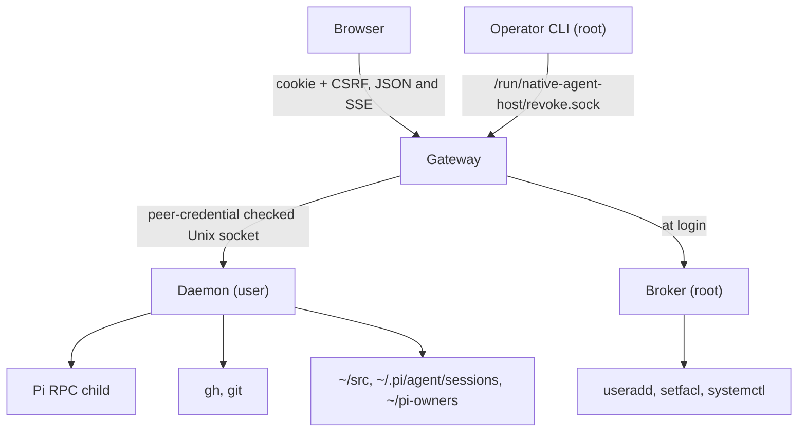

# Components and authorities

Five kinds of process cooperate: the browser, the gateway, the provisioning
broker, one daemon per Linux user, and the native tools that daemon runs. This
page says what each of them owns, what it trusts, and what it must never do.
The rule behind every row is the same: a component acts only with the authority
its Unix identity already gives it.

## Browser

The browser is a React single-page application served by the gateway. It
authenticates with a session cookie, reads a snapshot of the user's workspaces
and conversations, keeps one event stream open per tab and sends commands as
JSON writes. It validates every response against the schemas in
`contracts/v1/` before rendering, treats all host content as untrusted text
even though it came from the person's own processes, and renders Markdown only
through a sanitizer. It owns ephemeral state: the route, drafts, reading
position, and a bounded in-memory window of recently opened conversations. It
never chooses a Unix user, never sees a GitHub token and never persists
history. [Events and recovery](events-and-recovery.md) describes its state
modules.

## Gateway

The gateway runs as the fixed account `native-agent-host-gateway`, terminates
TLS and serves the static UI. It runs the GitHub OAuth flow, holds server-side
sessions in memory and enforces same-origin and CSRF rules on writes. From the
session it knows exactly one thing about the person: the Unix account the
broker bound at login, with its UID and socket path. For every API request it
checks that the socket path is the root-controlled one for that UID and
forwards a freshly built request over it. It does not parse daemon replies; it
copies finite bodies within a size cap and flushes event streams as bytes
arrive. It talks to the broker only during login and revocation, never per
request.

The gateway cannot read a home, run a native tool or reach a daemon it has not
been bound to. Its systemd unit sets `ProtectHome=yes`. A compromised gateway
can still claim an allowed GitHub ID to the broker, because the broker relies
on the gateway to have authenticated the person. That is why the gateway stays
small and why admission is an operator allowlist rather than open sign-up.

## Provisioning broker

The broker is the only root process. systemd starts it on demand behind a Unix
socket that only the gateway's group can open. It speaks a JSON protocol with
two operations: `ensure`, which admits a GitHub ID against the operator's
allowlist and creates the account if it is new, and `authorize`, which returns
the existing binding. It keeps its state under `/var/lib/native-agent-host/broker`:
the allowlist, a ledger of bindings and a crash-safe pending journal. Account
creation runs `useradd`, creates the home, grants the new UID traversal into the
runtime socket directory, writes the daemon's binding file and starts the
daemon's socket unit, verifying each step before publishing the binding.

The broker refuses to create or repair its own directories, socket permissions
or unit files. Those belong to the installation. A root process quietly fixing
its environment would hide deployment drift behind a working login.

## Daemon

One daemon runs per bound Linux user, as that user, started by systemd from a
per-user socket unit. At startup it loads its root-owned binding file, checks
that the binding's UID, username and home match the account it is actually
running as, and validates the pinned Pi runtime. If any of that fails it does
not serve. On every connection it checks that the kernel reports the gateway's
UID as the peer. Nothing in a request body or header is used as identity.

The daemon owns the user's native view and writes: it lists `~/src`, reads Pi's
session files, starts Pi as a child in a workspace, relays Pi's RPC events into
the user's event journal, installs the GitHub token into the user's own `gh`,
lists and clones the user's GitHub repositories and runs the Pi sign-in helper.
It holds the per-conversation writer lock. Its process limits are those of the
Linux account.

## Native tools

Pi runs as the daemon's child with the workspace as its working directory, the
user's home as `HOME` and a minimal environment. Pi executes its own tools,
reads its own credentials and writes its own history file. The daemon talks to
it over Pi's RPC mode on stdin and stdout and never edits the history file.

`gh` holds the GitHub credential the login flow installed and supplies the HTTPS
credential helper that Git uses. Git owns branches and worktree facts. systemd
owns which processes exist and cleans up a daemon's control group when it
stops.

## Operator CLI

The same binary is the operator surface. Besides the three `exec` entry points
that systemd calls, it offers `version`, `config`, `doctor`, `revoke subject`
and `skill`. The revocation command is root-only and reaches the gateway over a
private socket. The CLI is non-interactive and answers in JSON when asked;
`CONFORMANCE.md` records how it follows the AI-first CLI canon.

## Where each fact comes from

| Information | Source | How the daemon reads it |
|---|---|---|
| Who the person is | the broker's binding, loaded at daemon startup | root-owned file, re-verified by descriptor walk |
| Which workspaces exist | immediate directories of `~/src` | `openat2` beneath home, no symlinks, no mount crossing |
| A workspace's stable ID and display name | `.agent-host/workspace.json` inside it, when present | bounded read; otherwise an ID is derived from the directory name |
| Whether a workspace is a Git checkout or worktree | the `.git` entry | hint only; repository state is not verified |
| Conversations and their workspace | Pi's session files under `~/.pi/agent/sessions` | bounded header read; exact `cwd` match to `~/src/<name>` |
| Conversation content | the same JSONL file | paged reads, newest first |
| Whether a conversation is being written | the lock in `~/pi-owners/<id>.lock` and the daemon's own child table | advisory `flock`, inherited by the Pi child |
| Live turn progress | Pi's RPC events | translated into journal events |
| GitHub identity and credential state | `gh auth status` and `gh api user` run as the user | identity must match the binding |
| Pi sign-in state | the pinned Pi SDK's credential store, via a helper process | reports usable, missing or unknown |
| Processes | Linux | the daemon tracks only children it started |

Nothing in this table is cached between requests. A cache would need a measured
problem and a way to rebuild without losing anything the person did.

Decisions behind this page: ADR 0001, ADR 0003, ADR 0004.
