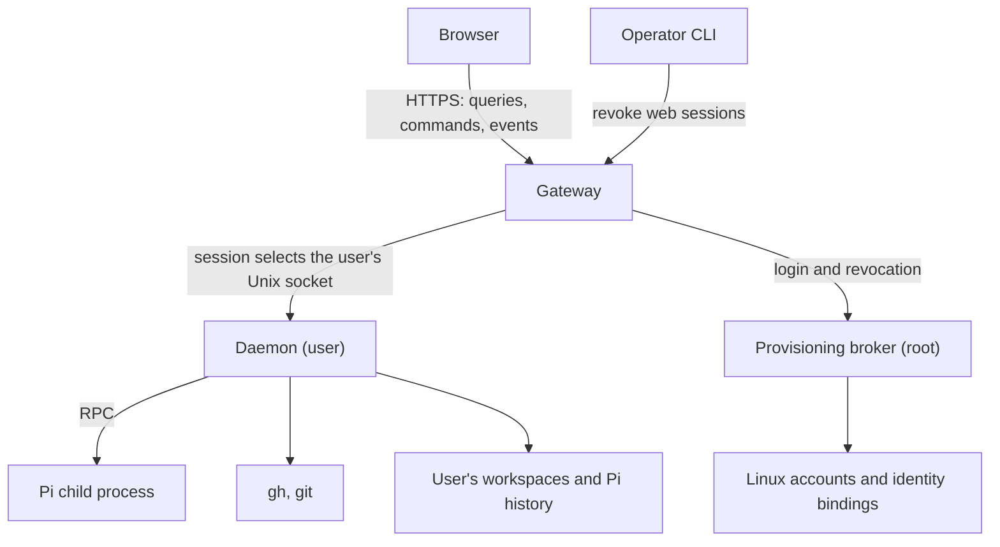

# Components and authorities

A browser request reaches the gateway, which identifies the signed-in person
and routes the request to that person's daemon. The daemon runs as their Linux
user and works with their files and native tools. On first approved login, a
root provisioning broker creates the account and its binding to the GitHub
identity. Separating these responsibilities lets the browser reach native work
while keeping each person's files and processes under their Unix account.

## Browser and gateway

The browser renders workspaces and conversations, sends commands and follows
changes through an event stream. It keeps the route, drafts, reading position
and recently opened conversation windows in memory. Pi's files remain the
source of conversation history; the browser's copy makes switching between
conversations immediate. [Events and recovery](events-and-recovery.md)
describes how this view stays current.

The gateway serves the browser application, handles GitHub login and holds web
sessions in memory. It selects the daemon socket from the signed-in session,
checks access to each request and forwards commands and replies. It runs as the
unprivileged `native-agent-host-gateway` account with home access disabled by
systemd. Native file access and tool execution belong to the daemon.

## Provisioning broker

The broker runs as root because creating Linux accounts requires that authority.
It owns the operator allowlist and the binding from a GitHub identity to a Unix
account. At first approved login it creates the account, home, daemon binding
and socket setup; later logins reuse the binding. Its persistent ledger and
pending-operation journal record account provisioning.

The installation supplies the broker's directories, permissions and service
units. Keeping that setup with deployment makes installation problems visible
instead of silently repairing them during login. [Identity and trust](identity-and-trust.md)
describes provisioning and the checks between components.

## Daemon and native tools

One daemon runs as each bound Linux user. It loads that user's binding at
startup, discovers workspaces, reads Pi history and starts Pi in the selected
workspace. It handles conversation commands and events, coordinates the single
writer for each browser conversation, and retains running-conversation state
and a bounded event journal in memory.

Pi executes tools, reads its credentials and writes its own history. The daemon
communicates with its Pi children through RPC. It also uses `gh` for the user's
GitHub authorization and repository access, Git for cloning, and a Pi helper for
model-provider sign-in. systemd starts the daemons and cleans up their service
processes when they stop. [Conversations](conversations.md) describes the
lifecycle and control of Pi children.

## Operator CLI

The same Go binary supplies the service entry points and the non-interactive
operator interface for configuration, diagnostics and administration. Operations
run with the caller's Unix authority; revoking web sessions requires root and
contacts the gateway through its operator socket. [Deployment](deployment.md)
covers the operator commands and service setup.

## Where information lives

| Information | Source |
|---|---|
| GitHub identity's Unix account | The broker's binding, loaded by the daemon at startup |
| Workspaces | Directories immediately under `~/src` |
| Workspace ID and display name | Optional `.agent-host/workspace.json`; otherwise derived from the directory |
| Git checkout or linked worktree hint | The workspace's `.git` entry; Git owns repository state |
| Conversations, their workspace and history | Pi's session files and their recorded working directory |
| Conversation writer and live progress | The writer lock, the daemon's child tracking and Pi RPC events |
| GitHub credentials | The user's native `gh` authorization |
| Model-provider credentials | Pi's credential store in the user's home |

Workspace and history reads observe the native files. Keeping those files as
the source avoids a second registry or history store that could drift from work
done through the terminal. In-memory conversation state and browser views serve
the running session; they do not replace native history. [Workspaces](workspaces.md)
describes discovery and onboarding.

Decisions behind this page: ADR 0001, ADR 0003, ADR 0004, ADR 0008, ADR 0009.
