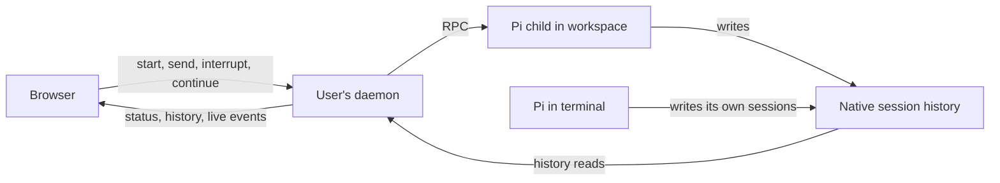

# Conversations

A conversation is a Pi session, identified by Pi's session ID and saved in a
JSONL file in the user's home. The daemon starts Pi in a workspace and controls
it through RPC. The browser sends commands through the daemon and follows the
response while Pi writes its own history. Closing the browser leaves Pi
working; after the daemon ends, the person can explicitly continue a browser
conversation from its saved history.

## Identity and control

Pi stores sessions under `~/.pi/agent/sessions/`. The daemon discovers them
from their file headers and exposes the native session ID as `pi:<session id>`.
The working directory recorded in the header associates a conversation with
its [workspace](workspaces.md). Duplicate session IDs are unavailable because
the daemon cannot choose which file represents the conversation.

A conversation belongs to the Unix user. Multiple browsers signed in as that
person reach the same daemon and Pi process. Control requires a live RPC
connection from the daemon to its child; readable history alone does not
provide it. The browser displays Pi's latest native session name, or a bounded
first-prompt fallback when there is no name. A terminal-origin name is visible
but does not grant browser control.

Terminal conversations are readable and their open views follow changes to
the session files. Pi's RPC interface cannot attach to a running terminal
session, and the host does not take it over. The agreed
[Taskfleet integration](../../issues/manage-agent-worktrees/item.md) will bring
worktree agents into browser control by having the daemon start their Pi
processes; that integration is not implemented yet.

## Starting Pi and keeping one writer

The daemon resolves the selected workspace, opens its directory and starts Pi
there as the user's process, with their home and native configuration. It
assigns a fresh session ID so that starting a conversation creates new history.

Before launch, the daemon acquires a lock for that session and records its
browser origin, workspace ID and working-directory path. The lock coordinates
browser writers: it remains held while Pi runs, including through a daemon
crash because Pi inherits it. Terminal Pi processes do not participate in this
lock, which is another reason their histories are not admitted for browser
control.

The current implementation allows four live Pi children per daemon and retains
up to 128 conversation handles, including ended conversations whose command
receipts remain available. Reaching either applicable limit prevents another
start. These are implementation limits; native session files remain the
history source independently of the retained handles.

## Commands and progress

The daemon supports sending a prompt, steering an active turn, queueing a
follow-up and clearing those queues. Aborting asks Pi to interrupt the current
turn while keeping the process available for another message. Stopping closes
the RPC channel. [HTTP API](http-api.md) lists the routes and message contracts.

Message commands have client-generated IDs so the browser can look up their
receipts after a lost reply. A receipt distinguishes pending, accepted,
rejected and uncertain outcomes. Acceptance means Pi accepted the command;
it does not establish that the turn finished. Receipts live in daemon memory,
so a missing receipt after restart cannot establish rejection. The browser
does not automatically resend an uncertain command, because Pi may already
have acted on it.

The daemon can give a new browser-owned conversation a native Pi session name
after its first turn settles, then refine a successfully generated name once
after the third accepted turn settles. Pi persists its fresh session only when an assistant message exists,
so naming cannot safely write at prompt acknowledgement. The name comes from
a separate, bounded, tool-free model call through that person's Pi model
access. A person can ask for another title beside a controlled conversation's
name. Generation failures leave the native name or first-prompt fallback
untouched. The daemon checks the full current native name before naming and
skips an automatic write if it changed during generation. Pi's RPC name setter
has no compare-and-set, so a terminal-selector rename in the final read/write
window can still be overwritten; [the title issue](../../issues/generate-conversation-titles/item.md)
tracks that remaining guarantee. No host title store exists.

Browser-owned Pi processes load the host's recap extension. A request invokes its command through the existing RPC child, without inserting a user message or an agent turn. It bounds a separate model call and appends a `conversation-recap` custom entry through Pi. The browser reads the latest entry directly from native history, outside the transcript, and compares its last-message key with the newest native message to label it stale. Terminal sessions' existing recaps are readable, but the daemon cannot run a command in a terminal-owned Pi process. There is no browser focus/idle trigger: the TUI's focus event and in-process background-process status are not available as equivalent verifiable browser signals.

Pi's events carry response text, thinking, tool progress and activity to the
browser. When Pi reports that it has settled, the daemon reads native history
and associates completion with a saved assistant entry. If that entry cannot
be verified, completion remains unknown. This establishes that the turn
settled, not the quality of its result. Authentication failures are reported
with a fixed status code so the browser can offer Pi sign-in without replaying
the message. [Events and recovery](events-and-recovery.md) describes how live
updates and saved history reach the browser and recover after a disconnection.

The implementation also displays pending Pi extension questions and provides
answer and cancel controls. Those responses have no correlated Pi receipt,
so even a successful HTTP reply leaves their outcome uncertain. The browser
records the attempt before sending and does not repeat it. These controls go
beyond the agreed display-only scope in
[agent control](../../issues/build-agent-control/item.md); the
[document review](../../issues/rethink-project-docs/item.md) records that
implementation/scope difference for joint follow-up.

## Archiving presentation

A browser-managed conversation with a confirmed idle controller state, or a
positively reaped daemon child, can be archived. The daemon checks the native
session header, workspace association and current snapshot observation token
before updating the user's `~/.local/state/open-habitat/user-state.json`.
Workspace visibility and archive updates share one writer lock and an atomic
rename; Pi history is neither moved nor copied. The snapshot reports `active`,
`archived` or `unknown` per conversation. Archived browser conversations do not
accept another browser send until restored. An unreadable state file makes archive
state unknown without hiding native history or overwriting corrupt bytes; browser
writes wait for the annotation state to be checked again. An archive annotation
whose native session is missing or unreadable makes the Pi-history source unknown rather than
presenting an empty archive; the browser warns on the home and workspace views.
Archive requires the current daemon handle; terminal history and a lost daemon
handle cannot prove idle or process exit. Restore changes only presentation and
also works after a daemon restart. A separate explicit continuation rechecks
native ownership and launches Pi on the same session ID. A stale archive view is
refused rather than used to reverse another browser's action.

## Ending and continuing

Browser or gateway loss leaves Pi running. A daemon restart loses its handles
and receipts, and systemd cleans up its service processes, including Pi.
An independently detached tool may outlive that cleanup or an interruption;
the host does not claim that all effects of the previous work have stopped.
Native history remains readable.

Continuing an ended browser conversation is an explicit action. The daemon
checks that its previous Pi child has exited, the session lock is available,
and the recorded browser origin identifies a discoverable workspace with the
same ID and working-directory path. This checks the current path association;
it does not preserve a filesystem identity across directory replacement.
The daemon also requires one readable native session with the matching ID and
working directory, and stable content across repeated reads.

The browser probes eligibility when opening an ended conversation. The daemon
repeats these checks on the continuation request and holds the lock through
launch, so a successful probe alone does not reserve a writer. If the checks
succeed, a new Pi child opens the existing session file. The earlier command's
outcome remains uncertain and no message is resent. If ownership or history
cannot be established, the conversation stays readable without control.

Implementation: `internal/daemon` owns discovery, RPC control, writer locks and
continuation; `web/src/app` owns browser commands and their displayed outcomes.

Decisions behind this page: ADR 0001, ADR 0003, ADR 0010.
