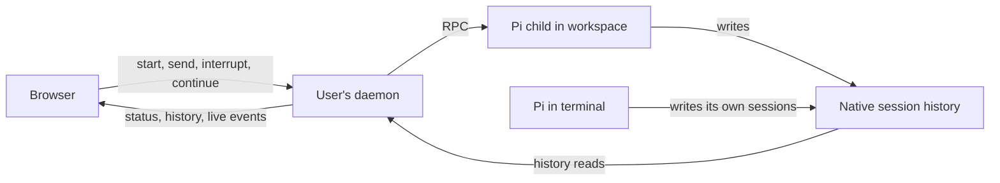

# Conversations

A conversation is a Pi session, identified by Pi's session ID and saved in a
JSONL file in the user's home. The daemon starts Pi in a workspace and controls
it through RPC. The browser sends commands through the daemon and follows the
response while Pi writes its own history. Closing the browser leaves Pi
working; after the daemon ends, the person can explicitly continue a browser
conversation from its saved history.

## Identity and control

Pi stores sessions under `~/.pi/agent/sessions/`. The daemon discovers them
from their file headers and exposes the native session ID as `pi:<session id>`.
The working directory recorded in the header associates a conversation with
its [workspace](workspaces.md). Duplicate session IDs are unavailable because
the daemon cannot choose which file represents the conversation.

A conversation belongs to the Unix user. Multiple browsers signed in as that
person reach the same daemon and Pi process. Control requires a live RPC
connection from the daemon to its child; readable history alone does not
provide it. The browser displays Pi's latest native session name, or a bounded
first-prompt fallback when there is no name. A terminal-origin name is visible
but does not grant browser control.

Terminal conversations are readable and their open views follow changes to
the session files. Pi's RPC interface cannot attach to a running terminal
session, and the host does not take it over. The agreed
[Taskfleet integration](../../issues/manage-agent-worktrees/item.md) will bring
worktree agents into browser control by having the daemon start their Pi
processes; that integration is not implemented yet.

## Starting Pi and keeping one writer

The daemon resolves the selected workspace, opens its directory and starts Pi
there as the user's process, with their home and native configuration. It
assigns a fresh session ID so that starting a conversation creates new history.

The daemon records a browser conversation's workspace and locks its session
while its Pi child runs. The lock survives a daemon crash with the Pi process,
but terminal Pi does not take it. Before continuing or changing saved-history
presentation, the daemon checks processes belonging to the same Unix user
for a native writer. An uncertain observation blocks the write. This is not
an atomic promise: a terminal Pi started after the check, or an unrecognized
launcher without an identifiable session, can still write. The daemon never
reads another user's process details. [The accepted limit](../../issues/native-writer-guarantee/item.md)
does not promise a shared terminal/browser lock.

The daemon bounds its running Pi children and retained handles. Reaching a
limit blocks another start, but native session files remain readable.

## Commands and progress

The daemon supports sending a prompt, steering an active turn, queueing a
follow-up and clearing those queues. Aborting asks Pi to interrupt the current
turn while keeping the process available for another message. Stopping closes
the RPC channel. Closing a freshly started, still-empty browser conversation
also removes its native session file, but only after reaping Pi and verifying
that no user message was saved on any branch. An unknown writer or changed
history prevents removal. The terminal-writer observation has the same race
as continuation. [HTTP API](http-api.md) lists the routes.

Message commands have client-generated IDs so the browser can look up their
receipts after a lost reply. A receipt distinguishes pending, accepted,
rejected and uncertain outcomes. Acceptance means Pi accepted the command;
it does not establish that the turn finished. Receipts live in daemon memory,
so a missing receipt after restart cannot establish rejection. The browser
does not automatically resend an uncertain command, because Pi may already
have acted on it.

After a turn settles, the daemon can ask the person's Pi model for a name and
save it as the native Pi session name. A person can request another name. For
settled history without a controller, a short-lived Pi child can write the
name after another writer check without making that conversation browser-
controllable. A failed model call leaves the existing name or first-prompt
fallback intact. Pi's name setter has no compare-and-set, so a terminal rename
in the final read/write window can still be overwritten. The host has no
separate title store.

Browser-owned Pi processes load the host's recap extension. A person can
request a recap, or the daemon can request one after a completed turn has been
idle. Pi saves the result in native history rather than in a host summary
store. The browser shows it outside the transcript and marks it stale when
new messages have appeared. Existing terminal recaps are readable, but the
daemon cannot request one from a terminal-owned Pi process.

Pi's events carry response text, thinking, tool progress and activity to the
browser. When Pi reports that it has settled, the daemon reads native history
and associates completion with a saved assistant entry. If that entry cannot
be verified, completion remains unknown. This establishes that the turn
settled, not the quality of its result. Authentication failures are reported
with a fixed status code so the browser can offer Pi sign-in without replaying
the message. A completed, natively verified device sign-in clears that failure
from the user's live controllers. Pi's unsupported-model error is classified
separately: signing in again cannot change account entitlement or the model
selected in a running Pi session, so the browser directs the person to change
Pi's native default and start a new conversation instead. [Events and recovery](events-and-recovery.md) describes how live
updates and saved history reach the browser and recover after a disconnection.

The implementation also displays pending Pi extension questions and provides
answer and cancel controls. Those responses have no correlated Pi receipt,
so even a successful HTTP reply leaves their outcome uncertain. The browser
records the attempt before sending and does not repeat it. These controls go
beyond the agreed display-only scope in
[agent control](../../issues/build-agent-control/item.md); the
[document review](../../issues/rethink-project-docs/item.md) records that
implementation/scope difference for joint follow-up.

## Archiving presentation

A settled native conversation can be archived, including one begun in a
terminal. Archiving changes only its visibility in user presentation state;
Pi history stays in place. The daemon checks the workspace, history and
writer again before making the change. A working or uncertain writer blocks
archiving, while restoring visibility is possible after a daemon restart.
Archived browser conversations must be restored before sending again; an
explicit continuation still checks native ownership before starting Pi.
Unreadable presentation state or missing native history is shown as unknown,
not silently replaced with an empty archive.

## Ending and continuing

Browser or gateway loss leaves Pi running. A daemon restart loses its handles
and receipts, and systemd cleans up its service processes, including Pi.
An independently detached tool may outlive that cleanup or an interruption;
the host does not claim that all effects of the previous work have stopped.
Native history remains readable.

Continuing an ended browser conversation is an explicit action. The daemon
checks that its previous Pi child has exited, the session lock is available,
and the recorded browser origin identifies a discoverable workspace with the
same ID and working-directory path. This checks the current path association;
it does not preserve a filesystem identity across directory replacement.
The daemon also requires one readable native session with the matching ID and
working directory, and stable content across repeated reads.

The browser probes eligibility when opening an ended conversation. The daemon
repeats these checks on the continuation request and holds the lock through
launch, so a successful probe alone does not reserve a writer. If the checks
succeed, a new Pi child opens the existing session file. The earlier command's
outcome remains uncertain and no message is resent. If ownership or history
cannot be established, the conversation stays readable without control.

Implementation: `internal/daemon` owns discovery, RPC control, writer locks and
continuation; `web/src/app` owns browser commands and their displayed outcomes.

Decisions behind this page: ADR 0001, ADR 0003, ADR 0010.
