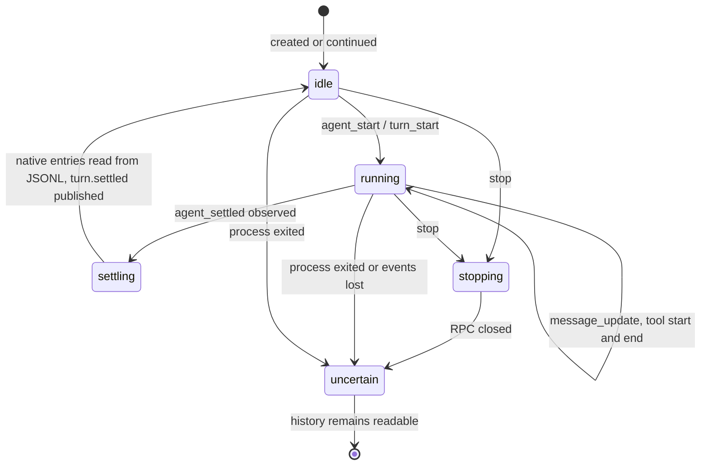

# Conversations

A conversation is a Pi session: one JSONL file that Pi writes under the user's
home, identified by Pi's own session ID. The browser shows two kinds. A
browser-controlled conversation is one whose Pi process the daemon started and
still talks to over RPC. Every other session file, whether started in a
terminal or left behind by an earlier browser session, is a readable history.
The person can send messages only to the first kind, and can deliberately turn
an ended browser conversation back into one.

## Identity and location

Pi stores sessions under `~/.pi/agent/sessions/`. Each file begins with a header
naming the session ID and the working directory it was started in. The daemon
walks that tree with bounds, refuses symlinks, reads only the header during
discovery and gives each conversation the identifier `pi:<session id>`. A
session belongs to a workspace when its header `cwd` is exactly
`~/src/<name>` for a directory that discovery confirmed. Two files claiming the
same ID make that ID unavailable rather than letting either one route.

## Starting a conversation

```mermaid
sequenceDiagram
  autonumber
  participant B as Browser
  participant D as Daemon
  participant L as ~/pi-owners/<id>.lock
  participant Pi as Pi (child)
  B->>D: POST /api/v1/conversations {workspace_id}
  D->>D: open ~/src/<name> beneath home, no symlinks or mounts
  D->>L: create, flock; record browser origin (workspace, cwd)
  D->>Pi: node .../dist/bundle/cli.js --mode rpc --session-id <id>
  Note over Pi: cwd = workspace, HOME = user home, lock fd inherited
  D-->>B: {agent_id: pi:<id>, state: idle}
  B->>D: POST .../send {command_id, text}
  D->>Pi: RPC prompt
  Pi-->>D: correlated response
  D-->>B: receipt accepted
```

The daemon opens the workspace directory with `openat2` beneath the home,
without following symlinks or crossing mounts, and holds that descriptor for
the child's working directory. It generates a fresh UUID and takes an advisory
lock on `~/pi-owners/<id>.lock`, a private 0600 file that is never unlinked,
because unlinking would let a second lock on a new inode coexist with the old
owner. The lock file also records that the browser started this conversation
and in which workspace. Pi is started from the pinned release with
`--session-id` so it creates a new session rather than reopening one, with a
minimal environment, the user's home, the lock descriptor inherited, its own
process group and a kill signal tied to the daemon's death.

A daemon serves at most four live Pi children at once and remembers at most
128 conversation handles, including ended ones kept so a lost reply can still
be looked up.

## Controlling it

| Request | Effect | Reply |
|---|---|---|
| `send` | prompt Pi with a message | receipt for the `command_id` |
| `steer` | add to Pi's steering queue, delivered after the current tool call | receipt |
| `follow_up` | add to Pi's follow-up queue, delivered when the turn settles | receipt |
| `clear_queue` | empty both queues | the removed texts in their original groups and order |
| `abort` | ask Pi to abort the current turn | receipt; the process keeps running |
| `stop` | close Pi's RPC channel | `termination_unknown`; the handle becomes `uncertain` |
| `question` | answer or cancel one pending extension dialog by its request ID | always `uncertain` |
| `status` | observe state, queues, settlement, pending question, history hint | JSON, no side effects |
| `continue` | re-admit an ended browser conversation | see below |

Every write carries a client-generated UUID `command_id`. A receipt is
`pending` until Pi's correlated RPC response arrives, then `accepted` or
`rejected`; if the daemon's event buffer overflowed or the process ended first,
it becomes `uncertain`. `accepted` means Pi took the message, not that the
turn finished. Receipts live in the daemon's memory only. After a daemon
restart a missing receipt is not a rejection, and the browser never resends a
message whose outcome it does not know, because the same work could run twice.

Pi's extension dialogs arrive as `extension_ui_request` events. Dialogs that
ask something become the conversation's pending question, carried as text with
its method and options; notifications and widget updates become `unknown.native`
text events. The daemon consumes the request ID before writing the answer to
Pi, and since Pi returns no correlated receipt for it, even a successful HTTP
reply is `uncertain`. The browser records the attempt before sending and never
repeats it.

## Turn lifecycle



The daemon translates Pi's RPC events into journal events as they arrive:
text deltas, tool starts and ends, queue changes, questions. When Pi reports
`agent_settled`, the daemon reads the session file, confirms the new assistant
entry by its native key and publishes `turn.settled` with that key. If the key
cannot be verified, the settlement is reported with `state: unknown` and the
browser does not show a confirmed completion. Settled does not mean the answer
was good, only that Pi stopped.

If Pi's model call fails with an authentication error, the daemon classifies
it as the fixed code `pi_auth_failed` in the conversation's status and never
forwards the provider's text. The browser then offers the Pi sign-in step
without resending anything.

## One writer

A conversation belongs to its Unix user, not to a browser session. Any valid
login of that user controls it, and another user's requests route to another
daemon that cannot see it. Inside the user's account the lock file is the
fence: the daemon holds it while its child runs, and the child inherits the
descriptor so a daemon crash does not release the fence while Pi is still
writing. The lock is not a census of terminal Pi processes or detached tools;
a Pi started in tmux does not take it, which is why the browser treats terminal
histories as read-only rather than attempting control.

Terminal sessions are readable in the browser from the same files. Pi's RPC
mode cannot attach to a running terminal TUI, so there is no takeover.

## Ending and continuing

Closing the browser changes nothing; Pi keeps working and the daemon keeps the
handle. `stop` closes the RPC channel and leaves the outcome of any detached
tool unknown. When the child exits, the handle stays as an `uncertain`
tombstone and the session file remains a readable history.

A daemon restart loses every handle. systemd stops the daemon's control group,
so a running Pi child does not survive it either, although a tool that detached
from the group may. After the restart the daemon knows only what the files say:
the histories are readable, nobody controls them, and the person must ask
explicitly to continue one.

Continuation is explicit and proven twice. Opening an ended browser
conversation asks `GET .../status?continuation=true`, which runs the proof and
releases the lock immediately. `POST .../continue` runs the same proof and
keeps the lock through the new child's start. The proof succeeds, with
`eligible`, only when all of these hold:

- no live handle for the ID exists in this daemon;
- the lock can be acquired without waiting, meaning no inherited child still holds it;
- the lock file carries a browser origin marker, so the history was started from the browser;
- the recorded workspace still resolves to the same directory and `cwd`;
- exactly one readable session file carries the ID, and reading it twice gives the same content.

Otherwise the status reports `writer_present`, `read_only_history` or
`unproven`, and `continue` answers with the matching 409 code. Concurrent
proofs and continuations within one daemon queue for at most two seconds on a
single permit; a timeout reports `unproven`, never a false writer. A successful
continuation starts Pi with `--session <file>` on the existing history, seeds
the already published entry keys so the next settlement does not replay old
history into the event journal, and reports `prior_outcome: uncertain`: the
previous turn's result is not inferred and no message is resent.

Decisions behind this page: ADR 0001, ADR 0003.
