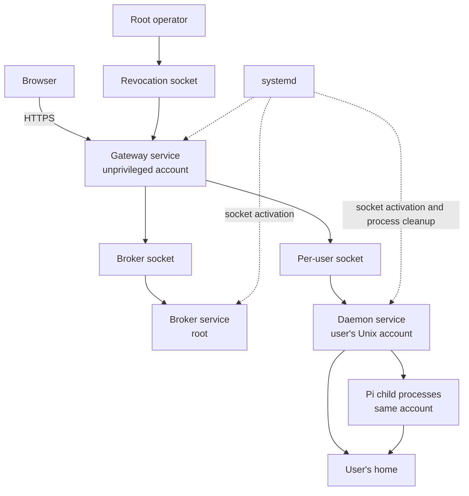

# Deployment

An installation runs the host binary under separate Linux accounts: a gateway
for browser traffic, a root broker for account provisioning and a daemon for
each user. systemd manages their sockets and processes. The browser assets and
pinned Node and Pi runtime are installed alongside the host; users' work and
credentials stay outside these replaceable releases.

## Processes and lifecycle

The gateway terminates TLS using its configured certificate and serves the
browser application. It runs without access to user homes. systemd supplies
its root-only revocation socket, through which the operator can end web
sessions with `native-agent-host revoke subject <GitHub ID>`.

The broker and per-user daemons are socket-activated: systemd holds the
listening sockets and starts a service when a connection arrives. The
installation supplies the service and socket templates. During provisioning,
the broker verifies them, prepares the user's socket directory and access
permissions, and starts that socket instance. It does not generate unit files.
The installation also restores the runtime directories and permissions after
reboot, since `/run` is temporary.

Closing a browser or restarting the gateway leaves daemon-owned Pi processes
running. Stopping or restarting a daemon ends its Pi processes: systemd first
signals the daemon and then kills any processes left in the service's control
group. Native history survives, but an active turn is interrupted.
[Conversations](conversations.md) explains how an ended conversation continues.

## Persistent data and configuration

User homes hold workspaces, Pi histories and configuration, and native `gh`
credentials. Root-owned broker state holds admission policy, account bindings
and the journal of provisioning operations. These survive service restarts and
release replacement. Gateway-private state at `/var/lib/native-agent-host-gateway/sessions.json` holds browser sessions and survives release replacement and reboot. The same private StateDirectory also holds `administration.json`, the gateway-owned server name and numeric GitHub subject roles. Keep it across release replacements; do not seed a browser administrator. A missing file starts with no name or administrators; an existing corrupt or incorrectly owned file prevents gateway startup until an operator repairs it. The already root-only `revoke.sock` control channel also carries bounded `ADMIN {"operation":"show|name|role",...}` newline requests from a verified root peer; the dedicated operator client is delivered by `server-administration-cli`. The gateway account alone can read it; sockets and pending login flows in `/run` or memory do not persist.

The gateway loads its installation configuration at startup; each daemon loads
the identity binding written by the broker. The broker reads its configuration
and state from its fixed root-owned directory. Identity and secret-bearing
configuration is protected by ownership and path checks, so an ordinary user
cannot redefine which account a service represents. The gateway and daemon
also check their configured identity against the Unix account running them.
[Identity and trust](identity-and-trust.md) describes these bindings and the
checks between processes.

Pi has a separate installation-wide selector naming its Node executable,
entry point and manifest. Each daemon reads it at startup and validates the
selected runtime. An invalid selector prevents the daemon from starting;
there is no fallback to a Pi executable from the user's search path.

## Release changes

The release contains the host binary, built browser assets and neutral service
templates. The operator installs and selects the release, supplies its
configuration and restarts affected services. A Pi update selects a new pinned
runtime and takes effect when daemons restart. User files and credentials
remain outside both releases.

Restarting the gateway preserves browser sessions when its private state remains available. The installation must apply the gateway StateDirectory unit change before the upgrade starts the new binary; the directory must not be removed when replacing a release. Restarting daemons also
interrupts active Pi work, so replacing release files alone does not describe
the effect of an upgrade on users.

ADR 0003 defines an immutable release model with atomic selection and a
known-good predecessor for rollback. The project's disposable test installation
uses the later [test-server policy](../../AGENTS.md): failed upgrades may be
fixed forward or replaced with a fresh installation, without retaining older
releases. Fleetrepo owns that installation's upgrade procedure and deployment
receipts.

## Operator responsibilities and diagnostics

The operator supplies admission policy, service configuration, secrets, TLS,
DNS and ingress, as well as the Linux accounts and runtime-directory setup
needed before provisioning can run. The product supplies neutral templates in
[`systemd/`](../../systemd/), [`sysusers.d/`](../../sysusers.d/) and
[`tmpfiles.d/`](../../tmpfiles.d/). Their directives and the implementation in
`internal/provision` define the detailed installation requirements.

The operator CLI exposes configuration inspection, diagnostics, revocation and
release provenance; `native-agent-host --help` lists its commands. The current
`maintenance enter|leave` command only creates or removes a marker file.
The host services do not consult that marker, so the command alone does not
pause traffic or drain work.

`/healthz` confirms that a gateway or daemon is serving HTTP. Gateway `/readyz`
and `admin readiness show` still return fixed foundation responses; neither
checks the running installation's readiness. A successful connection and
snapshot establish that a user's daemon responds, but do not demonstrate a
successful Pi model request. Diagnostic behavior is implemented in
`internal/cli` and `internal/gateway`.

Decisions behind this page: ADR 0003, ADR 0004.
