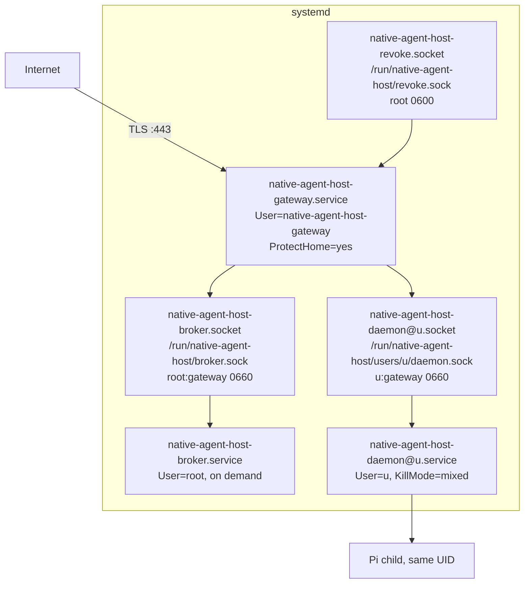

# Deployment

One binary, three systemd services, one static directory and one pinned Pi
release make up an installation. User data stays in user homes and in root's
small broker state; the release itself is immutable and replaceable. The
templates under `systemd/`, `sysusers.d/` and `tmpfiles.d/` in the repository
are neutral; the concrete installation, its secrets, TLS, DNS and ingress are
the operator's, kept outside this repository.

## Processes and sockets

The gateway listens for TLS itself with the certificate named in its
configuration. It requires the revocation socket, which systemd passes to it
at start. The broker and every daemon are socket-activated: systemd owns the
listening socket, so the socket's owner, group and mode are set before any
process runs, and a stopped service leaves no stale socket behind. A daemon's
unit uses `KillMode=mixed`, so stopping it terminates the daemon and then
everything left in its control group, Pi included.

The broker creates each daemon's socket unit and starts it when it provisions
the account. The runtime directory `/run/native-agent-host` is root-owned with
the gateway's group and mode 0750; `users/` beneath it is 0710, and each
provisioned UID receives a named ACL so it can reach its own socket directory
and nothing else.

## Files on disk

| Path | Owner and mode | Purpose |
|---|---|---|
| `/opt/native-agent-host/current/native-agent-host` | root | the release binary, all roles |
| static client directory, named in the gateway configuration | root | built browser assets |
| `/opt/native-agent-host/pi-runtime.json` | root, 0644 | selector naming the Node binary, the Pi entry file and its manifest |
| the Pi release tree the selector points at | root, read-only | pinned Node and `@earendil-works/pi-coding-agent` |
| `/etc/native-agent-host/gateway.json` | root:gateway, directory 0750 | listen address, TLS files, OAuth client, origin, static directory, optional Access issuer |
| `/etc/omega-habitat/daemon/user-mappings/daemon-<u>.json` | root:<u's group>, 0640 under 0711 directories | the daemon's binding, written by the broker |
| `/var/lib/native-agent-host/broker/` | root only | `allowlist.json`, the binding ledger and `pending.json` |
| `/run/native-agent-host/` | root:gateway, 0750 | broker, revoke and per-user sockets; `maintenance` marker |
| `/home/<u>/` | <u>, 0700 | the account's home, created by the broker |
| `~/src/` | <u> | workspaces; optionally a dedicated volume for clones |
| `~/.pi/agent/sessions/` | <u> | Pi's conversation files |
| `~/pi-owners/<id>.lock` | <u>, 0600 | writer locks for browser-started conversations |
| `~/.config/gh/hosts.yml` or the user's keyring | <u> | the `gh` credential installed at login |

A release upgrade replaces what sits under `/opt/native-agent-host/current`
and the static directory, then restarts the services. Nothing a person made
lives there. The Pi runtime is upgraded by installing a new release tree and
pointing the selector at it, which takes effect per daemon on restart; the
daemon refuses a selector that fails its checks rather than falling back.

## Configuration trust

Each role loads one JSON file and rejects unknown fields. When the file carries
secrets or identity, the file and every directory above it must be root-owned
and not writable by group or world, and the file must be a regular file reached
without symlinks. The gateway additionally requires that the configured gateway
UID equals the UID it runs as, and the daemon that its binding's UID equals its
own. Configuration is read once at start.

## Operator commands

| Command | Purpose |
|---|---|
| `native-agent-host gateway exec --config <path>` | the gateway service entry point |
| `native-agent-host daemon exec --config <binding>` | a daemon's entry point, with the socket from systemd |
| `native-agent-host broker exec` | the broker's entry point, state under its fixed directory |
| `native-agent-host config path\|show --component gateway\|daemon` | where configuration comes from |
| `native-agent-host doctor --component gateway\|daemon` | read-only checks |
| `native-agent-host revoke subject <GitHub ID>` | end a person's web sessions, root only |
| `native-agent-host maintenance enter\|leave --idempotency-key <k>` | write or remove the maintenance marker |
| `native-agent-host version`, `skill list\|print\|install` | provenance and the companion operator skill |

All commands are non-interactive, answer in JSON with `--json`, and exit 1 for
an invalid invocation and 2 for a system failure. `--verbose` makes the service
entry points emit JSON lines to stderr; those lines carry fixed event names and
server-generated attempt IDs and never a token, cookie, URL, identity or
conversation text.

## Health

`/healthz` on the gateway and on each daemon answers that the process serves.
`/readyz` on the gateway answers with a fixed body and does not aggregate the
broker's or any daemon's state. Readiness of an account's daemon is observed by
whether its socket accepts and its snapshot succeeds.

Decisions behind this page: ADR 0003, ADR 0004.
