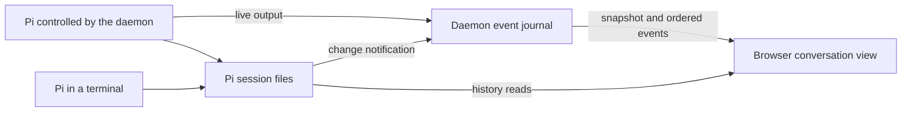

# Events and recovery

The browser first reads the user's workspaces and conversations, then follows
changes through one event connection per tab. Recently opened conversations
stay in memory so returning to them is immediate. After a connection break,
the browser catches up from retained events or reads native history again.
Pi's session files remain the source of saved conversation content; the live
view can be rebuilt from them and the daemon's current state.

## Opening and retaining a view

A snapshot gathers workspace facts, native conversations, the daemon's
controlled conversations and native GitHub authorization state. It includes
recent provisional output for active turns and an event cursor: the point
from which the browser can follow subsequent changes. A daemon-instance ID
lets the browser distinguish a restart from a temporary connection break.

Reading native files and observing a running agent are not atomic. When files
change during a snapshot, the daemon tells the browser to refresh after that
snapshot's event cursor rather than presenting the incomplete read as final.

The browser reads history from the newest entries first and loads older pages
as the person scrolls back. Application state, including the current snapshot
and workspace filter, lives in Redux. Conversation metadata and opened history
windows live in a separate in-memory store. Components subscribe to individual
conversations, so a streaming answer updates its own view without rerendering
the sidebar.

The store retains recently viewed conversation windows so switching back is
immediate. Every navigation into a conversation opens at its latest content.
Reading anchors preserve the current visit while older pages load or layout
changes; they are not restored on a later visit. A terminal conversation is
refreshed on opening because it may have changed outside browser control;
a conversation no longer retained is read again. The current store bounds
the number of windows, not their total bytes. [Retention tuning](../../issues/tune-conversation-retention/item.md)
will measure whether this needs changing.

Each store belongs to one identity in one tab. A new session for the same
person can retain it; logout, session expiry or a different identity clears
user-specific state and stops the old event connection. History is not
persisted in browser storage. Drafts and outstanding command markers use
session storage so they survive a page reload.

## Live output and saved history

Each daemon keeps one ordered, in-memory event journal for its user. All
connected tabs follow that journal independently. It carries live text,
thinking, tool activity, command receipts and hints that native state has
changed. Pi 1.3 wire updates are delta-only; the daemon forwards visible
thinking text but never signatures or opaque redacted payloads. Completed
message blocks are not emitted a second time into the live tail. The
[HTTP API](http-api.md) and `contracts/v1/` define the messages.

Streamed output is provisional: Pi does not give each fragment a durable
history key. When saved content appears, the browser replaces its live
presentation using native entry keys and tool call IDs, not text comparison.
Large blocks can be fetched separately from native history.

The daemon keeps a bounded event journal for reconnecting tabs and a separate
bounded tail of provisional output for newly opened views. If a tail is
truncated, the browser rereads that conversation's history. If a replay cursor
has expired or belongs to a previous daemon instance, it takes a new snapshot.
These limits do not truncate Pi's saved history.

## Changes made from a terminal

A Pi started in tmux writes the same session files, but the daemon has no RPC
connection to it. One filesystem watcher per daemon observes the user's Pi
session tree and publishes change hints through the existing event journal.
This lets several browser tabs follow terminal work without each polling files.

For a changed session file whose header identifies the conversation, the daemon
publishes a hint for that agent. The browser refreshes the snapshot and the
affected retained history window. Bursts of writes are coalesced. Directory
changes, unreadable headers and watcher failures produce a user-wide hint
instead. The watcher also notices a session tree created after login and
restricts its watches to user-owned directories without following symlinks.

Entries observed both through the controlled Pi and through the file watcher
are joined by native key, so they appear once. If the watcher fails, history
remains readable and is refreshed when a terminal conversation is reopened;
continuous updates to an already open view are no longer assured.

## Recovering after a connection break

Each event carries a sequence, cursor and unique ID. The browser checks their
consistency before advancing its cursor. An exact repeat of the last accepted
event is ignored. A sequence gap, conflicting repeat, malformed event or
changed daemon instance causes recovery from a new snapshot and history reads.

A transport error alone first causes a reconnect attempt from the last
validated cursor. The daemon replays retained events after that point. If the
cursor has expired or belongs to a previous daemon instance, the browser
fetches a new snapshot and reconciles its retained conversation windows.
An expired login returns the person to sign-in. Repeated network failures
back off; while the stream is unavailable, the browser also periodically
tries refreshing the snapshot. Streams have a bounded lifetime and heartbeats,
so reconnecting is part of normal operation.

Loaded content remains readable with a connection warning. A failed HTTP
snapshot marks server connectivity unavailable and blocks new conversation
sends while retaining the draft and reading position. A failed event stream
alone does not block writes: HTTP may still be available. When an HTTP snapshot
succeeds again, the open conversation checks any outstanding command even if
no event was published while disconnected.

Before posting a message the browser saves its command ID and text in session
storage. A lost reply shows a short send error; the browser checks the original
command's daemon receipt, retrying temporary read failures. An accepted receipt
clears the sent draft only if it has not been edited since; a rejected receipt
retains it. Pending and unknown outcomes keep the original command outstanding,
so another send cannot silently replace it. A missing receipt (for example
after daemon restart) is unknown, not rejection. The browser never resends an
outstanding command automatically. [Conversations](conversations.md) explains
what a receipt establishes.

Browser or gateway loss leaves Pi running and the daemon collecting events.
A daemon restart loses its in-memory journal, receipts and controlled handles;
in the systemd deployment, stopping the daemon also stops its Pi children.
Saved conversations remain readable, and the person explicitly continues one
to start a new controlled process. The new daemon instance forces browsers
to rebuild their views rather than replaying the previous instance's events.

Implementation lives in `internal/daemon` and `web/src/app`.
Decisions behind this page: ADR 0008, ADR 0009.
