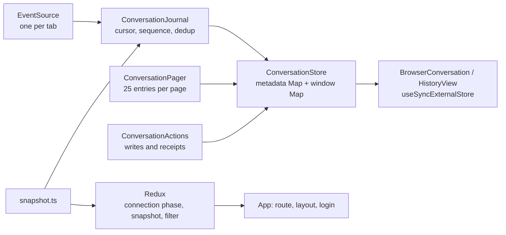

# Events and recovery

The browser learns about the user's workspaces and conversations in two ways.
A snapshot is a complete picture at one moment. The event stream carries what
changes after that moment, in order, with a cursor that lets the browser
resume after a disconnection. When the cursor can no longer be honoured, the
browser takes a fresh snapshot and reads history again. Nothing the browser
holds is authoritative; Pi's files are.

## Snapshot

`GET /api/v1/snapshot` makes the daemon observe the user's native state right
now: the directories under `~/src` with their facts, the Pi sessions matched to
those directories, the conversations the daemon currently controls, the state
of the native `gh` authorization, and the journal's current and oldest replay
cursors. Each agent entry carries its activity and, for a running turn, the
`live_tail` of provisional events already published for it. The response names
the daemon's `server_instance_id` so the browser can tell a restart from a gap.
The identity in it is an opaque hash of the provider and subject; no Unix
username or home path travels to the browser.

Native observation and the journal cursor are not atomic. The daemon takes the
journal watermark before reading the files, and if the journal moved during the
read it appends an invalidation so the browser knows to look again.

## Event journal

Each daemon keeps one in-memory ring of the user's events: up to 1024 events or
16 MiB, whichever fills first. Every event has a cursor `ev1:<instance>:<seq>`,
a unique event ID, a kind, a resource (the user or one agent) and a payload.

```mermaid
sequenceDiagram
  autonumber
  participant Pi
  participant D as Daemon journal
  participant B as Browser journal
  B->>D: GET /api/v1/events?after=<cursor from snapshot>
  D-->>B: replay of retained events after the cursor
  Pi->>D: message_update deltas
  D->>D: coalesce up to 50 ms / 4 KiB
  D-->>B: assistant.delta
  Pi->>D: tool_execution_start
  D-->>B: tool.started
  Pi->>D: agent_settled
  D->>D: read JSONL, verify native key
  D-->>B: history.entry (native key), turn.settled
  Note over D,B: ": heartbeat" every 20 s; stream ends after 10 min
```

| Kind | Meaning |
|---|---|
| `snapshot.invalidated` | the browser must take a new snapshot; `ring_truncated` on one agent means re-read that agent's history instead |
| `history.entry` | a new entry read from Pi's file, with its native key |
| `assistant.delta` | provisional streamed text for the running turn |
| `tool.started`, `tool.updated`, `tool.finished` | tool call progress |
| `queue.changed` | Pi's steering and follow-up queues as last observed |
| `question.requested` | an extension dialog is pending |
| `turn.settled` | Pi stopped; carries the verified native key or `unknown` |
| `command.changed` | a write's receipt changed |
| `unknown.native` | a native event with no dedicated rendering, carried as text |
| `question.resolved`, `agent.changed`, `workspace.changed`, `title.changed`, `source.warning`, `operation.changed` | reserved in the contract; the daemon does not emit them |

Streamed text is provisional. Pi gives deltas no durable key, so the browser
never merges them with history by comparing text. When the daemon publishes the
turn's entries from the file, each `history.entry` replaces the whole
provisional tail for that agent and the browser deduplicates by native key.
Per agent the daemon retains at most 128 provisional frames or 128 KiB; past
that it drops the tail and emits `ring_truncated`, which the browser answers
with a history read.

The stream request validates the cursor before sending headers. A cursor older
than the ring answers `409 cursor_expired`; a cursor from another daemon
incarnation answers `409 cursor_instance_mismatch`. `Last-Event-ID` on a
reconnect overrides the query cursor. A connection lives at most ten minutes
with a heartbeat every 20 seconds, and the browser reconnects from its last
validated cursor. The session is checked when the stream opens, not per frame.

## The browser's state



Redux holds application state: the connection phase, the current snapshot and
the workspace filter. Conversation content lives outside Redux in
`ConversationStore`, two plain Maps: metadata for the sidebar and status
lines, and one window per opened conversation with its entries, next page key,
provisional live turn and reading position. Components subscribe to one
conversation at a time, so a streaming answer rerenders its own view and not
the sidebar. The store keeps the 50 most recently viewed conversations and
evicts whole windows beyond that. Switching back to a retained conversation
renders from memory without a request; a cold open of a controlled
conversation waits for its status before loading history.

The store belongs to one identity in one tab. A new login of the same person
keeps it; logout, expiry or a snapshot naming a different identity clears it,
and the previous person's CSRF secret and drafts are discarded with it. History
is never written to browser storage.

`ConversationJournal` owns the one `EventSource` per tab. It validates each
frame: same instance, sequence exactly one higher than the last, cursor and
event ID consistent, no duplicate ID. Anything else is a gap.

## After a disconnection

```mermaid
sequenceDiagram
  autonumber
  participant B as Browser
  participant G as Gateway
  participant D as Daemon
  B--xG: EventSource error
  B->>B: mark windows stale, show offline
  B->>G: probe GET /api/v1/events?after=<cursor> (5 s)
  alt 401
    B->>B: open login
  else 409 cursor expired or instance mismatch
    B->>D: GET /api/v1/snapshot
    D-->>B: new cursor, agents, live tails
    B->>D: GET .../history for open windows
    B->>D: GET /api/v1/events?after=<new cursor>
  else 200
    B->>D: reconnect from the same cursor
  else network failure
    B->>B: retry after 3 s × failures, at most 30 s; snapshot every 60 s meanwhile
  end
```

While offline the loaded text stays readable with its connection state shown.
Writes are refused by the browser until the view is current again, because a
command sent against a stale picture could duplicate work. A lost reply to a
write is reported as uncertain, and the decision to try again is the person's.

Browser or gateway loss leaves Pi running; the daemon keeps publishing into
its ring. A daemon restart is different: the instance ID changes, every cursor
from before is mismatched, controlled handles are gone and systemd has stopped
the Pi children. The browser takes a snapshot, sees the conversations as
readable histories, and the person continues one explicitly when they want to.
[Conversations](conversations.md) describes the continuation proof.

## The clone stream is the exception

Cloning a GitHub repository during onboarding uses its own stream:
`POST /api/v1/onboarding/github/clone/stream` answers as Server-Sent Events on
the write request itself, carrying numbered Git stages and one final outcome.
It has no cursor, no replay and no persisted job. Losing the browser connection
cancels the clone. A reopened page asks the checkout endpoint what the native
Git state shows and whether the writer has stopped; it does not resume the
stream or clone again. [Workspaces](workspaces.md) describes the clone itself.

Decisions behind this page: ADR 0005, ADR 0008, ADR 0009.
