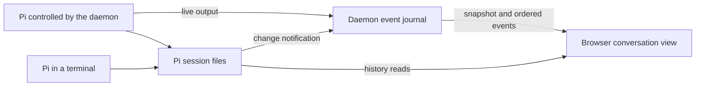

# Events and recovery

The browser first reads the user's workspaces and conversations, then follows
changes through one event connection per tab. Recently opened conversations
stay in memory so returning to them is immediate. After a connection break,
the browser catches up from retained events or reads native history again.
Pi's session files remain the source of saved conversation content; the live
view can be rebuilt from them and the daemon's current state.

## Opening and retaining a view

A snapshot gathers workspace facts, native conversations, the daemon's
controlled conversations and native GitHub authorization state. It includes
recent provisional output for active turns and an event cursor: the point
from which the browser can follow subsequent changes. A daemon-instance ID
lets the browser distinguish a restart from a temporary connection break.

Reading native files is not atomic with observing running agents. The daemon
records the native-change generation before discovery, then captures the
controlled state, live tails and journal cursor together after discovery.
If the native-change generation advanced during the read, it publishes an
invalidation after that cursor so the browser reads again. This recovery
notification does not itself count as a native change, avoiding repeated
refreshes caused by concurrent snapshots in different tabs.

The browser reads history from the newest entries first and loads older pages
as the person scrolls back. Application state, including the current snapshot
and workspace filter, lives in Redux. Conversation metadata and opened history
windows live in a separate in-memory store. Components subscribe to individual
conversations, so a streaming answer updates its own view without rerendering
the sidebar.

The store currently retains the 50 most recently viewed conversation windows,
including their reading positions. Returning to a retained window shows it
immediately; a read-only terminal history is also refreshed on opening because
it may have changed without controller events. Opening a controlled conversation
that is not retained first checks its status before loading history.

Each store belongs to one identity in one tab. A new session for the same
person can retain it; logout, session expiry or a different identity clears
user-specific state and stops the old event connection. History is not
persisted in browser storage. Drafts and outstanding command markers use
session storage so they survive a page reload.

## Live output and saved history

Each daemon keeps one ordered, in-memory event journal for its user. All
connected tabs follow that journal independently. It carries live text,
thinking, tool activity, command receipts and hints that native state has
changed. The [HTTP API](http-api.md) and `contracts/v1/` define the messages.

Streamed output is provisional: Pi does not give each fragment a durable
history key. When saved content becomes available, the browser replaces the
corresponding live presentation. Saved assistant content supersedes streamed
assistant blocks, a saved tool result replaces that call's progress by call ID,
and a saved local command replaces its provisional output. Saved entries are
joined by native key, rather than by comparing their text. Large saved blocks
can be read separately instead of being sent in full through the event stream.

Two bounded buffers serve different purposes. The daemon's replay journal
retains up to 1024 events or 16 MiB, allowing a disconnected tab to catch up.
The provisional tail for each agent retains up to 128 frames or 128 KiB,
allowing a newly opened view to display an active turn. Repeated cumulative
tool updates replace the earlier preview in that tail.

When a provisional tail exceeds its limit, the daemon asks the browser to
reread that conversation's history through a `ring_truncated` invalidation.
An event too large to publish also becomes an invalidation. This is distinct
from an expired replay cursor, which requires a new snapshot. These are
current implementation limits, not limits on the history Pi can save.

## Changes made from a terminal

A Pi started in tmux writes the same session files, but the daemon has no RPC
connection to it. One filesystem watcher per daemon observes the user's Pi
session tree and publishes change hints through the existing event journal.
This lets several browser tabs follow terminal work without each polling files.

For a changed session file whose header identifies the conversation, the daemon
publishes a hint for that agent. The browser refreshes the snapshot and the
affected retained history window. Bursts of writes are coalesced. Directory
changes, unreadable headers and watcher failures produce a user-wide hint
instead. The watcher also notices a session tree created after login and
restricts its watches to user-owned directories without following symlinks.

Entries observed both through the controlled Pi and through the file watcher
are joined by native key, so they appear once. If the watcher fails, history
remains readable and is refreshed when a terminal conversation is reopened;
continuous updates to an already open view are no longer assured.

## Recovering after a connection break

Each event carries a sequence, cursor and unique ID. The browser checks their
consistency before advancing its cursor. An exact repeat of the last accepted
event is ignored. A sequence gap, conflicting repeat, malformed event or
changed daemon instance causes recovery from a new snapshot and history reads.

A transport error alone first causes a reconnect attempt from the last
validated cursor. The daemon replays retained events after that point. If the
cursor has expired or belongs to a previous daemon instance, the browser
fetches a new snapshot and reconciles its retained conversation windows.
An expired login returns the person to sign-in. Repeated network failures
back off; while the stream is unavailable, the browser also periodically
tries refreshing the snapshot. Streams have a bounded lifetime and heartbeats,
so reconnecting is part of normal operation.

Loaded content remains readable with a connection warning. An event-stream
failure does not by itself establish that ordinary HTTP requests are
unavailable, and the current send path does not use stream availability as a
sending condition. A failed send retains its command ID and text. Refreshing
the conversation can query its receipt, but stream reconnection alone does not
trigger that query, and the current feedback still asks the person to check
the outcome. The browser never automatically resends the message.

[Recover sends after disconnection](../../issues/recover-sends-after-disconnection/item.md)
tracks implementation of the agreed change: block new sends during a server connection
outage and automatically check the earlier send outcome when connectivity
returns, before enabling another send. This is separate from an interruption
of only the event stream. [Conversations](conversations.md) explains what a
receipt establishes and why a missing receipt cannot prove rejection.

Browser or gateway loss leaves Pi running and the daemon collecting events.
A daemon restart loses its in-memory journal, receipts and controlled handles;
in the systemd deployment, stopping the daemon also stops its Pi children.
Saved conversations remain readable, and the person explicitly continues one
to start a new controlled process. The new daemon instance forces browsers
to rebuild their views rather than replaying the previous instance's events.

Implementation lives in `internal/daemon` and `web/src/app`.
Decisions behind this page: ADR 0008, ADR 0009.
