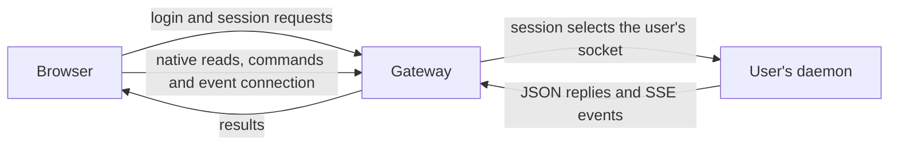

# HTTP API

The browser reads native work, sends commands and follows changes through the
same-origin HTTPS gateway. The gateway handles web sessions itself and routes
native operations to the signed-in person's daemon. The daemon interprets those
operations and returns their results. This keeps browser authentication separate
from access to native files and processes.

## Requests and responsibilities

Native reads use `GET`; native writes use `POST` or `DELETE`. Gateway-owned
administrator changes to server settings and storage limits use `PUT`. The
gateway checks the session cookie and, for writes, the configured origin and
session's CSRF header.
It checks the route and bounds the request before forwarding it. The daemon
validates native operation inputs. [Identity and trust](identity-and-trust.md)
explains how the session selects the daemon and how the socket peers are checked.

JSON replies carry finite results. Server-Sent Events (SSE) carry the user's
ongoing updates and, separately, progress within a clone request. The gateway
forwards native daemon replies without interpreting their application content;
it bounds finite replies and forwards streams incrementally. Server
administration and personal storage read native quota state through the root
broker, not a gateway accounting store or another user's daemon.

## Route map

Authentication and probes are served by the gateway:

| Route | Meaning |
|---|---|
| `GET /auth/github/start`, `GET /auth/github/callback` | begin and complete GitHub login |
| `GET /auth/session` | read the web session, its opaque `web_identity_id` (the same value the snapshot carries, so the browser can pair the two reads), CSRF secret and display-only GitHub profile ([contract](../../contracts/v1/account-session.schema.json)); this does not expose a Unix route |
| `POST /auth/profile` | supply missing name/email during onboarding ([input contract](../../contracts/v1/account-profile-update.schema.json)); requires session, origin and CSRF, and cannot overwrite supplied GitHub fields or change the identity binding |
| `POST /auth/logout` | end the web session; native `gh` authorization stays |
| `GET /auth/sessions`, `POST /auth/sessions/end` | list the person's own browser sessions (public id, `github` or `link`, coarse device label, creation time) and end one of them by id; ending requires Origin and CSRF, and another person's session is indistinguishable from an absent one ([contract](../../contracts/v1/device-link.schema.json)) |
| `POST /auth/link`, `GET /auth/link`, `POST /auth/link/cancel` | mint a one-minute, single-use phone sign-in token for the QR code (Origin and CSRF; minting again cancels the previous token), read whether it is pending, used (and by which session), expired or failed, and cancel it ([ADR 0018](../decisions/adr-0018-phone-sign-in-by-qr.md)) |
| `POST /auth/link/describe`, `POST /auth/link/redeem` | without a session: show whose account a token signs into without using it, and redeem it for the phone's own session; the token travels only in the `/link#…` fragment and these bodies, both routes check Origin and share the sign-in start rate limit, and redemption uses the token up before any other check |
| `GET /api/v1/server` | session-scoped server name and current browser administrator role ([contract](../../contracts/v1/server.schema.json)); does not expose another person's native work |
| `GET /api/v1/server/administration` | administrator-only name, default storage limit and bound-user role list ([contract](../../contracts/v1/server-administration.schema.json)); broker reads the binding ledger, not daemon sockets |
| `PUT /api/v1/server/administration` | administrator-only name, default storage limit or browser role update ([input](../../contracts/v1/server-administration-change.schema.json)); requires Origin and CSRF; role target must already be bound |
| `GET /api/v1/account/storage` | signed-in person's own kernel quota usage and limit ([contract](../../contracts/v1/account-storage.schema.json)); no other user's files or UID are exposed |
| `GET /api/v1/server/storage` | administrator-only bound-user quotas, home filesystem capacity/free space and overcommit warning ([contract](../../contracts/v1/server-storage.schema.json)) |
| `PUT /api/v1/server/storage` | administrator-only change of a bound subject's hard limit ([input](../../contracts/v1/server-storage-change.schema.json)); Origin and CSRF required; the broker resolves the committed UID |
| `GET /healthz`, `GET /readyz` | fixed gateway probe responses |

Native operations are forwarded to the user's daemon. In this table `<id>` is
the Pi session UUID: history routes include the `pi:` harness prefix, while
conversation control routes use the UUID alone.

| Route | Meaning |
|---|---|
| `GET /api/v1/snapshot` | workspaces, native and controlled conversations, event cursor and native `gh` state |
| `GET /api/v1/workspaces/git?workspace_id=<id>` | bounded read-only Git observation for one freshly discovered workspace: changed paths, upstream counts and recent commits; never fetches or mutates Git; [reply](../../contracts/v1/workspace-git.schema.json) |
| `POST /api/v1/workspaces` | create a local directory (optionally initialize Git), edit its display name, initialize Git later, or hide/restore it. The mapped daemon reobserves the source and target. [Workspaces](workspaces.md) describes the safety boundary. |
| `POST /api/v1/workspaces` with `action: delete_check`, `delete`, `trash_list`, `trash_inspect`, `trash_restore`, `trash_delete` or `trash_empty` | check, move to the home Trash or (for a clean, fully pushed Git clone, after a fetch) delete outright; list, inspect, restore or permanently delete Trash entries by entry name, or empty the listed Trash. The browser sends a workspace ID with its observation token, one entry name or a listing token, never a path; [requests and replies](../../contracts/v1/workspace-deletion.schema.json), [Workspaces](workspaces.md) |
| `GET /api/v1/events?after=<cursor>` | the user's event stream; `Last-Event-ID` takes precedence over the query cursor |
| `GET /api/v1/agents/pi:<id>/spinoffs` | direct Taskfleet children; optional `run=<full-run-id>` includes retained result and bounded native transcript projections; [reply](../../contracts/v1/spinoffs.schema.json); no writes or continuation |
| `GET /api/v1/agents/pi:<id>/history` | a history page; `limit` bounds entry count, `before` pages back and `after` supports forward reads |
| `GET /api/v1/agents/pi:<id>/entries/<key>/blocks/<index>` | read part of a selected block using `revision`, `offset` and `limit_bytes` |
| `GET`, `POST /api/v1/conversations` | list controlled conversations or start Pi in a workspace; [create input](../../contracts/v1/pi-conversation-create.schema.json) optionally selects an `openai-codex`, `openai` or `claude-bridge` provider/model pair and supported thinking level for this session only, without changing Pi defaults. Controller replies retain optional [startup choice](../../contracts/v1/pi-startup-choice.schema.json) intent while this child is alive, so an empty session does not falsely inherit a later/different default before Pi writes history |
| `GET /api/v1/conversations/<id>/status` | observe a browser conversation, including one without a running Pi (`stopped`, never started by the read); lists the messages the daemon holds until Pi runs, a failed start's fixed `start_problem`, and `interrupted` when Pi ended during a turn; `continuation=true` also runs the ownership proof without reserving anything |
| `GET /api/v1/conversations/<id>/eligibility` | read process observation and continuation eligibility for native history without a daemon handle; the answer is not a reservation |
| `GET /api/v1/conversations/<id>/processes` | native process inventory for the daemon-owned Pi child; unavailable is distinct from empty |
| `GET /api/v1/conversations/<id>/processes/<process_id>/output` | bounded combined stdout/stderr tail; requires `owner_generation`, `process_token`, `tail_lines` (1–2000) |
| `POST /api/v1/conversations/<id>/processes/<process_id>/stop` | `{owner_generation, process_token, force}`; native intentional stop, without notifying the agent; stale fences return 409 |
| `POST /api/v1/conversations/<id>/processes/clear-finished` | `{owner_generation}`; removes finished native records and logs, not history |
| `GET /api/v1/conversations/<id>/receipt?command_id=<uuid>` | look up an earlier command's receipt |
| `POST /api/v1/conversations/<id>/send`, `.../steer`, `.../follow_up` | send a [message](../../contracts/v1/pi-message.schema.json) with a client-chosen `command_id`; only `send` accepts `first_choice`, a transient model/thinking choice applied through native non-persisting RPC before the first prompt of a fresh empty child. A `send` while Pi is not running replies `held` ([reply](../../contracts/v1/pi-held.schema.json)) and starts Pi; held messages reach Pi joined as one prompt |
| `POST /api/v1/conversations/<id>/cancel_held` | `{command_id}`; takes back every held message before Pi runs and returns exactly those texts in order ([reply](../../contracts/v1/pi-held.schema.json)); stops a Pi started only for them |
| `POST /api/v1/conversations/<id>/clear_queue`, `.../abort`, `.../stop`, `.../continue`, `.../question` | queue, lifecycle and question controls; `continue` starts Pi again after a failed start, with the held messages |
| `POST /api/v1/conversations/<id>/close` | empty body; only a verified empty browser-started, idle conversation without another observed writer; stops and reaps its Pi child, removes empty native history, or refuses without unlinking |
| `POST /api/v1/workspaces` with `action: conversation_archive` | archive or restore presentation with `workspace_id`, `observation_token`, `previous_archive` and `archived`; checks native history and workspace, rejects active writers and stale state; never moves Pi history |
| `POST /api/v1/conversations/<id>/regenerate_title` | request a new native Pi name for a browser-controlled session; empty body, bounded synchronous `done` or `failed` result; failures include a fixed `reason` code, not provider diagnostics |
| `POST /api/v1/conversations/<id>/history_title` | request a new native Pi name for settled history without a controller; requires `workspace_id`, checks the writer again and uses a temporary Pi child without granting browser control |
| `POST /api/v1/conversations/<id>/recap` | request a tool-free recap on a settled browser-controlled Pi session; empty body; bounded `done` or `failed`, concurrent requests refused; a lost response is resolved by reading the native result |
| `GET /api/v1/agents/pi:<id>/recap` | read the latest native recap and latest conversation message for staleness, including terminal sessions; no Pi process is started |
| `GET /api/v1/account/git-identity` | read `git config --global` as the mapped user and offer GitHub profile suggestions when native `gh` is available ([reply](../../contracts/v1/git-identity.schema.json)) |
| `POST /api/v1/account/git-identity` | explicit confirmation in onboarding (only when both values are unset) or explicit settings edit, written by the mapped daemon to global Git config ([input](../../contracts/v1/git-identity-update.schema.json)); existing values are never overwritten by onboarding |
| `GET /api/v1/onboarding/github/repos` | list GitHub repositories through the user's `gh`, using `page` and `limit` |
| `POST /api/v1/onboarding/github/clone/stream` | clone a repository and stream progress in the response |
| `POST /api/v1/onboarding/github/clone` | clone with a single JSON result |
| `GET /api/v1/onboarding/github/checkout?full_name=<owner/repo>` | observe the local checkout after cloning |
| `GET /api/v1/onboarding/pi/status` | resolve native Pi readiness from supported OpenAI credentials or Claude Code subscription presence; this does not test a model request |
| `GET`, `POST /api/v1/pi/models` | list Pi's OpenAI candidates for stored credentials and its declared Claude bridge candidates, and read its global default, or choose a listed provider/model pair ([input](../../contracts/v1/pi-model-update.schema.json)); Pi's settings manager writes and reads back the default as the mapped user ([reply](../../contracts/v1/pi-models.schema.json)); the catalog includes older models with grouping metadata and optional supported thinking levels. Per-model answered/refused observations are derived on demand from bounded recent native history, never entitlement; a running conversation retains its model |
| `GET /api/v1/pi/credentials` | read native subscription/API-key presence and, only for a literal OpenAI key, its four-character suffix; raw configured references are never resolved |
| `POST /api/v1/pi/credentials` | store a validated literal OpenAI key in the mapped user’s Pi auth.json using native AuthStorage; body is piped to the helper, not argv or environment ([input](../../contracts/v1/pi-credential-update.schema.json), [reply](../../contracts/v1/pi-credentials.schema.json)) |
| `DELETE /api/v1/pi/credentials/openai` | remove only the OpenAI entry; preserve subscription login and restore its default provider/model if the removed key was the default |
| `POST`, `GET`, `DELETE /api/v1/onboarding/pi/attempt` | start, poll or cancel a Pi device login |
| `GET`, `POST`, `PUT`, `DELETE /api/v1/pi/claude-login` | observe native Claude subscription presence, start a session-bound native login, submit one returned code, or cancel its lease; [reply](../../contracts/v1/claude-login.schema.json), [code/cancel input](../../contracts/v1/claude-login-code.schema.json) |

[Conversations](conversations.md) explains the controls and their lifecycle;
[Workspaces](workspaces.md) explains cloning and provider sign-in.

## Reading history

A history request reads Pi's saved session file. With neither `before` nor
`after`, it selects the newest entries. Entries within a page are ordered from
oldest to newest. A `before` request selects older entries and includes the
boundary entry so the browser can join pages by their native keys. `before`
and `after` cannot be combined.

Entry-count and byte limits keep pages bounded. `next_before` identifies where
to continue backwards, and `older_complete` says that the oldest edge has been
reached. If the boundary key no longer exists, `boundary_found: false` tells
the browser to restart from the newest page.

Entries contain ordered block previews. Larger readable blocks are fetched
separately as bounded slices of text or base64 image data, with `next_offset`
when more remains. The page's `native_revision` identifies the file contents.
A block read must match that revision, so a changed file causes the browser to
reload history rather than combine content from different revisions.

## Command outcomes and errors

A command's receipt describes acceptance, not completion of the agent's work.
Conversation status and events describe its subsequent progress. If a reply is
lost, the browser can query the receipt using the same command ID. It does not
automatically resend the message: the first request may already be running.
[Conversations](conversations.md) explains the limits of receipt lookup, and
[Events and recovery](events-and-recovery.md) describes browser recovery.

API errors use the envelope in `contracts/v1/error.schema.json`: a code,
generic message, retryability flag and correlation ID. The status and code
distinguish invalid input, missing authentication, denied access, unavailable
resources, conflicting state and capacity or service failures. The appropriate
response depends on the operation; a conflict does not always call for the
same recovery action.

The gateway returns `daemon_unavailable` when it cannot reach the daemon or
read a complete reply within its limits. This can happen after the daemon
started a write, so an HTTP 503 does not establish that nothing happened.
The receipt or native observation must resolve the outcome. A retryability
flag alone does not make repeating a write safe. Error messages omit native
paths and credentials.

## Contracts and versioning

`contracts/v1/` contains the message schemas, redacted examples and scenario
catalogue. The schemas define message shapes; this page explains the HTTP
operations. Request formats are operation-specific: not every command body
has a version field. Versioned JSON replies and event envelopes identify the
current schema with `schema_version: 1`.

Schema objects reject unknown fields, apart from the error `details` object.
New optional fields can be added within v1, but a validator using an older
closed schema may reject them. Removing or renaming a field, or changing a
type, nullability or ordering guarantee, requires a new version directory
under the contract policy. Requests and replies carry no Unix username. The authenticated user's
snapshot may carry a discovered workspace's absolute path for the conversation
details view; it is never supplied by the browser as authority for a write.
No path is added to an error reply or to a public example.

The generated packages in `internal/contracts/` and `web/src/contracts/` carry
a schema fingerprint. The gate detects schema edits without regeneration;
runtime message validation is separate from that generated-code check.
HTTP handlers live in `internal/gateway` and `internal/daemon`.

Failed bash results may carry `failure_cause`, a presentation hint read from Pi's
fixed-format terminal status line (exit code, timeout or abort). It is emitted
only for an explicitly failed `bash` result, both in history and live events.
Unrecognized output remains a plain failure. This hint does not establish process
or control state; native output is retained verbatim and the browser hides only
the recognized terminal line, keeping it in the corner tooltip.

## Claude subscription through Pi

`/api/v1/pi/claude-login` runs Claude Code's own `auth login --claudeai`
as the mapped Unix user. GET reads native status or the caller's active lease;
POST starts a five-minute lease; PUT hands one returned code to its native
stdin; DELETE cancels that attempt without asserting logout. PUT requires
`attempt_id` and `code`; DELETE requires only `attempt_id`. Writes require
the normal same-origin CSRF proof. The gateway derives an opaque session
binding, never accepting a browser-supplied owner. A different browser session
cannot read, submit to or cancel another lease. Restart loses the lease, not
native credentials. An uncertain code submission is never automatically replayed.

The daemon publishes only the validated Claude authorization URL and coarse
status. Tokens and native errors never cross the contract. Claude Code writes
its own credential store under `~/.claude`; no host or Pi token copy is made.
The optional declared bridge runtime loads in both Pi RPC and catalog discovery;
while absent during rollout, ordinary Pi remains usable. The picker carries
`claude-bridge` as a provider-qualified model identity, not a separate harness.
Explicitly selecting a Claude default also registers the trusted extension path
through Pi SettingsManager, preserving other extension preferences, so native
SSH Pi can use that same default. Installing the runtime alone does not rewrite
a person's settings.

## Agent processes

The mapped daemon relays its own Pi child's pi-processes extension through a
product-shipped companion on a private Unix socket. The directory is 0700,
the socket 0600, and the daemon verifies both UID and its exact child's PID.
Systemd's private temporary namespace separates it from other services. No
process registry, log copy or host signal path is introduced. Stops and output
reads fence both the child generation and the native record's start time,
because the native manager can reuse a process ID.

The process API exposes redacted command hints, never PIDs, log paths, cwd or
raw inventory. Redaction is best effort for known credential syntax, not a
promise about every shell command. Explicit output reads contain the user's
own bounded process output. `process.changed` and `process.output` on the user
SSE are invalidation hints: following views read a fresh tail, including after
a reconnect. Unknown omitted-line counts and log retention state stay null.

Native completion messages become typed `process_event` blocks using structured
details, not their XML content. A live delivery label distinguishes a wake-up,
steering during a run and idle context; history cannot prove that distinction
and carries null. Waiting states derive from current native records and their
start-result exit attention, not from a second host store. Log watches do not
count until upstream reports their remaining wake conditions.

A daemon restart or a Pi stop ends every process of that Pi, and pi-processes
records no end for such a stop. The inventory's `interrupted` list therefore
comes from the conversation's native branch: a start from an earlier Pi with
no end notification or stop result, labelled a server restart when it started
before this daemon did. It is shown even without a running Pi and only until
the companion's resume message has told the agent about it (see
[ADR 0017](../decisions/adr-0017-observe-taskfleet-spinoffs.md)). A browser
stop is an intentional native stop with no record either, so after a restart
it is indistinguishable from a cut-off process.

### Browser views and recovery

The [reply](../../contracts/v1/process.schema.json),
[control](../../contracts/v1/process-control.schema.json) and
[notification](../../contracts/v1/process-event.schema.json) schemas define the
wire objects. A stale fence is 409; the browser refreshes but never retries a
write automatically. Clearing removes finished logs, not native conversation
history. Stopping a Taskfleet wait does not stop the spinoff.

The browser keeps only disposable fetched views, never a second process registry
or log store. An open conversation polls inventory every two seconds as a
fallback; output is fetched only for an expanded, following process, with
`tail_lines=200` and both lifetime fences. Pausing retains one bounded tail;
resuming replaces it with a fresh tail. Invalidation hints are not log delivery
or a gap-free replay guarantee.

A live `process.notification` uses the notification definition directly and asks
the browser to refresh native history, rather than inserting another message.
A completion has no process-lifetime fence, so it opens the current inventory,
not an allegedly matching log selected by recyclable ID alone. Start cards join
current inventory only when a native token or start timestamp is available.
Snapshot `run_active` and `waiting_on` distinguish active Pi work, waiting for a
process and waiting for a spinoff; a pending question always wins.
