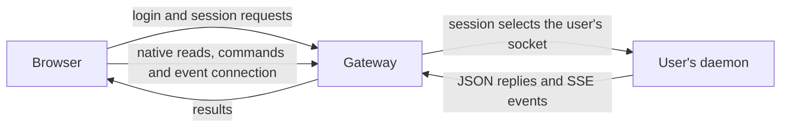

# HTTP API

The browser reads native work, sends commands and follows changes through the
same-origin HTTPS gateway. The gateway handles web sessions itself and routes
native operations to the signed-in person's daemon. The daemon interprets those
operations and returns their results. This keeps browser authentication separate
from access to native files and processes.

## Requests and responsibilities

Native reads use `GET`; writes use `POST` or `DELETE`. The gateway checks the
session cookie and, for writes, the configured origin and session's CSRF header.
It checks the route and bounds the request before forwarding it. The daemon
validates native operation inputs. [Identity and trust](identity-and-trust.md)
explains how the session selects the daemon and how the socket peers are checked.

JSON replies carry finite results. Server-Sent Events (SSE) carry the user's
ongoing updates and, separately, progress within a clone request. The gateway
forwards native replies without interpreting their application content; it
bounds finite replies and forwards streams incrementally.

## Route map

Authentication and probes are served by the gateway:

| Route | Meaning |
|---|---|
| `GET /auth/github/start`, `GET /auth/github/callback` | begin and complete GitHub login |
| `GET /auth/session` | read the web session and its CSRF secret |
| `POST /auth/logout` | end the web session; native `gh` authorization stays |
| `GET /healthz`, `GET /readyz` | fixed gateway probe responses |

Native operations are forwarded to the user's daemon. In this table `<id>` is
the Pi session UUID: history routes include the `pi:` harness prefix, while
conversation control routes use the UUID alone.

| Route | Meaning |
|---|---|
| `GET /api/v1/snapshot` | workspaces, native and controlled conversations, event cursor and native `gh` state |
| `GET /api/v1/events?after=<cursor>` | the user's event stream; `Last-Event-ID` takes precedence over the query cursor |
| `GET /api/v1/agents/pi:<id>/history` | a history page; `limit` bounds entry count, `before` pages back and `after` supports forward reads |
| `GET /api/v1/agents/pi:<id>/entries/<key>/blocks/<index>` | read part of a selected block using `revision`, `offset` and `limit_bytes` |
| `GET`, `POST /api/v1/conversations` | list controlled conversations or start Pi in a workspace |
| `GET /api/v1/conversations/<id>/status` | observe a conversation; `continuation=true` also checks whether it can be continued |
| `GET /api/v1/conversations/<id>/receipt?command_id=<uuid>` | look up an earlier command's receipt |
| `POST /api/v1/conversations/<id>/send`, `.../steer`, `.../follow_up` | send a message with a client-chosen `command_id` |
| `POST /api/v1/conversations/<id>/clear_queue`, `.../abort`, `.../stop`, `.../continue`, `.../question` | queue, lifecycle and question controls |
| `POST /api/v1/conversations/<id>/regenerate_title` | request a new native Pi name for a browser-controlled session; empty body, bounded synchronous `done` or `failed` result |
| `GET /api/v1/onboarding/github/repos` | list GitHub repositories through the user's `gh`, using `page` and `limit` |
| `POST /api/v1/onboarding/github/clone/stream` | clone a repository and stream progress in the response |
| `POST /api/v1/onboarding/github/clone` | clone with a single JSON result |
| `GET /api/v1/onboarding/github/checkout?full_name=<owner/repo>` | observe the local checkout after cloning |
| `GET /api/v1/onboarding/pi/status` | resolve Pi's stored authorization; this does not test a model request |
| `POST`, `GET`, `DELETE /api/v1/onboarding/pi/attempt` | start, poll or cancel a Pi device login |

[Conversations](conversations.md) explains the controls and their lifecycle;
[Workspaces](workspaces.md) explains cloning and provider sign-in.

## Reading history

A history request reads Pi's saved session file. With neither `before` nor
`after`, it selects the newest entries. Entries within a page are ordered from
oldest to newest. A `before` request selects older entries and includes the
boundary entry so the browser can join pages by their native keys. `before`
and `after` cannot be combined.

Entry-count and byte limits keep pages bounded. `next_before` identifies where
to continue backwards, and `older_complete` says that the oldest edge has been
reached. If the boundary key no longer exists, `boundary_found: false` tells
the browser to restart from the newest page.

Entries contain ordered block previews. Larger readable blocks are fetched
separately as bounded slices of text or base64 image data, with `next_offset`
when more remains. The page's `native_revision` identifies the file contents.
A block read must match that revision, so a changed file causes the browser to
reload history rather than combine content from different revisions.

## Command outcomes and errors

A command's receipt describes acceptance, not completion of the agent's work.
Conversation status and events describe its subsequent progress. If a reply is
lost, the browser can query the receipt using the same command ID. It does not
automatically resend the message: the first request may already be running.
[Conversations](conversations.md) explains the limits of receipt lookup, and
[Events and recovery](events-and-recovery.md) describes browser recovery.

API errors use the envelope in `contracts/v1/error.schema.json`: a code,
generic message, retryability flag and correlation ID. The status and code
distinguish invalid input, missing authentication, denied access, unavailable
resources, conflicting state and capacity or service failures. The appropriate
response depends on the operation; a conflict does not always call for the
same recovery action.

The gateway returns `daemon_unavailable` when it cannot reach the daemon or
read a complete reply within its limits. This can happen after the daemon
started a write, so an HTTP 503 does not establish that nothing happened.
The receipt or native observation must resolve the outcome. A retryability
flag alone does not make repeating a write safe. Error messages omit native
paths and credentials.

## Contracts and versioning

`contracts/v1/` contains the message schemas, redacted examples and scenario
catalogue. The schemas define message shapes; this page explains the HTTP
operations. Request formats are operation-specific: not every command body
has a version field. Versioned JSON replies and event envelopes identify the
current schema with `schema_version: 1`.

Schema objects reject unknown fields, apart from the error `details` object.
New optional fields can be added within v1, but a validator using an older
closed schema may reject them. Removing or renaming a field, or changing a
type, nullability or ordering guarantee, requires a new version directory
under the contract policy. Requests and replies carry no Unix username or
absolute home path.

The generated packages in `internal/contracts/` and `web/src/contracts/` carry
a schema fingerprint. The gate detects schema edits without regeneration;
runtime message validation is separate from that generated-code check.
HTTP handlers live in `internal/gateway` and `internal/daemon`.
