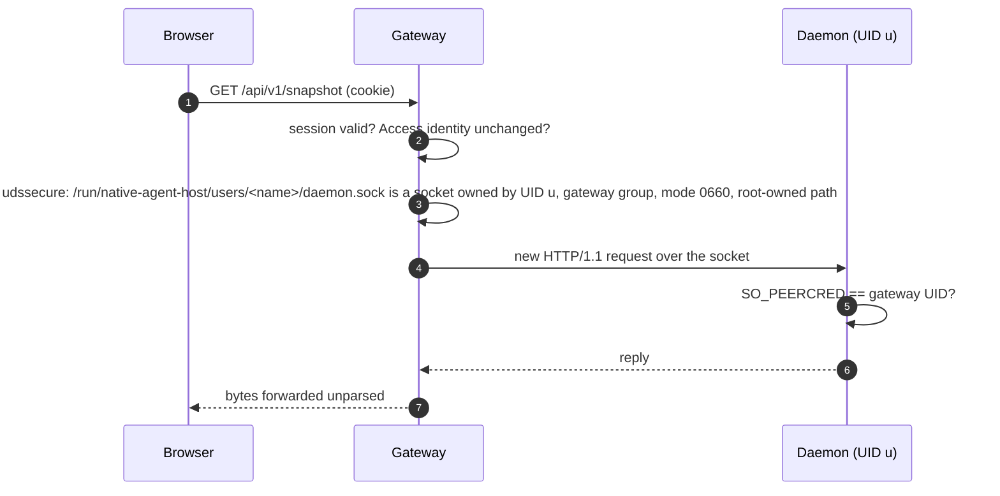

# Identity and trust

A person proves who they are to GitHub once. From that single authorization the
system derives three things: a browser session at the gateway, a binding from
the person's numeric GitHub ID to one Linux account, and a `gh` credential
installed under that account for the agent's own Git work. After login, every
request is checked locally at each hop with facts the kernel or root-owned
files supply, never with something the browser or the gateway asserts.

## First login

```mermaid
sequenceDiagram
  autonumber
  participant B as Browser
  participant G as Gateway
  participant GH as GitHub
  participant P as Broker (root)
  participant D as Daemon (user)
  B->>G: GET /auth/github/start
  G-->>B: 302 to GitHub; flow cookie, state, PKCE verifier kept 5 min
  B->>GH: authorize
  GH-->>B: 302 /auth/github/callback?code&state
  B->>G: callback
  G->>G: consume state once, match flow cookie
  G->>GH: exchange code (PKCE)
  GH-->>G: token, numeric user ID, login
  G->>P: ensure {id, candidate name}
  P->>P: allowlist? create account, home, binding, socket unit
  P-->>G: route {uid, username, socket}, generation, epoch
  G->>D: POST /internal/v1/native-credentials/github (token, once)
  D->>D: gh auth login --with-token; gh auth setup-git; gh api user == id?
  D-->>G: verified
  G->>P: authorize {id}
  P-->>G: same route, same epoch
  G-->>B: session cookie + CSRF secret; 303 back to the app
```

The gateway starts a flow with a random `state`, a PKCE S256 challenge and a
browser-bound flow cookie, and keeps the pending flow for five minutes. The
callback consumes the state before looking at anything else, so a replayed
callback fails even after an error. GitHub's authenticated user response
supplies the stable numeric ID; the login name is only a candidate for the Unix
username and a later rename on GitHub changes nothing here.

The broker's `ensure` admits the ID against the operator allowlist and, for a
new ID, creates the account. The gateway then hands the GitHub token to the
newly routed daemon exactly once over the daemon's own socket. The daemon feeds
it to `gh auth login --with-token --git-protocol https` on stdin, runs
`gh auth setup-git`, and checks that `gh api user` returns the same numeric ID
as its binding. The token is never written to the gateway's disk, a log, a
cookie or the browser. A lost acknowledgement is terminal for that login; the
person signs in again and the daemon re-observes the existing `gh`
authorization instead of installing twice. Only after a second `authorize`
confirms that the binding and allowlist epoch are unchanged does the gateway
issue a session.

## Account provisioning

The broker is reached only through `/run/native-agent-host/broker.sock`, owned
by root with the gateway's group and mode 0660. It authenticates the connecting
process by kernel peer credentials and accepts one JSON object of at most
4 KiB with two operations.

| Operation | Effect |
|---|---|
| `ensure` | Admit the ID. If the allowlist names it and no binding exists, reserve a UID, run `useradd` with `--no-create-home`, a `nologin` shell and a private primary group, create the 0700 home, grant the UID traversal into the runtime socket directory, write the daemon binding, start the daemon socket unit and verify it. Publish the binding to the ledger. |
| `authorize` | Return the existing binding for the ID, with the ledger generation and allowlist epoch. |

State lives in `/var/lib/native-agent-host/broker`: `allowlist.json` with an
epoch and the admitted IDs, each optionally carrying an operator-approved
alternate username; a ledger of bindings; and `pending.json`, a journal of the
mutation in progress. The broker serializes every request, refuses to run while
a pending mutation or drifted account exists, and never adopts an existing
account whose name collides with a new candidate. An occupied or unsafe name
requires the operator to add an alternate.

The daemon's binding is written to
`/etc/omega-habitat/daemon/user-mappings/daemon-<username>.json`, owned by root
and the user's private group with mode 0640, under directories that are
root-owned and mode 0711. A daemon can open its own binding by name but cannot
list the directory or read anyone else's. The binding carries the component,
UID, username, home, socket path, provider, subject and the gateway UID, and
nothing about Pi.

## Sessions and writes

A session is server-side state in the gateway, keyed by a random secret carried
in the cookie `__Host-agent-host` with `Secure`, `HttpOnly` and
`SameSite=Lax`. It expires after eight idle hours or 24 hours in total. The
cookie is resolved locally on each request; the broker is not consulted again.
`GET /auth/session` returns the session's CSRF secret, and every write must
carry it in the `X-Agent-Host-CSRF` header together with an `Origin` header
equal to the configured origin. Form bodies and cross-origin credentialed
requests are rejected. `POST /auth/logout` deletes the session and leaves the
user's native `gh` authorization in place.

When the installation sits behind Cloudflare Access, the gateway additionally
verifies the Access assertion on every request except the health probes. The
email in that assertion is bound to the login flow and to the session, so a
session cannot be carried to a different Access identity.

## Revocation

Changing the allowlist does not end a live session. An operator runs, as root,
`native-agent-host revoke subject <numeric GitHub ID>`. The command connects to
`/run/native-agent-host/revoke.sock`, which only the gateway's service holds and
only root can open. The gateway confirms the caller's UID is 0 by peer
credentials, rechecks the binding with the broker, deletes every session of that
subject and marks login flows started before the revocation so they cannot
issue a session. An SSE connection that was already open is not interrupted;
it closes at its ten-minute lifetime and cannot reconnect.

## From gateway to daemon



The gateway builds a new request rather than forwarding the browser's. Only the
method, path, query, content type and a bounded body cross the boundary; no
browser header is reused as identity, and the daemon has no field in which the
gateway could name a user. Which socket is dialled comes from the session's
binding alone.

One detail decides how each side verifies the other. The daemon's socket is
created by systemd and handed over as a file descriptor. `SO_PEERCRED` on a
connection to it reports the process that called `listen()`, which is PID 1 as
root, so the gateway cannot learn from the connection whom it reached. It
therefore establishes trust from the file system before dialling: every
directory on the path is root-owned and not group- or world-writable, and the
socket inode is owned by the mapped UID, in the gateway's group, mode 0660. On
the daemon's side the same call on an accepted connection names the real
client, so the daemon simply requires the peer UID to equal the configured
gateway UID.

## What the daemon trusts at startup

The daemon reads its configuration path from the systemd unit. The file and
every directory above it must be root-owned and not writable by group or world.
It then checks that the binding's UID is its own effective UID, that the
username and home match the account database, re-reads the binding file through
a descriptor walk that refuses symlinks, extra hard links, ACLs and wrong modes,
and compares the bytes with its configuration.

Pi's runtime comes from a separate installation-wide selector,
`/opt/native-agent-host/pi-runtime.json`, readable by every daemon and
pointing at a root-owned release tree. The daemon checks the tree's ownership
and modes, the package name and version in its manifest, that the entry file is
the package's public export, and that the Node binary reports the pinned
version. This happens once. Changing the binding, the selector or the release
requires a daemon restart, and nothing the gateway or browser sends can alter
these facts.

Pi credentials are different. A new account has none, so the daemon starts
without them and the person reaches onboarding. Credential paths are checked
before the sign-in helper runs, not before native reads.

## Boundaries, not sandboxes

An agent has exactly its Linux user's permissions, credentials and network
access. Accounts, file permissions and the per-user sockets keep people apart.
Pi extensions can add approval prompts and restrictions, but a process with
shell access under the same UID can bypass a restriction that only a tool
enforces, so those are guardrails. Observing another process under the same
user does not give the daemon authority to stop it; it stops only children it
started.

Decisions behind this page: ADR 0003, ADR 0004, ADR 0006.
