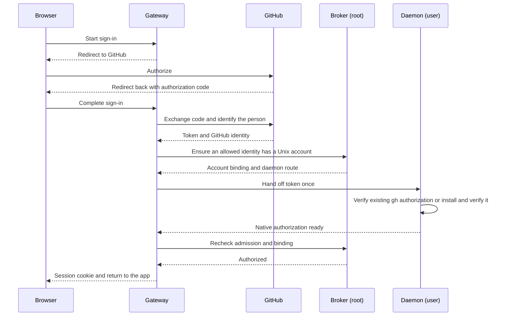

# Identity and trust

A person signs in with GitHub to reach their Linux account through the browser.
The gateway authenticates their GitHub identity, the root broker binds it to a
Unix account, and that user's daemon provides access to native work. The same
GitHub authorization supplies the account's native `gh` credentials, so the
person can use Git without a second sign-in.

## Login and account binding

GitHub's stable numeric user ID identifies the person. The login name supplies
an initial Unix-name candidate; the broker lowercases it or derives a name
from the ID if the login is unsuitable. Renaming the GitHub account does not
change an existing binding. The gateway ties the OAuth callback to the browser that
started it using a flow cookie, one-use state and PKCE.

The broker trusts the gateway to authenticate the remote person. By default it
checks the ID against the operator's allowlist. The disposable test installation
instead admits any verified GitHub identity without Cloudflare Access, as
[ADR 0014](../decisions/adr-0014-open-test-admission.md) specifies. The gateway
can verify signed Access assertions for installations that configure it; Access
is not a prerequisite for open test admission. The broker owns the binding to a
Unix account.
For a new admitted identity it creates a private account and home, prepares the
daemon binding and socket, and verifies them before publishing the route.
Later logins reuse that binding. An occupied or unsuitable username requires
an operator-approved alternative; the broker does not adopt an existing account.

The broker serializes provisioning and records unfinished changes in a journal.
An unfinished operation or a mismatch between its records and the native
account prevents service until the operator resolves it. This keeps the
published route tied to the account the broker actually prepared.

## Native GitHub authorization

The gateway passes the OAuth token once to the bound daemon over its Unix
socket. The token stays transient in the gateway and is never returned to the
browser or written to gateway storage or logs.

The daemon checks an existing `gh` authorization and reuses it when its GitHub
identity, HTTPS Git configuration and credential storage are valid. Otherwise,
when installation is needed, it gives the token to `gh` and verifies the
result. A working authorization for a different identity or an unverifiable
existing setup prevents login rather than being replaced. Credential storage
belongs to the user's native tools.

The gateway issues a browser session only after native setup succeeds and the
broker confirms that admission and the binding have not changed. A failed or
uncertain handoff requires a new login, which checks native state again.
Failure to issue a browser session does not undo an account already created
or credentials successfully installed.

## Requests and trust between processes

The gateway selects the daemon from the authenticated session's binding. The
daemon loads its own binding from root-controlled configuration at startup and
checks that it matches the Unix account it runs as. A request cannot select a
different daemon user.

Each local connection is checked at its receiving boundary. The broker and
daemon use kernel peer credentials to authenticate the gateway process. The
gateway verifies the daemon socket's ownership, permissions and root-controlled
path. It uses the filesystem because systemd creates the listening socket:
peer credentials on that connection identify systemd, not the daemon accepting
requests from it.

The gateway constructs the daemon request from the permitted route data and
headers. Browser-provided identity headers have no authority. Implementation
lives in `internal/gateway`, `internal/provision`, `internal/transport` and
`internal/udssecure`; [deployment](deployment.md) describes configuration,
sockets and files.

## Browser sessions

The gateway keeps hashed browser secrets and session records in its private
persistent state, outside the release and `/run`. The browser carries the
opaque random secret in a persistent Secure, HttpOnly, SameSite cookie,
expiring no later than one year after sign-in. The gateway denies a cookie
without a matching record. Missing or incorrectly permissioned live state
invalidates cached sessions; an unreadable or malformed file at startup also
starts with no sessions. A new OAuth login replaces unusable state. The gateway
does not reparse an otherwise correctly owned file on every request, so
external corruption of its contents while running is detected on restart.

Sessions expire after 90 days without use or one year from sign-in, whichever
comes first. Active sessions renew their idle deadline at most once a day,
without extending the absolute deadline. Each request resolves the session
locally, without another broker call. Writes also require the
session's CSRF secret and the configured origin, tying them to the signed-in
application.

When Cloudflare Access is configured, the gateway verifies its assertion on
requests other than health probes. The asserted email is bound to the login
flow and session, so changing Access identity requires a new host login.
GitHub remains the source of the Unix-account identity.

Logout ends the browser session. Native `gh` credentials and agents remain
available under the Linux account. Explicit native disconnect requires an OAuth
session issued within five minutes, a fresh local authorization observation,
and confirmation. It calls the user's `gh` logout and reports success only after
local absence is observed. It does not revoke the OAuth grant on GitHub; signing
in again restores native authorization. Pi's model-provider credentials are separate
from GitHub login; [workspaces](workspaces.md) describes their onboarding.

A root-only operator command can remove a person's existing web sessions and
invalidate login flows begun before it runs. It leaves native work and already
admitted requests running, and does not prevent a new login while admission
remains allowed. [Deployment](deployment.md) lists the command; its behavior
is implemented in `internal/gateway`.

## Unix authority

Agents run with their Linux user's file permissions, credentials and network
access. Unix accounts and per-user sockets separate people. Pi tool restrictions
and approval prompts operate within that account; they do not reduce the
underlying authority of a process running as the user. The daemon controls Pi
children it started; observing a terminal process does not give it ownership
of that process.

Decisions behind this page: ADR 0003, ADR 0004, ADR 0006, ADR 0014.
