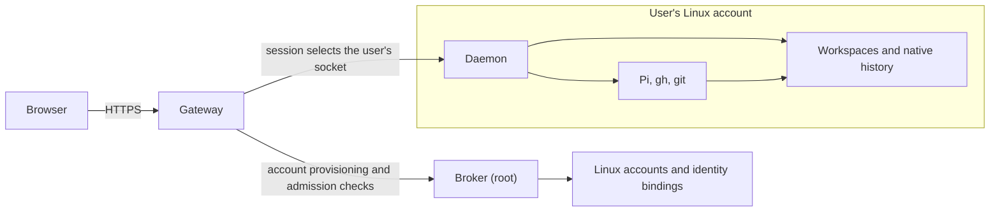

# Architecture overview

A person signs in with GitHub to reach their workspaces and Pi conversations
through a browser. The gateway maps the signed-in person to a Linux account
and routes native operations to a daemon running as that user. The daemon
reads their files and runs their native tools. Browser and terminal work share
the same workspaces, GitHub credentials and Pi histories.

## Separation and native state

Unix accounts, file permissions and per-user sockets separate people's work.
The gateway handles browser authentication and routing, while each daemon
accesses files and runs tools as its own user. A root broker provisions accounts
and owns their identity bindings. This division keeps native work under the
user's Unix authority and account creation in the privileged component.

Git owns repository state, Pi owns its configuration and history, and `gh`
maintains GitHub authorization. The host discovers workspaces and reads native
history so that work done through the terminal is also visible in the browser.
Daemon and browser memory hold running-session state and views of that history;
the native files remain its source.

Reading a conversation does not start Pi. Starting a new conversation or
explicitly continuing an ended browser conversation starts a daemon-owned Pi
process. Closing the browser leaves that process running. Terminal Pi
conversations can be read and followed in the browser; their running processes
remain under terminal control.

## Runtime and reading path

One Go binary provides the gateway, broker, daemon and operator CLI. systemd
runs the service roles under their respective accounts. The gateway serves the
built browser application, and daemons use an operator-installed Node and Pi
runtime. The pages below explain the implemented behavior and link to the
issues for changes being designed or built.

- [Components and authorities](components.md): responsibilities, their reasons and where information lives.
- [Identity and trust](identity-and-trust.md): GitHub login, Unix account binding, native authorization and browser sessions.
- [Workspaces](workspaces.md): discovery under `~/src`, workspace identity, repository cloning and Pi sign-in.
- [Conversations](conversations.md): starting, controlling and continuing Pi, including the browser writer lock and its limits with terminal Pi.
- [Events and recovery](events-and-recovery.md): live updates, terminal changes and recovery after disconnection or restart.
- [HTTP API](http-api.md): operations, history pagination, command outcomes and the machine-readable contract.
- [Deployment](deployment.md): process lifecycle, persistent data, release changes and operator responsibilities.
