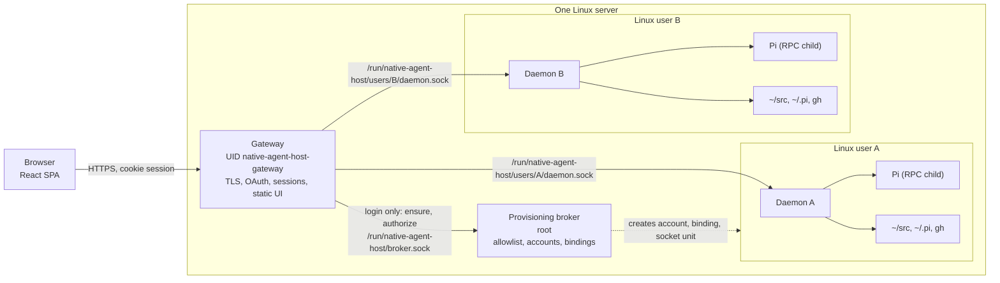

# Architecture overview

A person signs in with GitHub. The gateway maps that login to one Linux account
on the server and forwards every request to a daemon running as that account.
The daemon lists the directories under the person's `~/src`, reads the Pi
conversation files in their home and starts Pi as a child process when they
open a conversation. The browser is one more way to reach what the person
already has over SSH and tmux: the same files, the same `gh` credentials, the
same Pi histories. Closing the browser leaves Pi running.

Two ideas shape the system.

**Unix users are the security boundary.** People are separated by ordinary
Linux accounts, file permissions and per-user Unix sockets. The gateway cannot
read a home directory or run an agent. A daemon can touch only its own user's
files and processes. Root authority exists in one small broker that creates an
account on first approved login and does nothing else. If one of these three
could do another's job, a bug in the component that parses browser traffic
would become access to files, or a bug in a daemon would become access to other
people's identities.

**Native components keep their own truth.** Git owns repository facts, Pi owns
its configuration, tools and history, `gh` owns GitHub credentials, systemd owns
process lifecycle. The host reads these sources rather than keeping a workspace
registry, a history database or a credential store of its own, because every
copy is a second place where the truth about a person's work can drift from the
native one.

## Three authorities

| Component | Runs as | Owns | Never does |
|---|---|---|---|
| Gateway | fixed unprivileged account | TLS, GitHub OAuth, server-side sessions, CSRF, static UI, routing to the mapped daemon socket | read a home, run a native tool, parse daemon replies, trust a browser header as identity |
| Provisioning broker | root | the operator allowlist, account creation, the binding from GitHub ID to Unix user, the daemon's socket unit | listen on the network, run arbitrary commands, hold OAuth credentials, repair its own environment |
| Daemon | the mapped Linux user | workspace discovery, Pi history reads, Pi child processes, native `gh` credentials, the user's event journal | trust any identity claim from the browser or the gateway, cross a mount or symlink under `~/src`, serve another user |

The browser renders what the daemon reports and sends commands. It holds no
native history beyond a bounded in-memory view and no credentials beyond the
session cookie.

## What runs where

One Go binary, `native-agent-host`, provides all three server roles through
subcommands, and systemd starts each role under its own account. The browser
package is built to static files that the gateway serves. Pi runs from a
root-owned, pinned Node and Pi release that the operator installs beside the
host binary. [Deployment](deployment.md) lists the units, sockets and files.

## Reading path

- [Components and authorities](components.md): what each part owns and trusts, and where every piece of information comes from.
- [Identity and trust](identity-and-trust.md): first login, account provisioning, sessions, the socket checks between gateway and daemon, and revocation.
- [Conversations](conversations.md): how a Pi conversation is identified, started, controlled, ended and continued, and why there is one writer.
- [Events and recovery](events-and-recovery.md): the snapshot, the event journal, the browser's state, and what happens after a disconnection or a daemon restart.
- [Workspaces](workspaces.md): directory discovery under `~/src`, workspace metadata, GitHub repository onboarding and Pi sign-in.
- [HTTP API](http-api.md): the routes, error codes and versioning rules, with the machine contract in `contracts/v1/`.
- [Deployment](deployment.md): processes, sockets, files on disk and the operator commands.

## Not in the system

Some things a reader might expect are deliberately absent.

- Web identity comes from GitHub only. There is no second login provider.
- Pi is the only agent harness the daemon runs. Conversation identifiers carry a harness prefix so another could be added, but none is.
- One deployment serves one server. There is no view across servers and no tenant object inside a deployment; a second tenant is a second deployment.
- The browser never attaches to a Pi started in a terminal. Terminal histories are readable in the browser and nothing more.
- There is no workspace registry, no stored annotations such as hiding a workspace or archiving a conversation, and no generated conversation titles. A conversation is labelled by its first prompt.
- The browser cannot create, rename or delete a workspace. The only workspace write is cloning a GitHub repository during onboarding.
- Logging has no agreed policy. Each role emits JSON lines with a fixed vocabulary to its service journal, and none of them records tokens, identities or conversation content.
