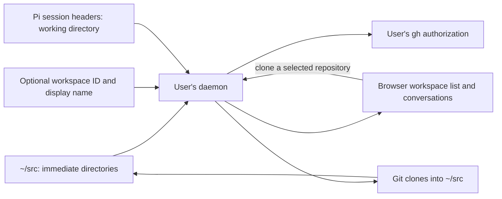

# Workspaces

A workspace is a directory immediately under the user's `~/src`. It can be a
plain directory, a Git checkout or a linked worktree. The daemon discovers it
from the filesystem whenever it takes a snapshot, so projects created through
native tools appear without registration. Git owns repository state and Pi's
session files identify the conversations belonging to each workspace.

## Finding and identifying workspaces

Discovery reads immediate directories under `~/src`, not nested paths or
symlinks. The source must be on the filesystem containing the user's home so
quota-backed writes apply. It scans the whole collection in bounded batches;
there is no fixed workspace-count cutoff. Unreadable or changing entries leave
the observation incomplete, while confirmed workspaces remain visible. The
daemon does not treat an incomplete listing as proof that a clone destination
is free. It checks all names, including case-insensitive matches, before
creating a destination.

The `.git` entry distinguishes a plain directory from a Git checkout or a
linked worktree. This is a filesystem hint, not a check of Git's repository
state. A linked worktree is recognized only when its Git-directory reference
can be resolved within the source tree under the scanner's path rules. A
reference outside `~/src` leaves its kind unknown; a worktree located outside
`~/src` is not discovered. Discovery observes worktrees without managing them.

An optional `.agent-host/workspace.json` supplies a stable workspace ID and
display name. Otherwise the daemon derives the ID from the user's identity
and directory name, so renaming the directory changes its workspace ID.
Keeping these optional settings with the workspace avoids a separate registry.

A conversation belongs to a workspace when the working directory recorded in
its Pi session header exactly matches that workspace's path. A stable
workspace ID does not change this path-based association.
[Conversations](conversations.md) describes native session identity and history.

## Reading the workspace page

The page leads with the workspace's open conversations and their native recaps.
Completed conversations and the archive are folded. The + starts a conversation
with the default agent directly; worktree-agent presentation is separate work.

The Git pill opens a read-only layer. Its details are read on demand, as the
mapped user, from the freshly discovered directory through an inode-checked
descriptor. Git's NUL-delimited status preserves filenames and rename pairs;
only bounded changed-path lists and recent commit subjects enter the contract.
Upstream counts and per-commit publication marks reflect local remote-tracking
refs, not the current server: this operation never fetches. The main checkout's
safely opened FETCH_HEAD mtime supplies the last recorded fetch when available;
linked worktrees and missing/unsafe records leave that time unknown. Missing upstream or
log information is shown as unknown, not as clean or synchronized. No new store,
credential handling or authority is involved. The browser validates the reply
before rendering any native text.

## Cloning a GitHub repository

During onboarding the browser lists repositories using the user's native `gh`
authorization. The daemon checks that this authorization belongs to the
GitHub identity bound to the account, then uses GitHub's repository information
to clone the selected repository into `~/src/<repository-name>`. Both `gh` and
Git run as the user. Existing destinations, including partial earlier clones
and names differing only in case, prevent a new clone.

The daemon runs one clone at a time and streams Git's progress to the browser.
A percentage appears only when Git supplies one. The request is bounded; it
is not a persistent job that can be resumed after the browser disconnects.
[HTTP API](http-api.md) describes the routes.

The home filesystem has a Linux user quota for the account. Clone admission
checks the daemon's own effective UID limit, current usage and filesystem free
blocks. It refuses a clone when quota state cannot be read or the quota is
full, and explains confirmed fullness in the browser. There is no fixed
`~/src` size or separate volume requirement. A repository's eventual size
cannot be known from GitHub metadata: after admission the kernel still enforces
the quota for every writer, including Git, Pi and the user's shell. A write
that reaches the limit during cloning may leave a partial checkout. Quota
usage covers files owned by the user across the home filesystem, including
Pi history and caches, not just `~/src`. Workspace discovery does not hide
workspaces when the source grows. [Deployment](deployment.md) describes the
operator's quota responsibilities; [ADR 0012](../decisions/adr-0012-per-user-storage-quotas.md)
records the choice.

A disconnected browser cancels the clone. Cancellation leaves any partial
directory in place for inspection. After an interruption, the browser asks
the daemon to observe the native checkout and writer state; it does not resume
the stream or automatically retry the write. Confirmation requires the expected
Git origin, a clean checkout and a HEAD commit. An empty repository without a
first commit remains uncertain because that observation cannot distinguish it
from an interrupted clone.

The workspace UI imports repositories listed through the user's native `gh`
authorization. It also offers publishing a local main Git checkout to that
person's GitHub account. The daemon checks the repository and remote again at
each write; a displayed opportunity alone is not permission to publish. It
creates the GitHub repository through `gh`, then adds and verifies the Git
remote before pushing. An interrupted publication is observed before the
person explicitly continues it, rather than blindly creating or pushing
again. Existing or unreadable remotes do not enable a new publication, and
the daemon never sends credential-bearing remote URLs to the browser.
Publishing is limited to repositories owned by the mapped GitHub login.

The daemon also creates local workspaces, initializes Git, changes display
names and hides or restores workspaces. It checks the observed source and
target again before writing; an incomplete listing or a replaced directory
blocks the change. A newly annotated directory gains a stable workspace ID
in `.agent-host/workspace.json`. The daemon excludes this metadata locally
from the Git checkout without changing its `.gitignore`. Hidden state lives
in user presentation state, not in Pi history or the workspace directory.
A partial result requires a fresh observation rather than an automatic retry.

Deletion is not enabled. A safe implementation would need to recover from a
same-UID process replacing a workspace path and establish which native
processes, worktrees and mounts still depend on it. Until that work is done,
the browser explains why deletion is unavailable. [The deletion issue](../../issues/recoverable-workspace-deletion/item.md)
records the proposed recovery behavior.

## Pi sign-in during onboarding

The browser also offers Pi's device sign-in for OpenAI Codex access. The daemon
uses a helper built on the installed Pi SDK to check the stored authorization
and start sign-in when needed. The person follows the verification link,
enters the code and completes sign-in with the provider; Pi stores the
credential in the user's home.

The daemon holds the attempt in memory for the browser session that started
it. The browser polls its result and can cancel it; cancellation does not prove
whether a credential was saved. The status check resolves Pi's stored
authorization, rather than testing a model request. Workspace snapshots and
history reads do not invoke this helper.

Discovery, cloning and onboarding are implemented in `internal/daemon`.

Decisions behind this page: ADR 0001, ADR 0005, ADR 0012.
