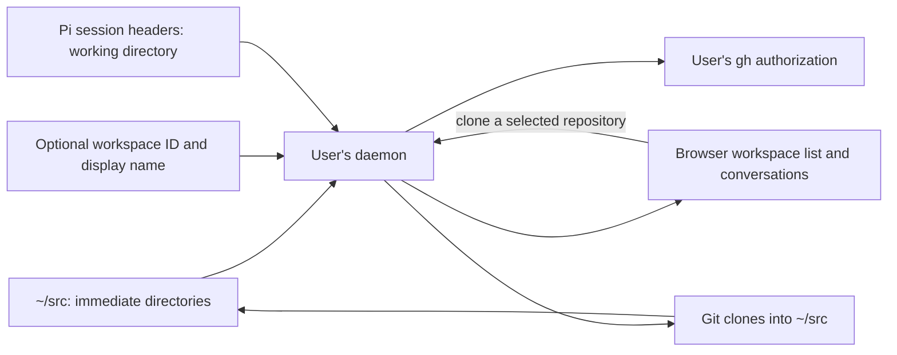
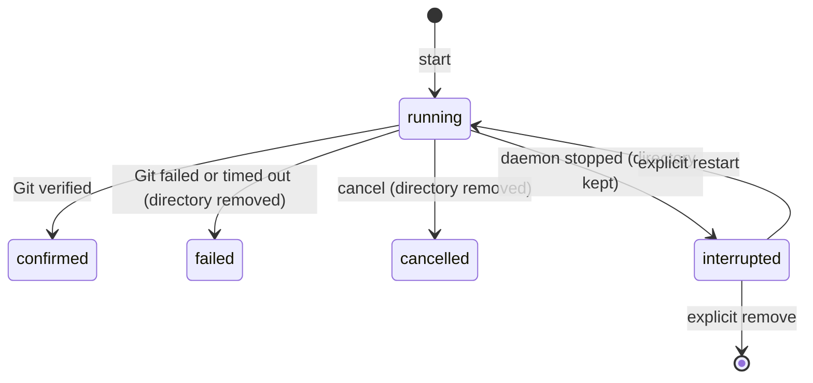

# Workspaces

A workspace is a directory immediately under the user's `~/src`. It can be a
plain directory, a Git checkout or a linked worktree. The daemon discovers it
from the filesystem whenever it takes a snapshot, so projects created through
native tools appear without registration. Git owns repository state and Pi's
session files identify the conversations belonging to each workspace.

## Finding and identifying workspaces

Discovery reads immediate directories under `~/src`, not nested paths or
symlinks. The source must be on the filesystem containing the user's home so
quota-backed writes apply. It scans the whole collection in bounded batches;
there is no fixed workspace-count cutoff. Unreadable or changing entries leave
the observation incomplete, while confirmed workspaces remain visible. The
daemon does not treat an incomplete listing as proof that a clone destination
is free. It checks all names, including case-insensitive matches, before
creating a destination.

The `.git` entry distinguishes a plain directory from a Git checkout or a
linked worktree. This is a filesystem hint, not a check of Git's repository
state. A linked worktree is recognized only when its Git-directory reference
can be resolved within the source tree under the scanner's path rules. A
reference outside `~/src` leaves its kind unknown; a worktree located outside
`~/src` is not discovered. Discovery observes worktrees without managing them.
[ADR 0025](../decisions/adr-0025-worktree-as-a-place.md), not yet
implemented, makes a linked worktree a place under the workspace whose Git
registry lists it, wherever it is on disk, and gives the daemon a way to list
and remove worktrees with the Trash's safety rules
([implement-worktree-agents](../../issues/implement-worktree-agents/item.md),
[implement-worktree-cleanup](../../issues/implement-worktree-cleanup/item.md)).

An optional `.agent-host/workspace.json` supplies a stable workspace ID and
display name. Otherwise the daemon derives the ID from the user's identity
and directory name, so renaming the directory changes its workspace ID.
Keeping these optional settings with the workspace avoids a separate registry.

A conversation belongs to a workspace when the working directory recorded in
its Pi session header exactly matches that workspace's path. A stable
workspace ID does not change this path-based association.
[Conversations](conversations.md) describes native session identity and history.

## Reading the workspace page

The page leads with the workspace's open conversations and their native recaps.
Completed conversations and the archive are folded. The + starts a conversation
with the default agent directly; worktree agents (ADR 0025) are separate work.

The Git pill on the workspace page and the Git chip in a conversation's top
bar (beside the model) show the same native observation. The snapshot's
`git_summary` carries the branch, the change count, the upstream with its
ahead/behind and the base comparison, so the chip is drawn without another
read. Its details are read on demand (when opened, when the agent's turn ends,
and on *Lue uudelleen*), as the mapped user, from the freshly discovered
directory through an inode-checked descriptor; nothing is polled or stored.
One `git status --porcelain=v2 --branch -z` gives the branch, the upstream
counts and the NUL-delimited changed paths with rename pairs. The details add
per-file line counts (`git diff --numstat HEAD`, and the line count of an
untracked text file read through the descriptor), and the commits of each
comparison by name, newest first and at most 20 per list; the counts stay the
totals. A conversation in a linked worktree shows its own worktree, because
the conversation's working directory decides its workspace.

The **base branch** is chosen from native records only: the source branch
recorded for the branch in `branch.<name>.workmux-base` (written when a
worktree is made from another branch), otherwise `refs/remotes/origin/HEAD`,
which `git clone` and Git 2.48's `git fetch` set from the remote's default
branch, so for a GitHub clone it is GitHub's default branch. Without either the
comparison is left out rather than guessed, and a base that is the branch
itself or its own upstream is left out because it says nothing new. *Merged*
means HEAD is an ancestor of the base (no commits ahead of it); a squash merge
is not recognised. Worktree agents read this fact to show merged-or-not.

Upstream counts reflect local remote-tracking refs, as fresh as the last
fetch. The main checkout's safely opened FETCH_HEAD mtime supplies the last
recorded fetch; linked worktrees and missing/unsafe records leave that time
unknown. *Hae etärepo* is the one Git write: on an explicit request only, the
daemon runs `git fetch` of the branch's upstream remote (else `origin`, else
the only remote) as the user, with the user's own Git configuration and
credentials and automatic maintenance off, bounded to 45 seconds. It moves only
remote-tracking refs and FETCH_HEAD, and answers with the observation read
again. The daemon has no SSH agent, so an SSH remote whose key needs one
fails; Git's diagnostics are classified into a fixed code (SSH key
unavailable, sign-in required, unreachable, not found, timed out) and never
passed on as text. Missing upstream or log information is shown as unknown,
not as clean or synchronized. The browser validates every reply before
rendering any native text.

## Cloning a GitHub repository

The browser lists the person's repositories using their native `gh`
authorization. The daemon checks that this authorization belongs to the
GitHub identity bound to the account, then reads the whole catalog (owner,
collaborator and organisation repositories, at most ten pages of 100, newest
push first) with each repository's size estimate, default branch and owner
type, and returns the bound account's own login from the same check so the
browser can group the person's own repositories. An exact `owner/repo` outside the catalog, such as someone else's public
repository, is looked up on GitHub with the same authorization; GitHub's 404
means it does not exist or is not accessible to this person. Free space for
the details comes from the existing personal quota read.

A clone is a job of the user's daemon
([ADR 0024](../decisions/adr-0024-clone-jobs.md)). The daemon uses GitHub's
repository information to clone into `~/src/<repository-name>`, with full
history or, if the person chooses, as a light clone
(`git clone --filter=blob:none`). Both `gh` and Git run as the user. Existing
destinations, including names differing only in case, prevent a new clone.
The browser subscribes to the job's progress and may leave and come back:
losing the stream does not stop the job. In the browser, Uusi työtila is a
page (`/workspaces/new`, the selected repository in `?repo=`) whose top lists
the daemon's jobs and interrupted clones with their actions; a block above
the sidebar's workspaces shows a running, failed or interrupted clone and
links back to it. A percentage appears only when Git
supplies one. One job runs at a time, under the same writer lock as other
writes to `~/src`, and a job is bounded to 45 minutes.

Jobs live in the daemon's memory only. Cancel and native failure remove the
directory the job created, so a retry is admitted. When the daemon stops
during a clone, the directory stays, and after the restart it is recognised
from the filesystem as an interrupted clone: nothing but a `.git` whose origin
is the canonical GitHub URL of that name, no index and no ref, Git agreeing
that `HEAD` has no commit, and no process of the user inside it. An
interrupted clone, like a running one, is not listed as a workspace. The
clone list reports it with its size, and only the person's explicit restart
or remove acts on it; nothing restarts a clone by itself. Removal works by
descriptor on the recognised directory, never follows a symlink or crosses a
filesystem, and keeps whatever it cannot remove. A shell-made `git init` that
holds nothing but a matching GitHub origin looks the same and is treated the
same; a workspace created in the browser always has its `.agent-host/`
settings.

The home filesystem has a Linux user quota for the account. Clone admission
checks the daemon's own effective UID limit, current usage and filesystem free
blocks. It refuses a clone when quota state cannot be read or the quota is
full, and explains confirmed fullness in the browser. There is no fixed
`~/src` size or separate volume requirement. A repository's eventual size
cannot be known from GitHub metadata: after admission the kernel still enforces
the quota for every writer, including Git, Pi and the user's shell. A write
that reaches the limit during cloning fails the job, which removes its
directory. Quota usage covers files owned by the user across the home
filesystem, including Pi history and caches, not just `~/src`. Workspace
discovery does not hide workspaces when the source grows.
[Deployment](deployment.md) describes the operator's quota responsibilities;
[ADR 0012](../decisions/adr-0012-per-user-storage-quotas.md) records the
choice.

Confirmation requires the expected Git origin, a clean checkout and a HEAD
commit. An empty GitHub repository without a first commit therefore never
confirms, and its clone looks like an interrupted one. After a lost reply the
browser reconciles by observing the checkout, waiting while the daemon's own
job is still cloning; it never repeats the write automatically.
[HTTP API](http-api.md) describes the routes.

The workspace UI imports repositories listed through the user's native `gh`
authorization. It also offers publishing a local main Git checkout to that
person's GitHub account. The daemon checks the repository and remote again at
each write; a displayed opportunity alone is not permission to publish. It
creates the GitHub repository through `gh`, then adds and verifies the Git
remote before pushing. An interrupted publication is observed before the
person explicitly continues it, rather than blindly creating or pushing
again. Existing or unreadable remotes do not enable a new publication, and
the daemon never sends credential-bearing remote URLs to the browser.
Publishing is limited to repositories owned by the mapped GitHub login.

The daemon also creates local workspaces, initializes Git, changes display
names and hides or restores workspaces. It checks the observed source and
target again before writing; an incomplete listing or a replaced directory
blocks the change. A newly annotated directory gains a stable workspace ID
in `.agent-host/workspace.json`. The daemon excludes this metadata locally
from the Git checkout without changing its `.gitignore`. Hidden state lives
in user presentation state, not in Pi history or the workspace directory.
A partial result requires a fresh observation rather than an automatic retry.

Deletion follows [ADR 0019](../decisions/adr-0019-workspace-deletion.md):
"Delete" moves `~/src/<name>` into the person's freedesktop home Trash
(`~/.local/share/Trash`) with one `renameat2(RENAME_NOREPLACE)`, after
writing the specification's `.trashinfo` file first. A move destroys nothing,
so a check that missed something leaves the directory whole and restorable,
in the browser or with any Trash-aware native tool. Before moving, the daemon
pins the workspace by descriptor and runs its checks; any check that cannot
complete blocks, as a found problem does. A live managed Pi child, another
process of the person with its cwd, root, executable or a descriptor inside,
a live Taskfleet run of the repository or one whose worktree still exists, a
live or locked linked worktree in Git's own registry (wherever it is on
disk), a workspace that is itself a linked worktree or holds one, a mount
below it, or a Trash on another filesystem each block. Settled conversations
never block: Pi history lives outside the workspace and is associated again
by path on restore. Git facts are shown but do not block a move.

While deletion runs, the conversation controller holds a fence on the
directory's device and inode, so no conversation can start in it. Every Pi
launch (create, relaunch, resume and title) also checks, under the same lock,
that its workspace descriptor is still the directory `~/src/<name>` names, so
a start that resolved the workspace before the move cannot launch Pi inside
the Trash afterwards. After the move the daemon compares the moved inode with the
observed one; a directory swapped in meanwhile is put back, or, if that
fails, left whole in the Trash and reported.

A Git repository whose status is clean, with no untracked files, no stash,
no initialized submodule or ignored nested repository, and every commit of
HEAD and every ref contained in a remote-tracking ref, may be deleted outright
(Jari's amendment to the ADR). The check itself makes no fetch, so the
confirmation shows what the last fetch recorded; the outright deletion then
fetches every remote (pruning, without tags, hooks or maintenance) on the moved directory, and keeps the directory if the fetch moved any local ref,
before checking it again, so a remote branch deleted or rewritten since is
noticed. Ignored files do not prevent it and are listed so the person sees
what is lost. Outright deletion still moves first, fetches, checks the moved
directory again and only then removes it; a failed fetch, a change or a
process found there keeps it in the Trash instead.

The Trash view lists only entries whose recorded path is an immediate child
of this person's `~/src`, plus directories without an info file; info files
written by other tools are parsed strictly and never trusted as paths.
Restore renames back without replacing anything and refuses a name that is
taken. Permanent deletion of a Trash entry requires the typed name and walks
the entry by descriptor without following symlinks or entering a mount
(the kernel's `RESOLVE_NO_XDEV`, which also stops at a bind mount of the same
filesystem); a mount found inside the entry blocks it; whatever it cannot remove stays listed and can be deleted again.
Emptying the Trash removes exactly the entries of the listing the person
confirmed: the listing carries a token over the entry names, their inodes and
info, and a Trash that changed since is refused whole. Nothing is purged
automatically. In the browser the Trash lives in Asetukset › Tallennustila
beside the quota bar, which shows the Trash's share.

## Pi sign-in during onboarding

The browser also offers Pi's device sign-in for OpenAI Codex access. The daemon
uses a helper built on the installed Pi SDK to check the stored authorization
and start sign-in when needed. The person follows the verification link,
enters the code and completes sign-in with the provider; Pi stores the
credential in the user's home.

The daemon holds the attempt in memory for the browser session that started
it. The browser polls its result and can cancel it; cancellation does not prove
whether a credential was saved. The status check resolves Pi's stored
authorization, rather than testing a model request. Workspace snapshots and
history reads do not invoke this helper.

Discovery, cloning and onboarding are implemented in `internal/daemon`.

Decisions behind this page: ADR 0001, ADR 0005, ADR 0012, ADR 0019, ADR 0024, ADR 0025.
