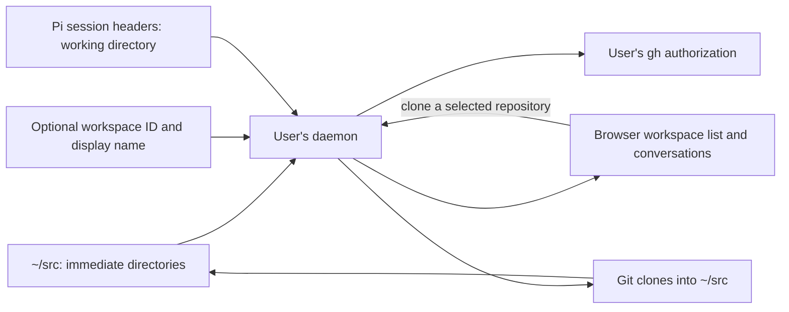

# Workspaces

A workspace is a directory immediately under the user's `~/src`. It can be a
plain directory, a Git checkout or a linked worktree. The daemon discovers it
from the filesystem whenever it takes a snapshot, so projects created through
native tools appear without registration. Git owns repository state and Pi's
session files identify the conversations belonging to each workspace.

## Finding and identifying workspaces

Discovery reads the immediate directories under `~/src`; it does not search
nested directories or other locations. It follows no symlinks and crosses no
mounts inside a workspace. `~/src` itself can share the home's filesystem or
use the dedicated volume described below. Unreadable or changing entries are
reported as incomplete observations rather than treated as absent.

Discovery reads the whole immediate collection in bounded batches of 512 entries;
files and hidden entries do not consume a workspace allowance. Entries that
cannot be inspected leave the observation incomplete, while confirmed
workspaces remain visible. A failed directory read likewise cannot establish
that an omitted name is absent. Snapshot responses have a 16 MiB transport
bound; if exceeded, the request fails rather than publishing a truncated list.
Clone destination checks scan all names, including case-insensitive matches,
before reserving a directory. A read failure blocks cloning rather than
assuming the destination is available.

The `.git` entry distinguishes a plain directory from a Git checkout or a
linked worktree. This is a filesystem hint, not a check of Git's repository
state. A linked worktree is recognized only when its Git-directory reference
can be resolved within the source tree under the scanner's path rules. A
reference outside `~/src` leaves its kind unknown; a worktree located outside
`~/src` is not discovered. Discovery observes worktrees without managing them.

An optional `.agent-host/workspace.json` supplies a stable workspace ID and
display name. Otherwise the daemon derives the ID from the user's identity
and directory name, so renaming the directory changes its workspace ID.
Keeping these optional settings with the workspace avoids a separate registry.

A conversation belongs to a workspace when the working directory recorded in
its Pi session header exactly matches that workspace's path. A stable
workspace ID does not change this path-based association.
[Conversations](conversations.md) describes native session identity and history.

## Cloning a GitHub repository

During onboarding the browser lists repositories using the user's native `gh`
authorization. The daemon checks that this authorization belongs to the
GitHub identity bound to the account, then uses GitHub's repository information
to clone the selected repository into `~/src/<repository-name>`. Both `gh` and
Git run as the user. Existing destinations, including partial earlier clones
and names differing only in case, prevent a new clone.

The daemon runs one clone at a time and streams Git's stages to the browser.
It reports a percentage only when Git supplies a usable measurement. The
streaming attempt has a 45-minute deadline; the non-streaming API has a shorter
90-second request deadline. The clone stream has no replay cursor or persisted
job. [HTTP API](http-api.md) describes the routes.

Cloning requires an operator-provisioned filesystem mounted at `~/src`, with
at most 20 GiB total capacity and at least 5 GiB available before admission.
A bind mount sharing the home's filesystem does not qualify. This volume
bounds disk consumption even when native tools write outside the browser.
Workspace reads do not require the free-space headroom, so filling a qualifying
volume does not hide existing workspaces. Ordinary workspace reads on the
home's filesystem need no separate volume; a separately mounted `~/src` must
satisfy the dedicated-volume size checks. [Deployment](deployment.md) describes
the installation's responsibilities. [ADR 0012](../decisions/adr-0012-per-user-storage-quotas.md) replaces these
fixed-volume assumptions with a Linux user quota over the whole home; this
page describes the implementation until that lands.

A disconnected browser cancels the clone. Cancellation leaves any partial
directory in place for inspection. After an interruption, the browser asks
the daemon to observe the native checkout and writer state; it does not resume
the stream or automatically retry the write. Confirmation requires the expected
Git origin, a clean checkout and a HEAD commit. An empty repository without a
first commit remains uncertain because that observation cannot distinguish it
from an interrupted clone.

The daemon also manages local workspace creation, optional `git init`, display
names and hide/restore. It reobserves the source directory before each write,
opens entries with no-follow descriptors and checks the observed target again
before acknowledging the result. Creation requires the user's source observation
token; target writes require the workspace inode token. First annotation gives an
unannotated directory a new stable ID rather than persisting its name-derived
fallback ID. An unrelated corrupt entry does not disable clean targets if the
source listing itself was complete; unreadable listings and replaced sources
still block writes. A partial result requires a fresh snapshot;
the browser does not repeat a failed native write automatically. Optional
`.agent-host/workspace.json` keeps the stable ID and display name with the
workspace. For main Git worktrees the daemon adds `.agent-host/` to the
checkout's local Git exclude instead of changing `.gitignore`. Hidden state is presentation-only in the user's
`~/.local/state/native-agent-host/user-state.json`, keyed by that ID. Corrupt
state and unknown workspace annotations are not overwritten.

Deletion is **not enabled**. Even with descriptor-pinned traversal and a
per-user quarantine, Linux pathname rename cannot atomically compare the
source inode with an expected inode: a same-UID replacement can move another
directory. The adopted guarantee permits that move, provided contents of the
replacement are never deleted and it can be recovered after a crash. Shipping
that guarantee still requires a recovery protocol and reliable observations of
processes, linked worktrees outside `~/src`, and mounts; unknown worktrees and
unowned processes must block cleanup. Those adapters are not yet verified, so
no delete route is mounted and the browser explains why deletion is unavailable.
A future implementation can move to quarantine, revalidate there and remove
only the confirmed target; a mismatch must restore a moved replacement and
report the residual operation if restoration cannot complete.

## Pi sign-in during onboarding

The browser also offers Pi's device sign-in for OpenAI Codex access. The daemon
uses a helper built on the installed Pi SDK to check the stored authorization
and start sign-in when needed. The person follows the verification link,
enters the code and completes sign-in with the provider; Pi stores the
credential in the user's home.

The daemon holds the attempt in memory for the browser session that started
it. The browser polls its result and can cancel it; cancellation does not prove
whether a credential was saved. The status check resolves Pi's stored
authorization, rather than testing a model request. Workspace snapshots and
history reads do not invoke this helper.

Discovery, cloning and onboarding are implemented in `internal/daemon`.

Decisions behind this page: ADR 0001, ADR 0005.
