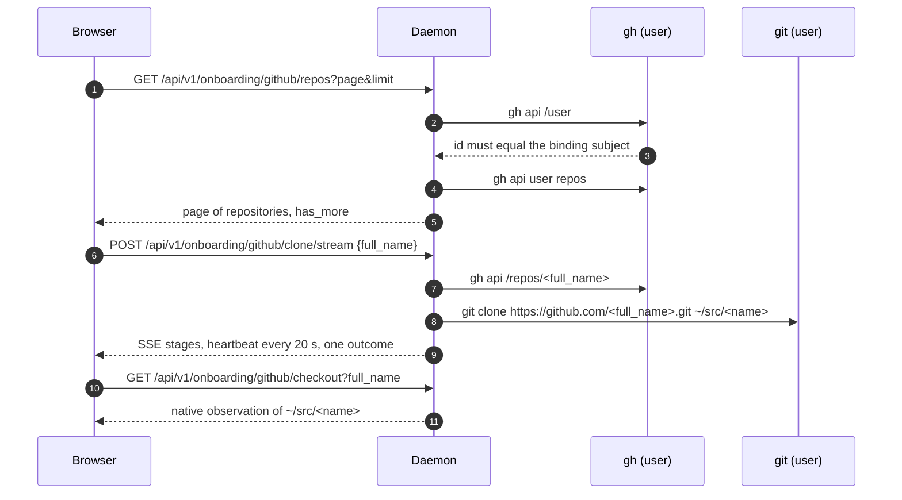

# Workspaces

A workspace is a directory immediately under the user's `~/src`. A plain
directory qualifies; so does a Git checkout or a linked worktree. Nothing has
to be registered, and no file has to exist inside the directory for it to
appear. The daemon finds workspaces by listing the directory each time it
takes a snapshot.

## Discovery

The daemon opens `/`, then the home, then `src`, with `openat2` and
`RESOLVE_BENEATH`, refusing symlinks and magic links. The home may sit on its
own filesystem, but below `~/src` no mount boundary is crossed, with one
exception described under cloning. It reads at most 512 entries and classifies
each one.

| Kind | Evidence |
|---|---|
| `directory` | an ordinary directory |
| `git_main_worktree` | a `.git` directory inside it |
| `git_linked_worktree` | a bounded `.git` file pointing elsewhere |
| `unknown` | the entry could not be read safely |

The `.git` entry is a hint. The daemon does not run Git to verify repository
state, so the snapshot reports the Git fact as `unknown` for both Git kinds.
Linked worktrees created by other tools, inside or outside `~/src`, are
observed and never managed.

If `.agent-host/workspace.json` exists inside the directory, the daemon reads
up to 4 KiB of it for a stable `ws_` identifier and an optional display name.
Without it, the identifier is derived from the provider, subject and directory
name, so a renamed directory is a new workspace. In a Git repository the
natural place to keep the file out of history is `.git/info/exclude`.

The snapshot carries each workspace with its name, display name, kind and three
facts: the filesystem observation, the metadata file and the Git hint, each
`confirmed`, `absent`, `unknown` or `unavailable` with the observation time.
Conversations are attached to a workspace only when a Pi session header's `cwd`
equals `~/src/<name>` exactly.

## What the browser can change

The browser creates, renames and deletes nothing under `~/src`. The daemon's
only workspace write is the GitHub clone below. Everything else the person does
to their directories, they do with native tools.

## GitHub onboarding

Repository listing and cloning run `/usr/bin/gh` and Git as the user, with no
inherited environment and the user's own `gh` credential. Before either, the
daemon checks that `gh api /user` returns the numeric ID in its binding; a
missing or foreign authorization answers `409 github_auth_unavailable`. The
clone name must match the repository's owner and name exactly, the clone URL
must be the canonical HTTPS one, and one clone runs at a time per daemon.

Large clones need somewhere to go. The daemon allows `~/src` to be a separate
mount only when it is a dedicated volume: a distinct filesystem rather than a
bind mount of the home, of at most 20 GiB. A full volume stops new clones
without hiding the workspaces already there. The streaming clone has a ceiling
of 45 minutes; the non-streaming route keeps 90 seconds for small
repositories. The gateway forwards at most 512 KiB of stream per clone.

After any interruption the checkout endpoint reports what the directory shows.
A clone counts as complete only when Git is initialised, `origin` is set, the
tree is clean and `HEAD` points at a commit. An empty repository without a
first commit stays uncertain, because a local tree cannot distinguish it from
an aborted clone.

## Pi sign-in

Pi's model access is the person's own OpenAI Codex credential, stored by Pi in
the user's home. `GET /api/v1/onboarding/pi/status` runs a small helper on the
pinned Pi SDK as the user and reports `usable`, `missing` or `unknown`. The
browser asks once on first load and shows the sign-in step when the credential
is missing.

`POST /api/v1/onboarding/pi/attempt` starts Pi's device login: the helper
returns a verification URL and user code, the person completes it in another
tab, and the browser polls `GET` on the same route every two seconds until the
attempt ends or five minutes pass. The attempt is held in the daemon's memory,
bound to one web session by a purpose-specific digest, and a second session can
neither read nor cancel it. `DELETE` cancels and reports `unknown`, since
cancelling proves neither success nor rollback. Snapshot, history and event
reads never run the helper; only the onboarding routes do.

Decisions behind this page: ADR 0001, ADR 0005.
