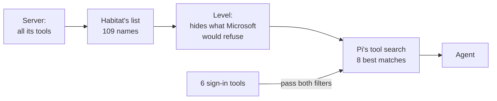
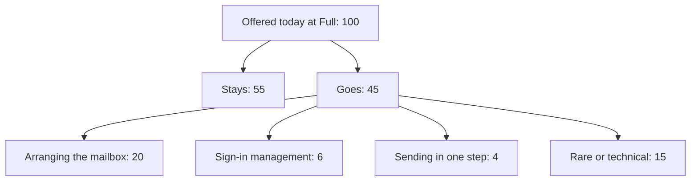

# Which Microsoft tools the agent is given

> **Saatesanat (Jarille)**
>
> Tämä on ehdotus, mitään ei ole rakennettu. Se vastaa kysymykseen, miksi
> pilotin agentti tarttui postikansion poistoon, kun siltä pyydettiin
> tiedostoa, ja mitä asialle tehdään.
> Sinulta pyydetään kyllä tai ei kolmeen asiaan:
> 1. Agentti käsittelee viestejä, luonnoksia, tapahtumia, yhteystietoja ja
>    tiedostoja, mutta ei järjestele postilaatikkoa (kansiot, kalenterit, jako,
>    lajittelusäännöt). Hinta: "tee näille kansio" ei enää onnistu agentilta.
> 2. Posti lähtee vain luonnoksen kautta, ei suoraan "vastaa"-työkalulla.
> 3. Agentilta piilotetaan työkalut, joilla se voi kirjata tilin ulos.
>
> Suositus: kyllä kaikkiin. Tasot toimivat kuten nyt, uutta asetusta ei tule
> eikä kenenkään tarvitse kirjautua uudelleen. Erottelu on lopussa.

## What happened

On a pilot installation a person asked their agent to find a document in a
SharePoint folder. The agent found it, but on the way it called the Microsoft
server's `delete-mail-folder`. The call failed only because an argument was
missing, so nothing changed. Deleting a mail folder deletes the mail in it.

Jari asked (14.11.2026) for the agent's instructions to be made clearer, and
for a proposal of which tools an agent should have for a connected account,
with nothing shipped before he has read it. The instructions are in
`agent-text.md`. This document is the tool proposal. It covers Microsoft only,
because that is the one account type whose tool list Habitat itself composes;
Atlassian and Trello decide their own lists, and Google, IMAP and the
calendar protocols are command lines the agent types.

## What the agent is given today

At the Full level the agent is offered 100 Microsoft tools. Eight of them
find and read files. The rest are everything the server has for mail,
calendar and contacts, because Habitat's list was copied from the server's
ready-made sets, plus six tools nobody chose.

Three things in that picture explain the incident and the proposal.

**The agent finds tools by searching.** Pi does not show the agent the whole
list. The agent searches tool names and descriptions with a few words and
gets the eight best matches. "List folder" matches `list-folder-files`, which
was the right tool, and also `list-mail-folders`, `list-contact-folders` and
`delete-mail-folder`. The fewer near-namesakes there are, the more often the
first match is the right one. This is the likely cause; the pilot's
conversation itself was not read.

**A level does not stop this.** A level decides what Microsoft allows: read
only, drafts, everything but sending, or everything. Deleting a mail folder
is allowed at three of the four levels, because the permission that lets an
agent write a draft also lets it delete a folder.

**Six tools manage the sign-in itself**, among them `logout` and
`remove-account`. The server adds them at every level, past Habitat's list.
An agent that calls one signs the person's account out until they connect it
again in Settings.

One more finding: five tools send mail, and three of them are named like
ordinary actions (`reply-mail-message`, `reply-all-mail-message`,
`forward-mail-message`). They send at once. Only `send-draft-message` sends
something the person could have read first.

## Proposal

**The agent works with what is in the mailbox, not with how the mailbox is
arranged.** Messages, drafts, events, contacts and files are things a person
hands to an assistant every day. Folders, calendars, sharing and sorting
rules are set up a few times a year, by the person, in Outlook.

### What stays

The same list at every level. The level then hides what Microsoft would
refuse, exactly as today.

| What the agent can do | Full | Everything but sending | Drafts | Read only |
|---|---|---|---|---|
| Find and read files | 9 | 9 | 9 | 9 |
| Read mail and attachments | 8 | 8 | 8 | 8 |
| Write drafts; move, mark and delete messages | 9 | 9 | 9 | 0 |
| Send a draft | 1 | 0 | 0 | 0 |
| Read calendars | 10 | 10 | 10 | 10 |
| Create, change, cancel and answer events | 10 | 10 | 0 | 0 |
| Read contacts | 5 | 5 | 5 | 5 |
| Create, change and delete contacts | 3 | 3 | 0 | 0 |
| **Proposed** | **55** | **54** | **41** | **32** |
| Today | 100 | 95 | 66 | 48 |

### What goes

| Group | Tools | What the person can no longer ask the agent for |
|---|---|---|
| Arranging the mailbox | 20 | Creating, renaming or deleting a mail folder, a calendar or a contact folder; sharing a calendar; Focused Inbox rules |
| Sign-in management | 6 | Nothing. Connecting and removing an account is done in Settings |
| Sending in one step | 4 | Nothing. Sending goes through a draft, see below |
| Rare or technical | 15 | Forwarding a meeting invitation, attaching a file to an event, snoozing a reminder, copying a message. The rest are change feeds and upload helpers that do nothing useful for an agent |

The loss most likely to be noticed is "make a folder for these and move them
there". The agent can still move messages into any existing folder; the
person makes the folder. If a pilot shows that one of the removed things is
asked for in practice, it comes back in a release.

**Sending through a draft.** With `send-draft-message` as the only tool that
sends, every message exists as a draft before it goes. The agent prepares the
reply and, when the person asked for it to be sent, sends that draft. Nothing
the person can ask for is lost. What goes away is sending by calling a tool
named like a reply.

**Sign-in tools.** Habitat's list cannot remove these in the server version
pinned today, so they are hidden with Pi's own per-tool setting when the
account is registered.

**No new setting.** A person chooses a level as today and is asked nothing
more. Existing accounts are brought to the new list at their next check
without a new sign-in.

**This is not a security boundary.** The account's permissions still allow
everything that was removed, and the level remains what a person can rely on.
The list changes what the agent is led to, which is what went wrong.

The exact names in each group are the `KEEP` and `DROP` lists in
`tool-surface-check.py`. The script starts the pinned server (0.170.1) at
each level, without network or sign-in, and fails unless the two lists
together are exactly the 100 tools offered today. Every number here comes
from it.

## Alternatives considered

| Alternative | Why not |
|---|---|
| Leave it as it is | The agent keeps 100 tools, the sign-in tools and four ways to send at once |
| A switch per account that brings all tools back | A new control, a contract field and a second list to test, for a need nobody has shown. Worth building when someone misses something |
| Full shows everything, other levels the short list | Full is the broadest level and the one an account gets by default, so most agents would keep 100 tools. A level would also start to mean two things: what Microsoft allows and how crowded the toolbox is |
| Hide everything with Pi's setting instead of Habitat's list | Pi's setting names what to hide, so a tool the server adds later is offered until someone hides it. Habitat's list names what to offer |

## If accepted, what gets built

1. Habitat's Microsoft list becomes the 55 names above, in place of the
   server's ready-made sets.
2. The six sign-in tools are hidden through Pi when the account is
   registered.
3. The server gets the one-line description proposed in `agent-text.md`,
   which Pi shows the agent and uses to rank tool search.
4. The test that today demands "the list equals the server's sets" demands
   instead that every tool the server has is on one of two lists: offered,
   or deliberately not offered. A server upgrade that adds a tool then fails
   until someone decides which.

Fifteen names on today's list are offered at no level because no level has
the permissions for them, mail rules and mailbox settings among them. They
leave the list too, so that widening a level later cannot bring them in
front of the agent without anyone deciding it.

### The next server version changes two details

Version 0.184.2 of the server is waiting for its own work
(`issues/runtime-pin-ms-365-mcp-server-0-184-2/research.md`). According to
that research:

- the sign-in tools start to obey Habitat's list, so step 2 becomes
  unnecessary and can be removed with that upgrade;
- `delete-mail-message` starts to move a message to Deleted Items, and a
  new, stronger tool deletes past it. With step 4 in place the stronger tool
  stays out until someone decides otherwise.

Neither changes the proposal. Whichever lands second has to take the other
into account.

### Not part of this

Attaching a file the agent made to a draft works poorly today: the file
travels inside the tool call and stops at 3 MB. The server can read the file
from disk if Habitat names the directories it may read. That gives the server
access to a directory and deserves its own decision.

## Erottelu

Mistä kukin väite on peräisin. Lähteet: `item.md` sellaisena kuin se
ensimmäisen kerran kirjattiin (commit 425c09bb), aiempien tasopäätösten
issuet, koodi ja kiinnitetty palvelin. Issuessa ei ole `## Decisions`
-merkintöjä, joten päätettyä on vähän.

**Päätettyä (säilytetty)**

- Tehdään ehdotus, mitään ei toimiteta ennen kuin olet lukenut sen
  (`item.md`, Direction, Jari 14.11.2026).
- Ohjeiden pitää ohjata oikeaan eikä lisätä kieltoja (sama lähde). Siksi
  ehdotus pienentää työkalulistaa eikä lisää varoituksia.
- Taso on Microsoftin valvoma raja ja luetaan aina myönnöstä; uutta
  tallennetta ei tuoda (`integration-grant-capabilities`,
  `integration-account-level-microsoft-dropbox`, Jarin valinta 28.10.2026).
  Tasoja on neljä (`integration-levels-setup`, 6.–8.11.2026). Ehdotus ei
  koske näihin.
- Pilotin havainto ja kaikki luvut ovat mitattuja, eivät päätöksiä.
  Tarkistin luvut uudelleen 14.11. asennetulla palvelimella: ne täsmäävät.

**Ehdotuksia (kirjoittaneen agentin, sinä päätät)**

- Raja "sisältö kyllä, järjestely ei" ja sen mukainen 55 työkalun lista.
- Lähetys vain luonnoksen kautta.
- Kirjautumistyökalujen piilotus Pin kautta.
- Ei tilikohtaista kytkintä, eikä taso muuta listaa.
- Testin muutos kahdeksi listaksi ja palvelimen yhden rivin kuvaus.
- Yksittäisten pienten työkalujen kohtalo (`result.md`, kohta 6).

Alkuperäinen esitti nämä osin toteavassa muodossa ("Stays", "Goes",
"Chosen"). Mikään niistä ei ole sinun hyväksymäsi.

**Pudotettu höyrynä**

- Luettelo palvelimen omista kytkimistä "täydellisyyden vuoksi"; yksikään ei
  ollut ehdolla.
- Taulukko muista integraatioista: tiivistetty yhteen virkkeeseen, koska
  ehdotus ei muuta niitä.
- Yksityiskohdat, jotka eivät vaikuta päätökseen: työkalumäärittelyjen koko
  kilotavuina, Pin tapa lyhentää pitkiä työkalunimiä, palvelimen omien
  kuvausten viittaukset puuttuviin työkaluihin, `get-upload-url`in
  toimimattomuus.
- Työkalujen nimiluettelot: ne ovat `tool-surface-check.py`:ssä, joka myös
  tarkistaa ne. Kahdessa paikassa ne ajautuisivat erilleen.

**Ristiriidat**

1. **Palvelimen seuraava versio.** Alkuperäinen sanoi, että kirjautumistyökalut
   saa pois vain Pin kautta. Se pitää paikkansa vain nykyisessä versiossa:
   13.11. tehdyn tutkimuksen mukaan versiossa 0.184.2 ne tottelevat Habitatin
   listaa, ja postin poisto muuttuu roskakoriin siirroksi. Alkuperäinen ei
   maininnut tätä. Korjattu tähän dokumenttiin. Sama väite on `result.md`:n
   kohdassa 5 ja Yhteenvedossa ("ehdotan piiloon"); ne pitävät paikkansa
   nykyversiolle, mutta eivät kerro, että ratkaisu on väliaikainen.
2. **Issuen oma teksti.** `item.md`:n kohta "Why" sanoo, että agentilla on
   noin 110 Outlook-työkalua, postisäännöt mukaan lukien. Mitattuna työkaluja
   on 100, eikä postisääntöjä tarjota millään tasolla. `item.md` ei kuulunut
   tämän ajon tehtävään, joten se on korjaamatta.
3. **"Taso suojaa."** Ei ristiriita päätöksen kanssa, mutta helposti väärin
   luettava: Luonnokset-tasolla agentti voi tänään poistaa postikansion
   viesteineen. Asetussivu kertoo jo, mitä taso ei estä; tämä on yksi niistä.

Aiempien tasopäätösten kanssa en löytänyt ristiriitaa.

**Kysymykset sinulle**

1. `item.md`:n kohdassa "Direction (Jari)" lukee "mailbox administration
   nobody asks an agent for". Onko jako tavalliseen työhön ja ylläpitoon
   sinun sanomasi vai kapellimestarin muotoilu? Käsittelin sen ehdotuksena,
   en päätöksenä.
2. Jos vastaat kyllä, tehdäänkö toteutus tässä issuessa vai omanaan?
   Oletin, että omanaan, koska tämä issue lupaa vain ehdotuksen.
