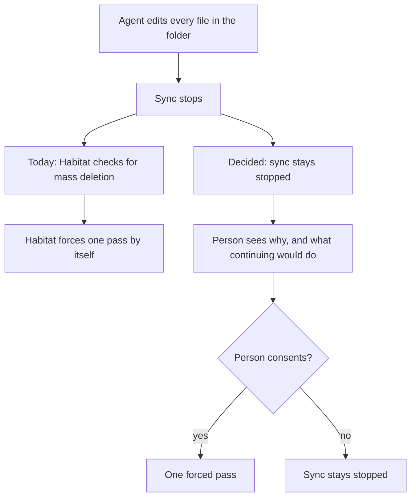
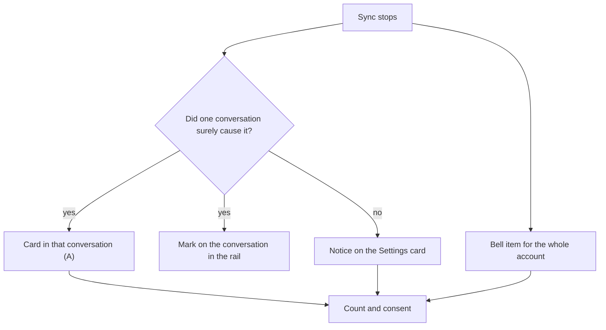
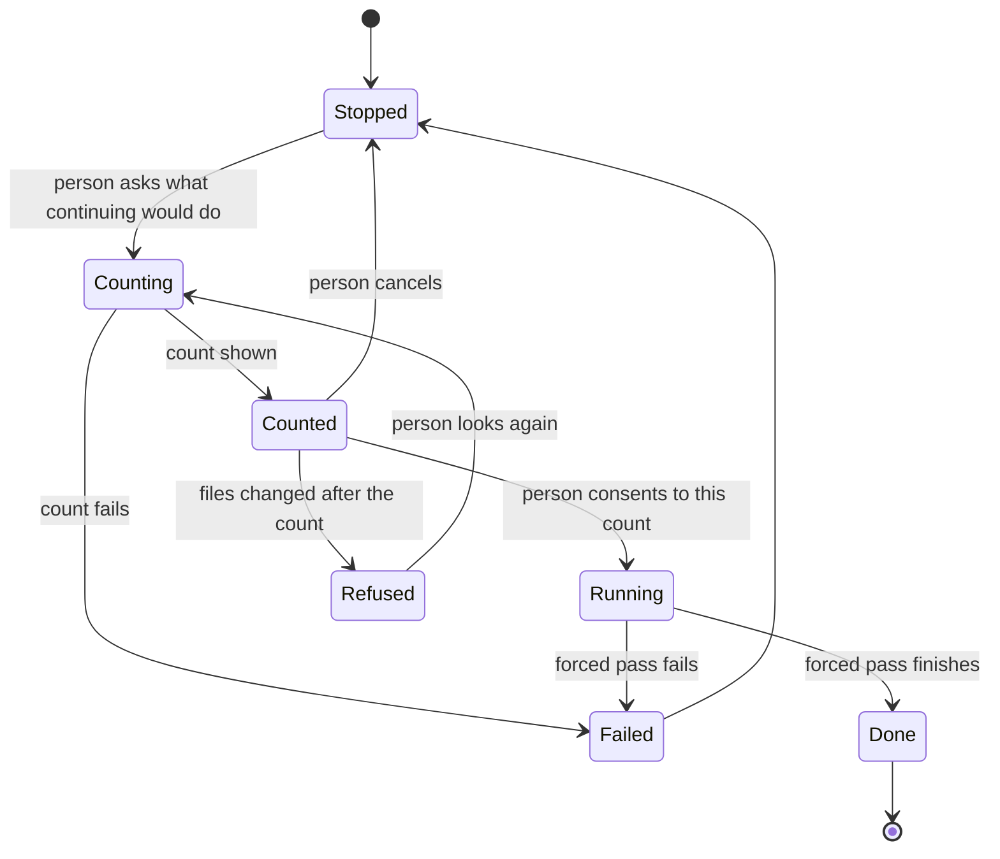

# Sync stop and consent: where the prototype rounds stand (14.11.2026)

> **Saatesanat.** Tämä kokoaa kahden prototyyppikierroksen tuloksen: mitä
> ihminen näkee, kun pilvikansion synkronointi pysähtyy, koska agentti muutti
> kansion jokaista tiedostoa, ja miten hän antaa luvan jatkaa.
> Sinulta kysytään viisi asiaa (kohta "Questions for Jari"): pysähdyksen
> paikka keskustelussa, saako agentti koskaan jatkaa synkronointia ihmisen
> "kyllä"-vastauksella, riittävätkö kello ja Asetukset, kun mikään keskustelu
> ei aiheuttanut pysähdystä, muutaman sekunnin jäännösriski ja se, koskeeko
> sama lupa myös "liikaa poistoja" -pysähdystä.
> Suositus: **A Kortti**. Habitatin oma kortti tulee keskusteluun heti sen
> vuoron jälkeen, jonka muutokset pysäyttivät synkronoinnin. Kortti näyttää,
> mitä jatkaminen tekisi, ja lupa annetaan kortin painikkeella, ei agentille.
> Lopun "Erottelu" kertoo, mikä tästä on sinun päättämääsi ja mikä ehdotusta.

## The problem

When an agent edits every file in a synced cloud folder, two-way sync stops:
it cannot tell such an edit from a mistake that would overwrite everything on
the other side. Today Habitat checks that the stop is not a mass deletion and
then continues by itself with a forced pass. The person sees nothing, and a
mass deletion that arrives between the check and the forced pass goes through
to the other side. This has not been observed; it is a known gap.

## What Jari has decided

- Sync stops and does not continue by itself. The person is told that it
  stopped and why, sees what continuing would do (how many files would
  change and be deleted), and gives a separate consent to one forced pass.
  (Verdict 14.11.2026 on `decisions-review-after-31-10` item 1; "direction
  accepted" in this issue's Decisions, 11:42Z.)
- The stop and the consent belong in the conversation where the agent did
  the work that caused the change, not on the integrations card in Settings,
  where a person will not find them. (Decisions, 12:54Z, on round 1.)

Today and decided, side by side:

Everything below is a proposal built on those two decisions.

## Round 2: three places in the conversation

Round: `design-system/prototypes/rounds/2026-11-14-sync-consent-2/`; its
`NOTES.md` says how to build it and what the host would have to provide.

The three directions differ in where the stop sits. In all of them the rail
marks the conversation that caused the stop and the bell shows it for the
whole account.

- **A Kortti.** Habitat's own card appears in the timeline right after the
  turn whose edits stopped sync, and names those edits. *Katso, mitä
  jatkaminen tekisi* fills the count and the consent button into the card.
  *Kysy agentilta* drafts a message that the person may send.
- **B Agentti kertoo.** Habitat tells the agent about the stop. The agent
  explains in its own words what it did and runs the count; Habitat's
  consent card sits under its reply.
- **C Kentän yllä.** A fixed line above the message field, outside the
  timeline. The count and the consent open in a dialog.

**Recommendation: A.** The card is where the person reads the agent's
result, and it says which edits caused the stop. Consent needs no agent
turn, so A also works when the agent has moved on or is not running. B
explains best, but it starts a turn the person did not ask for, and the
agent's account of what it did can be wrong; A's *Kysy agentilta* gives the
same explanation when the person wants it. C is detached from its cause and
takes space from the message field on a phone.

**When no conversation caused the stop** (the change came from another
device, the cloud's own web interface or a terminal), there is no card and
no rail mark. The bell item explains the stop and opens the count and
consent in a dialog, and the Microsoft 365 card in Settings shows a notice
with the same dialog. This is what remains of round 1.

Where the person meets the stop, as proposed:

## Proposals that the directions share

None of these has been decided. They are what the prototype shows, and the
mechanisms are described in the two rounds' `NOTES.md`.

What the count and consent go through, in every direction:

- **The count is made when the person asks for it**, not at the moment of
  the stop, so that it is fresh when they read it.
- **Consent covers exactly the count shown.** If any file changed after the
  count, continuing is refused and the person looks again. This is what
  closes the gap described under "The problem". A window of a few seconds
  remains on the cloud side (question 4).
- **A count that contains deletions gets a strong warning and a checkbox**,
  and the button names the number. The prototype's example is an agent that
  moved 212 files; the cloud sees a move as 212 deletions and 212 new files.
- **A stop is tied to a conversation only when that is sure enough**: the
  agent's file edits inside the folder are certain, shell commands are only
  probable. Otherwise the fallback above is used, because a card in the
  wrong conversation would tell the person a wrong cause.
- **The agent can count and explain but cannot continue the sync.** Round 1
  let the agent continue after a yes in the conversation; round 2 removed
  that (question 2). This is how the product asks, not a security boundary:
  the agent runs as the same Unix user and could run the sync tool itself.
  No authority moves between gateway, daemon and provision.
- **The card is Habitat's own state, not part of the conversation's
  history.** It shows while the stop lasts, and afterwards as a one-line
  receipt until the conversation is reopened. Nothing new is stored; after
  a restart the next pass stops again and the card returns.
- **In B, Habitat wakes an idle agent once per stop.** If the agent is not
  running, B behaves as A.

Two faults in today's Settings card came up while building round 1, and
both hold on main: for this stop the card offers *Kirjaudu uudelleen*,
which would resync the whole folder, and it shows the storage-quota help
under the row.

## Questions for Jari

1. Direction: A, or another?
2. May the agent ever continue the sync after the person says yes in the
   conversation? The direction you accepted mentions "asking the agent" as
   one way to consent. Round 2 says no, citing you ("a real button, not the
   agent's word"), but that sentence is not in the recorded decisions.
   Recommendation: no. A yes in a conversation is not tied to a count, and
   the agent's instructions already tell it not to force a stopped sync.
3. When no conversation caused the stop, are the bell and the Settings card
   enough, or should the stop also show as a notice on the start page?
4. After the count is checked there are still a few seconds in which a
   deletion in the cloud could slip into the forced pass. Is that
   acceptable, or should a forced pass whose count had no deletions run in
   a mode that cannot delete at all?
5. The prototype's large example (212 of 240 files moved) would in practice
   probably stop for a different reason, "too many deletions", which Habitat
   never continues by itself and which this issue does not cover. Should
   that stop get the same card and consent, or stay as it is?

## Decisions for later review

Made in this rewrite (14.11.2026):

- **The two rounds are told as one document, with round 1 reduced to what
  still holds.** Alternative: keep both round reports one after the other.
  Why: round 1's axis (where on the Settings card) and its recommendation
  were answered by Jari's verdict, and a reader had to work out which half
  still applied.
- **Round 1's rule "any deletion is unexpected here" is not carried over as
  a reason.** Round 2's own example shows an ordinary move producing
  hundreds of deletions. The warning and checkbox stay as a proposal.
- **The agent's permission is put to Jari as a question** instead of being
  stated as his decision, because the quoted sentence has no recorded
  source.

## Live check

Nothing on the test server yet; this is an offline prototype. Build round 2
with the command in its `NOTES.md` and open `offline.html`. In A, press
*Katso, mitä jatkaminen tekisi*, then *Jatka kerran*. Switch Keskustelu to
*Arkistointi* for the 212-deletions case and its checkbox. Choose *Toinen
keskustelu auki* and click the marked conversation in the rail. Choose
*Varapaikka* and open the bell.

## Erottelu

Mistä tämän ja kierroksen 2 `NOTES.md`:n väitteet ovat peräisin. Lähteet:
issuen Decisions-merkinnät, `decisions-review-after-31-10`:n merkintä,
tiedostojen git-historia ja nykyinen koodi.

**Pidetty päätettynä**

- Synkronointi pysähtyy eikä jatka itse; ihminen näkee syyn ja sen, mitä
  jatkaminen tekisi, ja antaa erillisen luvan yhteen ajoon. Lähde: Jarin
  ratkaisu 14.11. (`decisions-review-after-31-10`, 11:38Z) ja "direction
  accepted" (tämä issue, 11:42Z).
- Paikka on keskustelu, jossa agentti aiheutti muutoksen, ei Asetukset.
  Lähde: tämä issue, 12:54Z.

**Muutettu ehdotuksiksi** (aiemmin kirjoitettu päätösten sävyyn; kukaan ei
ole päättänyt näitä)

- Laskelma tehdään pyynnöstä eikä heti pysähdyksessä.
- Lupa sidotaan laskelmaan ja torjutaan, jos tiedostot muuttuivat; samoin
  toteutuksen yksityiskohdat (kertakäyttöinen tunniste, 15 minuutin
  vanheneminen, komentojen ja kenttien nimet), jotka ovat nyt vain
  NOTES-tiedostoissa.
- Poistoja sisältävä laskelma vaatii varoituksen ja valintaruudun.
- Milloin pysähdys liitetään keskusteluun ja milloin ei.
- Sivupalkin merkki, kello joka tapauksessa, kortin kuittausrivi, ei uutta
  tallennetta.
- Varapaikka: kello ja Asetusten kortti.

**Pudotettu**

- Kierroksen 1 kolme suuntaa (Rivi, Ilmoitus, Paneeli), niiden suositus ja
  kysymys "B vai muu": Jarin ratkaisu vastasi niihin. Ne ovat
  git-historiassa ja kierroksen 1 hakemistossa.
- Tilaluettelot, kielimaininnat ja toistot ("kuten kierroksella 1"), sekä
  maininnat siitä, mitä kierros ei muuttanut.
- Huomio palvelun nimen kirjoitusasusta ("OneDrive ja SharePoint" vastaan
  "OneDrive"): kuuluu toteutuksen teksteihin.

**Ristiriidat myöhemmän päätöksen kanssa**

1. **Paikka.** `item.md`:n Direction-kappale sanoo yhä "e.g. *Jatka silti*
   in the account's card". Jarin myöhempi päätös (12:54Z) siirsi paikan
   keskusteluun. Sama vanha oletus on kierroksen 1 `NOTES.md`:ssä
   (`design-system/prototypes/rounds/2026-11-14-sync-consent/`), joka kuvaa
   koko ratkaisun Asetusten korttiin. `item.md`:tä ja kierrosta 1 ei tässä
   ajossa muutettu.
2. **Agentin lupa jatkaa.** Kolme tekstiä sanoo kolme eri asiaa: `item.md`
   ("or asking the agent"), kierroksen 1 `NOTES.md` (agentti saa pyytää
   pakotetun ajon ihmisen kyllä-vastauksen jälkeen) ja kierros 2 (ei
   koskaan). Tuotannon nykyinen agenttiohje
   (`internal/daemon/integrations/skill_linux.go`) on kierroksen 2 kannalla:
   pysähdyksen ratkaisu kuuluu ihmiselle. Kierroksen 2 Jari-sitaatille ei
   löydy kirjattua lähdettä, joten tämä on kysymys 2.
3. **Issuen tila.** `item.md` sanoo "Awaiting Jari's confirmation of the
   concrete shape (`preparation: pending`)", vaikka suunta hyväksyttiin
   11:42Z ja kaksi kierrosta on tehty. Rivi on vanhentunut.
4. **Esimerkki ja issuen rajaus.** Prototyypin "paljon poistoja" -tapaus
   (212/240) pysähtyisi koodin mukaan todennäköisesti eri syystä
   (`delete_limit`: yli puolet poistuisi, ja poistot tarkistetaan ennen
   muutoksia). Issue koskee vain "kaikki tiedostot muuttuivat" -pysähdystä.
   Tätä ei ole kokeiltu oikealla synkronoinnilla; kysymys 5.
5. **Perustelu poistoista.** Kierros 1 perusteli valintaruudun sillä, että
   agentin muokkaus ei poista mitään, joten jokainen poisto on yllätys.
   Kierroksen 2 oma esimerkki (siirto näkyy poistoina) kumoaa perustelun.

**Kysymykset, joista en ollut varma** ovat kohdan "Questions for Jari"
numerot 2 ja 5.
