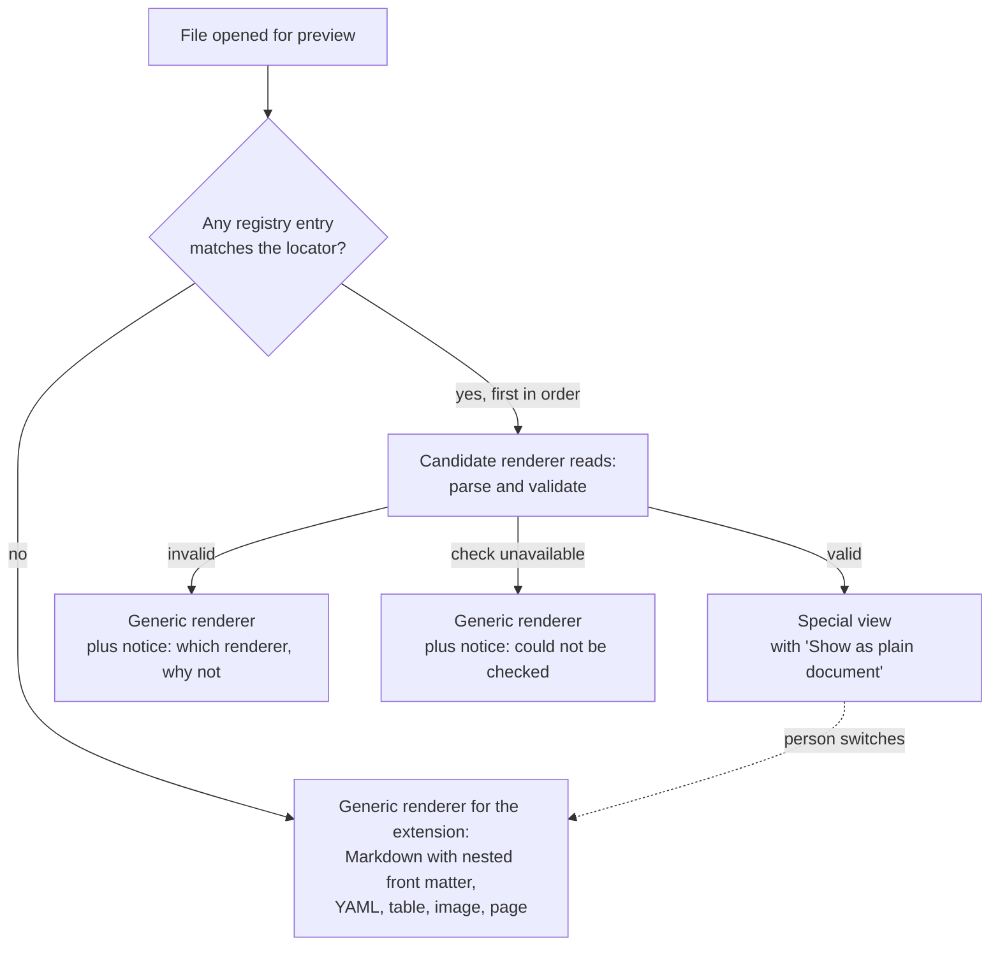
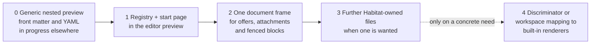
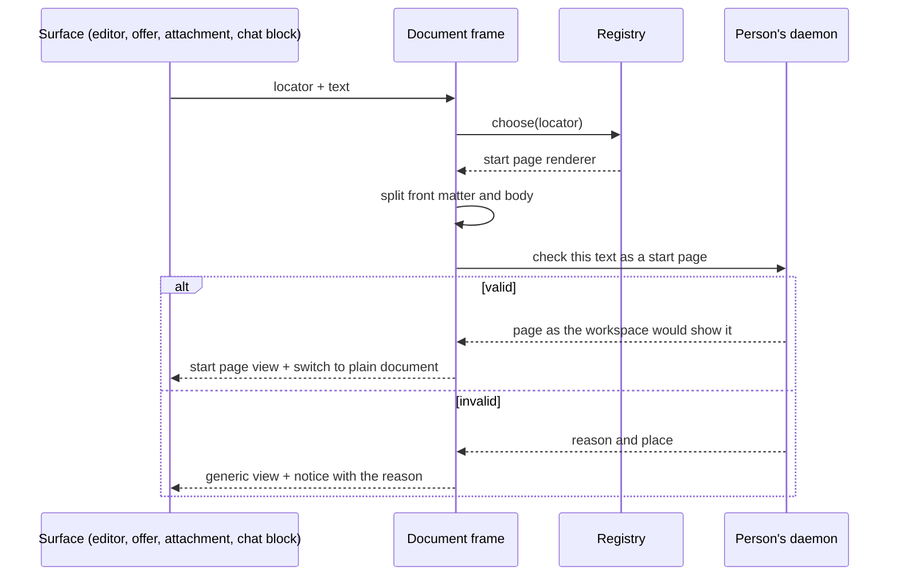

# Design: how a file gets its own preview renderer

## Saatesanat

Suositus: **selaimen paketissa oleva kiinteä luettelo tunnetuista
tiedostoista, valinta polun perusteella työtilan juuresta, ja kelpoisuus
daemonilta.** Aloitussivu on ensimmäinen ja toistaiseksi ainoa rivi.
Tiedosto tunnistetaan samalla säännöllä, jolla tuote antaa sille
merkityksen: daemon lukee vain polun `.agents/start-page.md`, joten
esikatselukin katsoo vain sitä. Jos erikoispiirtäjä ei kelpuuta sisältöä,
näytetään yleinen esikatselu ja kerrotaan syy. Repon tai taidon tuomaa
piirtäjäkoodia ei ajeta sovelluksen originissa koskaan; siihen tarpeeseen
on jo näkymät (ADR 0032). Sinulta tarvitaan viisi päätöstä (luku 7); tärkein
on, saako daemon uuden reitin, joka tarkistaa editorin puskurin samalla
jäsentimellä kuin tallennetun sivun. Toteutusta ei ole tehty.

## 1. What exists today

### Four surfaces, four selection rules

| Surface | Where it chooses | By what | What it knows about the file |
| --- | --- | --- | --- |
| Editor preview | `fileView()` in `web/src/components/editorPreview.ts`, used by `BrowserEditor.tsx` | file extension, a fixed list of four patterns (Markdown, CSV/TSV, SVG, HTML) | workspace-relative path, the live buffer |
| File offer panel | `usePreview()` in `AttachmentPreview.tsx`, called from `OfferPanel.tsx` | the `kind` the daemon froze into the offer (`contracts/v1/file-offer.schema.json`), then `previewKind()` for documents | a path inside the frozen offer, not in the workspace |
| Attachment dialog | `usePreview()` → `previewKind()` in `web/src/app/attachments.ts` | extension, confirmed by the first bytes (`%PDF-`, zip header, valid UTF-8 under 1 MiB) | a file name only |
| Chat Markdown | `MarkdownRenderer.tsx` | fence language: `mermaid` draws a diagram, `markdown`/`md` gets a preview toggle | nothing: text inside a message |

All Markdown ends in one component: `Markdown` → `MarkdownRenderer`, with
`document` set for a file (editor, `DocumentPreview.tsx`, the fenced-block
preview) and unset for a message. With `document`, `splitFrontmatter()`
(`frontmatter.ts`) takes the leading YAML block and `FrontmatterBlock` shows
its top-level keys; nested values stay YAML source. The body goes through
the sanitising schema whatever its origin.

Two things in this code are already the pattern this design generalises:

- **Mermaid** (`MermaidDiagram.tsx`): a marker nominates the content (the
  fence language), the renderer then has to succeed (`mermaid.parse`), a
  failure falls back to the ordinary code block, and the source is one
  click away under the diagram. The output never enters the DOM as markup:
  the SVG is shown as an image.
- **`previewKind()`**: the name nominates, the bytes confirm, and a
  mismatch means no document preview.

What is missing is a shared place. The editor's list, the offer kinds and
`previewKind()` each answer "what is this file" separately, and none of
them can say "this Markdown file is a start page".

### What Habitat knows about particular files

| File | Who gives it meaning | How it is identified | Reader |
| --- | --- | --- | --- |
| `.agents/start-page.md` | Habitat | fixed path at the workspace root; a regular file owned by the person, at most 32 KiB | `parseStartPageDocument` in `internal/daemon/start_page_linux.go`: strict known fields, limits per field. The browser gets the page or `state: needs_update`; the reason goes only to the daemon's diagnostics |
| `.open-habitat.yaml` | Habitat | fixed name at the workspace root | `configIcon` in `workspace_icon_linux.go`, reads `icon` only |
| `SKILL.md` | Pi (Agent Skills) | location in a skills directory; `name` in front matter | `skillDescription` in `skill_linux.go` reads `name` and `description` for the invocation card; Habitat also installs its own skills as `SKILL.md` |
| `AGENTS.md`, `CLAUDE.md` | the agent harnesses | file name | none in Habitat; ordinary Markdown |
| issue `item.md` | issuectl | `issues/<slug>/item.md`, issuectl front matter | none in Habitat |
| `OSS-RELEASE.md` | shipshape | file name, front matter | none in Habitat |

The start page is the only file whose **rendering** Habitat owns:
`WorkspaceIntro.tsx` and `StartHere.tsx` draw it from the daemon's reading.
The last three rows are other tools' formats that Habitat does not read at
all.

## 2. Selection

### The principle

**The preview recognises a file by the rule that gives the file its
meaning in the product.** The daemon reads the start page from one path
and nowhere else. A preview that also accepted a `kind: start-page` key
would show a page for a file the workspace never uses as one, and that
would be a second, different truth about what a start page is. The same
holds for `SKILL.md`: Pi finds skills by location.

### The options

| Option | For | Against |
| --- | --- | --- |
| **Path pattern** from a known root | matches how the daemon and Pi identify these files; no parsing needed to choose; cannot be triggered by content | needs a root: only the editor knows the workspace-relative path |
| **Front matter discriminator** (`kind`, `$schema`) | works without a path, so also in offers, attachments and chat | a new authored convention that every file must carry; for a path-identified file it creates the second truth above; none of today's known files has one |
| **Content sniffing** (the keys look like a start page) | no convention needed | guesses; an unrelated file with `title` and `goals` changes appearance; grows unpredictable with every added renderer |
| **Workspace-declared mapping** (`.open-habitat.yaml`: pattern → renderer) | lets a repository apply a built-in renderer to its own layout | a new configuration surface with no file yet that needs it; repository content changing how the app draws other files needs care even when it only picks among built-ins |

**Recommendation: path pattern, anchored to a root, as the only mechanism
now.** A discriminator is added later only for a Habitat-owned format that
has no fixed location, if one appears. No sniffing. No workspace mapping
until a concrete file needs one.

### The root is part of the match

The selection input is a locator, not a bare path:

- `workspace` + relative path: the editor.
- `offer` + path inside the offer: the file offer panel. An offer is a
  frozen copy; its path is relative to what was offered, so
  `start-page.md` inside an offered directory is not the workspace's start
  page.
- `none` + optional name: attachments and fenced blocks in chat.

A renderer states which roots it accepts. The start page accepts only
`workspace` with exactly `.agents/start-page.md`; a nested
`docs/.agents/start-page.md` does not match, as it does not for the daemon.
Elsewhere the same file gets the generic preview. What is consistent across
surfaces is the function that chooses, not that every surface finds a
special renderer.

### Precedence, conflicts and failure

Selection has two steps, as with Mermaid: **match** nominates cheaply,
**read** decides.

1. Registry order is precedence: exact path, then path pattern, then (later)
   discriminator, then the generic renderer for the extension. The registry
   is a short ordered list in one file, so a conflict between two special
   renderers is a visible ordering decision in code review, not something
   resolved at run time. The first match is the only candidate; a failed
   read does not try the next special renderer.
2. The candidate's `read` parses and validates. On success its view is
   shown.
3. On failure the generic renderer is shown with a notice above it that
   names the intended renderer and the reason: "This file is the
   workspace's start page, but it cannot be shown as one: goal 2 has no
   `prompt`." For the start page this notice is the most useful part of the
   preview, since for a saved page with the same fault the workspace is
   told only that the page needs updating, not why.
4. If the check itself is unavailable (the daemon cannot be reached), the
   generic renderer is shown with "could not be checked", never an
   optimistic special view.

## 3. Registration

### A. Static registry in the web bundle

One module lists the renderers; each entry's view is a lazily loaded
component, as `DocumentPreview` and Mermaid already are. Adding a renderer
is a code change with review.

This fits because a special renderer is React code built from the app's own
components (the start page view is `WorkspaceIntro`), and such code can
only come from the bundle. It adds no store, no route and no authority.

### B. Renderers contributed by the daemon

The daemon would serve a list of known files with schemas, and the browser
would draw them from a generic schema-driven form. Its attraction is one
truth for validity. Its cost is that a schema describes fields, not a page:
the start page view is a designed layout, so the layout would still live in
the bundle and the served list would be a second description of what the
bundle already contains.

The valuable part of B is narrower and worth taking: **the daemon is the
validator of the formats it reads.** For the start page that means a route
where the person's own daemon parses given text with
`parseStartPageDocument` and returns the page or the reason. This is not
new authority (the person's daemon reads text the person's browser sends
it), but it is a new route and a contract schema, and the reasons must
become precise enough to show ("goal 2, field `prompt`"), where today they
are coarse codes for the log.

### C. Renderers contributed by repositories or skills

A repository or a skill would ship code that draws its own file type. That
code would be arbitrary script from a repository, and the repository is not
trusted: it may be a clone of someone else's work, and agents write into
it. In the app origin such script holds the person's session: it can read
every conversation, call every route the person can, and start agents as
them. `web/AGENTS.md` already rules this out for the editor ("no
active-content preview or project-provided plugins"), and the Markdown
schema, the image-only SVG and the scriptless Word frame all exist for the
same reason.

Habitat already has the place where repository code may run: an HTML view
(ADR 0032) on its own per-view origin, sandboxed to scripts without
same-origin rights, with no network, opened by the person from an offer. A
repository that wants a rich presentation of its file has an agent offer a
view of it. A renderer mechanism that loaded repository code automatically
on file open would be a second, weaker door to the same thing: it would
remove the "person opens" step and need its own origin, handoff and CSP.

**So C is not built.** If a need for repository-defined presentation without
an agent appears, the acceptable shape is declarative only (the workspace
mapping of section 2, choosing among built-in renderers), and it gets its
own decision.

### Recommendation, phased

0. **Generic renderer** (the nested front matter and YAML preview being
   built now). It is the fallback every special renderer falls to, so it
   comes first.
1. **Registry and the start page, editor only.** `fileView()` grows from
   "extension → kind" into the choosing function over a locator; the
   registry has one special entry. The daemon gains the check route. The
   editor shows the special view, the notice on failure and the switch to
   the generic view. This is the smallest step that serves the start page,
   and the only one that touches the daemon and the contract.
2. **One document frame for all surfaces.** `DocumentPreview`'s Markdown
   branch and the fenced-block preview call the same frame as the editor,
   passing their locator. With `offer` and `none` roots nothing special
   matches yet, so nothing changes visibly; the gain is that the next
   renderer cannot be wired into one surface and forgotten in another.
3. **Further known files**, each a registry entry and a designed view:
   `SKILL.md` (name, description, then the body) and `.open-habitat.yaml`
   are the Habitat-side candidates. Each needs a reason of its own.
4. **Discriminator or workspace mapping**, only when a file exists that
   path matching cannot serve.

## 4. The renderer contract

A registry entry is four things:

- **`id` and label**: the name the notice and the switch use ("start
  page").
- **`match(locator)`**: synchronous, looks only at the root and the path.
  It never parses content, so choosing a candidate costs nothing and
  cannot depend on what an untrusted file says about itself.
- **`read(input, signal)`**: asynchronous; returns either a value for the
  view, or problems. A problem has a message and, where known, a place (a
  source line, or a path into the front matter such as `goals[1].prompt`).
  Being asynchronous lets it ask the daemon and lets a stale check be
  aborted when the buffer changes.
- **`View`**: a lazily loaded component that draws the value.

**Input**, prepared once by the frame so that renderers do not each split
the file: the locator, the full text, the parsed front matter (or the fact
that it did not parse), and the Markdown body.

**Output** is React elements made of the app's components. Authored text
reaches the page as text nodes or through `Markdown`, which sanitises; a
renderer never produces HTML strings and never inserts authored markup. A
renderer's code is ours and reviewed; its input stays untrusted, as
everything from the host is.

**A preview is inert.** The start page view shows goal cards, but pressing
one must not start a conversation from an unsaved buffer; in the preview it
moves to that goal's guide below, as in the prototype round.

**The frame owns what is common**, so every renderer and every surface gets
it the same way:

- the notice when the candidate declined, with its problems;
- the switch between the special view and the generic one. It is not
  remembered: a file opens in its special view each time. In the editor the
  existing text/preview toggle remains the way to the source, and a problem
  with a line opens the text there; on surfaces without a text view the
  generic renderer is the source view;
- loading and failure states, and size limits before any parsing (a file
  over the start page's 32 KiB is declined with that reason);
- scroll position between text and preview. Markdown maps headings to
  heights and tables carry `data-line`; a special view marks its sections
  with `data-line` the same way, and without marks the position maps
  proportionally.

## 5. What phase 1 changes, by component

- **Web**: the registry module and the frame; the start page view reusing
  `WorkspaceIntro`; texts for the notice and the switch in Finnish and
  English.
- **Contract**: a schema for the check request and reply in
  `contracts/v1/`, generated to Go and TypeScript.
- **Daemon**: a route beside `WorkspaceStartPagePath` that takes text of at
  most 32 KiB for an admitted workspace and returns what
  `parseStartPageDocument` makes of it; that function reports where it
  failed. It reads no file and writes nothing. Skill references are
  returned as authored, as in the file-only read.
- **Gateway, provision**: nothing.

The check validates content. It cannot see what the saved file will be on
disk (ownership, a symlink), which the daemon checks when it reads the real
page; the notice therefore says the content is valid, not that the
workspace shows it.

Because the route and schema are a daemon and contract change, the
implementation gets an independent review, and the rule from section 3C
("repository-provided renderer code never runs in the app origin; known
files are a static registry") moves into `web/AGENTS.md` with it.

## 6. What this design deliberately leaves out

- Special renderers for other tools' formats (issue `item.md`,
  `OSS-RELEASE.md`, `AGENTS.md`). The generic nested preview already makes
  their front matter readable, and drawing them as their tools mean them
  would make Habitat a second interpreter of formats it does not own.
- Editing through the preview. The preview reads; the text view writes.
- Any renderer state kept by the browser or the daemon.

## 7. Questions for Jari

1. **May the daemon get a check route for the start page?** Recommended:
   yes. The alternative is a copy of the daemon's rules in the browser,
   which will drift from `parseStartPageDocument`, or a preview without
   validity, which loses the most useful part. It is a new route and
   contract schema, no new authority.
2. **Is the start page recognised only in the editor, by workspace path?**
   Recommended: yes. In an offer or an attachment the same file shows as a
   plain document, because there it is a copy and not the workspace's
   page. The alternative, recognising it by file name plus a successful
   parse, is content sniffing under another name.
3. **Which view opens first when a file has a special renderer?**
   Recommended: the special view, with the plain document one press away
   and no remembered choice.
4. **Are other tools' formats out of scope?** Recommended: yes; only files
   whose meaning Habitat itself defines get a special renderer, and
   `SKILL.md` and `.open-habitat.yaml` wait until someone wants them.
5. **Is "repository or skill code never draws previews in the app; a rich
   presentation is an offered view" the rule?** Recommended: yes, written
   into `web/AGENTS.md` when phase 1 is built. A declarative workspace
   mapping to built-in renderers stays possible later and gets its own
   decision.
