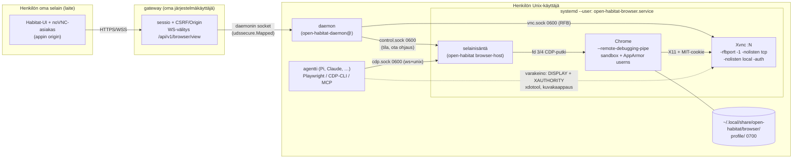

# Henkilön oma palvelinselain: ensin kirjautuminen etänäkymässä, sitten agentin käyttöön

Selvitys issueen `research-remote-browser-session`, 6.11.2026. Lähteet on
luettu 6.11.2026, ja kokeilu ajettiin samana päivänä Birchlla (Ubuntu 24.04.5,
aarch64). amd64:llä ei kokeiltu mitään; sen pakettitiedot ovat arkistosta.

## Tiivistelmä ja suositus

Suosittelen arkkitehtuuria, jossa **jokaisella henkilöllä on yksi oma selain
omassa systemd-käyttäjäyksikössään**, samaan tapaan kuin editori
(code-server) toimii nyt. Yksikössä on kolme prosessia, jotka kaikki ajetaan
henkilönä:

1. **Xvnc** (TigerVNC, Ubuntun `tigervnc-standalone-server`) on virtuaalinen
   näyttö ja VNC-palvelin yhdessä. Se kuuntelee VNC:tä vain `0600`
   Unix-socketissa (`-rfbunixpath`, `-rfbport -1`), ei TCP:ssä, ja X:ää
   MIT-evästeellä suojattuna ilman abstrakteja socketeja.
2. **Chrome** ajetaan sandbox päällä ja omalla profiilillaan henkilön kodissa.
   Se käynnistetään `--remote-debugging-pipe`-valitsimella, eli DevTools-portti
   ei avaudu lainkaan.
3. **Pieni selainisäntä** (`open-habitat`-binäärin uusi rooli, ajetaan henkilönä)
   omistaa Chromen debug-putken. Se tarjoaa sen agentille WebSocketina `0600`
   Unix-socketissa ja siivoaa CDP-tilan, kun asiakas lähtee. Lisäksi sillä on
   kytkin "ota ohjaus takaisin".

Henkilö avaa selaimen Habitatissa. Selaimessa on mukana **noVNC**-asiakas
(MPL-2.0, npm `@novnc/novnc` 1.7.0), joka avaa WebSocketin appin omaan
originiin. Gateway välittää sen henkilön daemonille samalla tavalla kuin
selainshellin nyt, ja daemon kytkee sen Xvnc:n Unix-socketiin. Etäsivu ei
koskaan aja koodia Habitatin originissa, koska selaimeen kulkee pelkkiä
pikseleitä. Siksi selain ei tarvitse editorin tapaan omaa originia.

Agentti käyttää samaa selainta tavallisilla CDP-työkaluilla (Playwright,
Puppeteer, `playwright-cli`, `chrome-devtools-mcp`) osoitteella
`ws+unix://$XDG_RUNTIME_DIR/open-habitat/browser/cdp.sock:/`. Pi saa sen
Habitatin toimittamana taitona, kuten Taskfleetin taidot nyt. Computer use
-tyyppinen kuvakaappaus ja hiiri toimivat varakeinona samalla näytöllä
(`xdotool`, X-kuvakaappaus) tai CDP:n kautta.

Valtuuksia ei siirry komponentilta toiselle. Gateway saa yhden uuden
WebSocket-välityksen, joka on samaa lajia kuin shellin. Daemon saa yhden uuden
lapsiyksikön, kuten editorin. Uusi isäntärooli ajetaan henkilönä eikä luota
keneenkään. Juurena tehtävä osa rajoittuu host applyyn: paketit ja tarvittaessa
AppArmor-profiili. Broker ei muutu.

Päätettäväksi jää viisi kysymystä (lopussa). Tärkein niistä on, mistä
Chrome tulee, koska selain on pidettävä ajan tasalla eikä sitä voi kiinnittää
versioon kuten muita komponentteja.

## Mitä kokeiltiin ja mitä se ratkaisi

Kokeilu tehtiin hakemistossa `/var/tmp/rbs-exp.*` (`mktemp -d`). Kaikki ajettiin
`timeout`in alla, ja lopuksi tarkistettiin, ettei mitään jäänyt käyntiin.
Skriptit ovat hakemistossa `experiment/`. Selaimena oli Playwrightin
Chromium-1243 (Chrome for Testing 153.0.8010.12, linux-arm64), näyttönä Xvfb.

| Kysymys | Tulos |
|---|---|
| Käynnistyykö headful Chrome sandboxilla Ubuntu 24.04:ssä ilman muuta? | **Ei.** `FATAL … No usable sandbox!`. Syy on `kernel.apparmor_restrict_unprivileged_userns=1` (Ubuntun oletus). |
| Auttaako polkukohtainen AppArmor-profiili, jossa on `userns,`? | **Kyllä.** Profiili ladattiin (`apparmor_parser -r`) ja poistettiin kokeen jälkeen (`-R`, `aa-status` 0 osumaa). Sandboxattu Chrome toimi. Ubuntun `apparmor`-paketti toimittaa valmiin samanlaisen profiilin polulle `/opt/google/chrome/chrome` (`/etc/apparmor.d/chrome`). |
| Toimiiko `--remote-debugging-pipe` Unix-socket-välittäjän kautta? | **Kyllä.** 40-rivinen Node-välittäjä (`experiment/broker.js`) omistaa putken (fd 3/4, NUL-erotellut JSON-viestit) ja tarjoaa WebSocketin `0600`-socketissa `0700`-hakemistossa. |
| Hyväksyykö Playwright `ws+unix://`-osoitteen? | **Kyllä.** `chromium.connectOverCDP('ws+unix:///…/cdp.sock:/…')` toimi (playwright-core 1.65.0). |
| Hyväksyykö Puppeteer, jota `chrome-devtools-mcp` käyttää, saman osoitteen? | **Kyllä.** Toimi sekä `browserWSEndpoint: 'ws+unix://…'` että oma transport (puppeteer-core 25.16.0). `chrome-devtools-mcp --wsEndpoint` -valitsinta itseään ei ajettu. |
| Voiko agentti irrottautua ja liittyä myöhemmin samaan selaimeen? | **Kyllä, kunhan välittäjä siivoaa.** Ilman siivousta toinen Playwright-yhteys näki tyhjän sivulistan: Chrome ei näe putken asiakkaan vaihtuvan, joten ensimmäisen asiakkaan CDP-istunnot ja `setAutoAttach` jäivät voimaan. Kun välittäjä lähetti irrottautumisen jälkeen `Target.detachFromTarget`-kutsut ja nollasi `setAutoAttach`/`setDiscoverTargets`-asetukset, toinen ja kolmas asiakas näkivät saman avoimen sivun. |
| Paljonko muistia kuluu? | Mitattiin cgroupista (`systemd-run --user`, `MemoryCurrent`): Xvfb ja Chrome joutilaana **235 MiB**, kolmella raskaalla välilehdellä (canvas-animaatio ja iso DOM) **543 MiB**. RSS-summa (1,5 GiB) liioittelee jaetun muistin takia. |
| Lisähavainto | Xvfb ilman `-auth`-valitsinta päästää jokaisen paikallisen käyttäjän X-näyttöön (Xserver(1), "GRANTING ACCESS"). Kokeen Xvfb ajettiin näin muutaman minuutin jaksoissa, ja ruudulla oli vain `data:`-sivuja. Tuotannossa evästetiedosto on pakollinen, ks. turvamalli. |

Avoimeksi jäi: Google Chromea, Xvnc:tä ja noVNC:tä ei asennettu eikä ajettu
(ks. kysymys 1). Evästeiden säilyminen uudelleenkäynnistyksen yli on Chromen
tavallista profiilikäytöstä, eikä sitä kokeiltu oikealla palvelulla, koska
Birchn ulosmeno on rajattu.

## Suositeltu arkkitehtuuri

### Prosessit ja socketit



Tekstinä:

```
selain ──WSS──▶ gateway ──(daemonin socket)──▶ daemon ──▶ $XDG_RUNTIME_DIR/open-habitat/browser/vnc.sock ──▶ Xvnc
                                                  └─────▶ …/browser/control.sock ──▶ selainisäntä ──fd3/4──▶ Chrome ──X11──▶ Xvnc
agentti (sama UID) ──────────────────────────────────────▶ …/browser/cdp.sock ─────┘
```

Kaikki socketit ovat hakemistossa `/run/user/<uid>/open-habitat/browser/`
(`0700`, sockettien tila `0600`). Toinen paikallinen käyttäjä ei pääse yhteenkään
niistä. TCP-portteja ei ole. Xvnc:n X-socket `/tmp/.X11-unix/X<N>` on
väistämättä yhteisessä hakemistossa, joten sen suojana on evästetiedosto,
ks. turvamalli.

### Kuka omistaa minkäkin valtuuden

| Komponentti | Saa | Ei saa koskaan |
|---|---|---|
| **gateway** | Todentaa selaimen, tarkistaa appin session sekä Origin/CSRF:n WebSocketin avauksessa ja välittää kehykset sidotun henkilön daemonille, kuten `terminal_linux.go` nyt. | Valita käyttäjää pyynnön kentästä, lukea profiilia, nähdä CDP:tä, pitää evästeitä tai tunnuksia. Kuvavirta kulkee sen läpi samaan tapaan kuin shellin teksti, mutta sitä ei tallenneta. |
| **daemon** | Käynnistää ja pysäyttää yksikön henkilönä (`systemd-run --user`, kun lingering on päällä, muuten lapsena kuten editori). Välittää RFB:n `vnc.sock`iin, lukee tilan `control.sock`ista ja välittää "ota ohjaus" -kytkimen. | Pitää omaa rekisteriä selaimista tai sivuista, välittää CDP:tä selaimelle, tallentaa kuvaa. |
| **selainisäntä** | Omistaa CDP-putken, tarjoaa sen henkilön omille prosesseille `cdp.sock`issa, siivoaa CDP-tilan asiakkaan lähtiessä, sallii yhden ohjaavan asiakkaan kerrallaan, kieltäytyy uusista asiakkaista, kun henkilö on ottanut ohjauksen, ja kertoo tilan. | Avata TCP:tä, kirjata URL-osoitteita tai sivusisältöä diagnostiikkaan, hallita tunnuksia. |
| **Chrome** | Pitää profiilinsa ja evästeensä henkilön kodissa omassa muodossaan. | Ajaa `--no-sandbox`- tai `--remote-debugging-port`-valitsimella. |
| **host apply (juuri)** | Asentaa Ubuntu-paketit (`tigervnc-standalone-server`, `xauth`, `xdotool`), Chromen ja tarvittaessa sen AppArmor-profiilin. | Käynnistää kenenkään selainta. Broker ei saa selaimeen liittyvää tehtävää. |

Daemonin nykyinen valtuus riittää tähän: se ajaa jo editorin ja shellin
henkilönä. Uusi isäntärooli on saman binäärin toinen pääkomento, joka
ajetaan henkilönä ja tarkistaa socketinsa itse, eli siirrettävää valtuutta ei
ole. Arkkitehtuurimuutoksiksi `internal/AGENTS.md`:n mielessä luen vain kaksi
asiaa: gatewayn uuden välitysreitin ja sen, ettei selain tarvitse omaa
originiaan. Molemmat on syytä kirjata päätökseen.

### Miksi oma originia ei tarvita (toisin kuin editorissa)

Editori sai oman originin, koska code-server ajaa laajennusten ja webviewien
koodia omassa originissaan, ja appin originissa se koodi voisi käyttää
appin sessiota. Etäselaimessa Habitatin sivulla ajetaan vain mukana tulevaa
noVNC-koodia. Etäsivu on toisen koneen pikseleitä, eikä sen HTML, skripti tai
eväste koskaan päädy Habitatin originiin. Etäpuolelta tulee kuvan lisäksi vain
leikepöydän teksti (RFB cut text), ja se käsitellään datana: se näytetään tai
kopioidaan vain henkilön omasta toimesta. Tämä on samalla syy suosia
pikselisiirtoa kaikkien niiden vaihtoehtojen sijaan, jotka toisivat etäsivun
DOMin Habitatin selaimeen.

## Agentin pääsy selaimeen

**Ensisijaisesti CDP.** CDP on rakenteinen ja tarkka: saavutettavuuspuu ja
Playwrightin aria-tilannekuvat, odotukset ja lomakkeet. Se on myös halvempi
kuin kuvakaappaukset. Agentin kannalta natiivi rajapinta on yksi socket ja yksi
osoite. Kaikki Node-pohjaiset työkalut, jotka käyttävät `ws`-kirjastoa,
hyväksyvät sen sellaisenaan (Playwright ja Puppeteer todettu kokeessa):

- **Pi**: Habitat toimittaa taidon, kuten Taskfleetin taidot tulevat
  laajennuksen kautta (`/opt/open-habitat/core/taskfleet/extension.mjs`).
  Taito kertoo osoitteen ja näyttää lyhyen Playwright-skriptimallin
  julkaisun omalla Nodella, tai vaihtoehtoisesti
  `playwright-cli attach --cdp=<osoite>` (Apache-2.0). Pi ei tarvitse
  MCP:tä.
- **MCP:tä osaavat agentit** (Claude Code, Codex):
  `chrome-devtools-mcp --wsEndpoint=ws+unix://…` tai Playwright MCP
  `--cdp-endpoint`. Molemmat ovat henkilön omaa konfiguraatiota, eikä
  Habitat kirjoita niitä.
- **Selaimen käynnistys agentin pyynnöstä**: agentti voi ajaa saman
  käynnistyksen itse (`open-habitat browser start` henkilönä, eli
  `systemd-run --user`). Agentin kuuntelijaan ei tarvita uutta reittiä,
  koska selain on henkilön oma.
- **Kun agentti tarvitsee henkilön kirjautumaan** (esim. MFA kesken työn):
  agentti kirjoittaa sen keskusteluun kuten minkä tahansa pyynnön, ja
  henkilö avaa etänäkymän. Jos keskusteluun halutaan oma kortti "avaa
  selain", se vaatii agentin kuuntelijaan uuden reitin. Se on erillinen,
  pieni päätös, joka kuuluu prototyyppikierrokselle
  (`proto-remote-browser-session`).

**Varakeinona computer use.** Kuvakaappaus ja hiiri tarvitaan siellä, minne
CDP ei ylety: selaimen omat dialogit (perus-HTTP-todennus, tiedostonvalitsin,
oikeuskyselyt), laajennusten ponnahdusikkunat ja canvas-sovellukset.
Samassa yksikössä on oikea X-näyttö, joten agentti käyttää sitä
`DISPLAY`- ja `XAUTHORITY`-muuttujilla (`xdotool`, X-kuvakaappaus).
Anthropicin referenssi käyttää samaa pinoa (Xvfb, x11vnc, xdotool) ja
suosittelee XGA-tarkkuutta (1024×768) kuvakaappauksiin. Näyttö kannattaa
siis asettaa noin 1280×800:ksi ja skaalata kuva työkalussa. CDP:n
`Page.captureScreenshot` ja `Input.dispatch*` riittävät sivun sisällä ilman
X:ää.

**Miksi ei `--remote-debugging-port`**: portti kuuntelee osoitteessa
`127.0.0.1` ilman todennusta, ja jokainen paikallinen käyttäjä ylettyy
siihen. Se antaisi täyden vallan kirjautuneeseen selaimeen ja sen
evästeisiin, ja se rikkoisi Unix-käyttäjärajan suoraan. Chrome 136 rajoitti
porttia samasta syystä: se ei toimi enää oletusprofiilin kanssa.

## Elinkaari ja resurssit

- **Käynnistys pyynnöstä**: henkilön "Avaa selain" tai agentin
  `browser start`. Tilan lukeminen ei käynnistä mitään, kuten Pi-sääntö
  sanoo keskusteluista.
- **Pysyy päällä etänäkymän sulkemisen jälkeen**, koska koko käyttötapaus
  on, että agentti jatkaa kirjautuneena.
- **Joutokäyntipysäytys**: kun yksikään CDP-asiakas tai katselija ei ole ollut
  kiinni määräaikaan (ehdotus 24 h, ylläpitäjän säädettävissä kuten
  editorin `idle_timeout_seconds`), selainisäntä sulkee Chromen hallitusti
  ja yksikkö päättyy. Kirjautumiset säilyvät pysyvinä evästeinä profiilissa.
  **Riski:** istuntoevästeet (ilman vanhenemisaikaa) katoavat Chromen
  sulkeutuessa, ellei Chrome palauta edellistä istuntoa. Palautus asetetaan
  profiiliin päälle (`session.restore_on_startup = 1`), jolloin Chrome
  palauttaa myös istuntoevästeet. Jotkin palvelut silti kirjaavat ulos, ja
  silloin agentti pyytää henkilöä kirjautumaan uudelleen.
- **Daemonin uudelleenkäynnistys ja päivitys**: lingering-tilassa yksikkö elää
  käyttäjämanagerissa ja säilyy, kuten editori ja shellit
  (`internal/AGENTS.md`: päivitys ei pysäytä henkilön käyttäjäyksiköitä).
  Ilman lingeringiä selain on daemonin lapsi ja päättyy sen mukana.
- **Uudelleenkäynnistys koneelle**: selain ei käynnisty itsestään. Se avataan
  seuraavalla pyynnöllä ja istunto palautetaan.
- **Muisti**: mitattuna 235 MiB joutilaana ja noin 0,5 GiB kolmella
  raskaalla välilehdellä, eli samaa luokkaa kuin editori (150 MiB – 0,8 GiB).
  Raja tulee henkilön `user-<uid>.slice`sta, jota operations.md kutsuu
  asiakkaan politiikaksi. Yksikköön `OOMPolicy=continue`, jotta yksittäisen
  renderöijän kaatuminen ei vie koko selainta (sama perustelu kuin
  editorilla).
- **Levy ja kiintiö**: profiili kodissa (`~/.local/share/open-habitat/browser/profile`,
  `0700`) kuluttaa henkilön kiintiötä. Välimuisti ohjataan hakemistoon
  `~/.cache/open-habitat/browser` ja rajataan valitsimella
  (`--disk-cache-size`, ehdotus 256 MiB). Täysi kiintiö kaataa Chromen
  profiilikirjoitukset, ja se näkyy henkilölle samalla viestillä kuin muutkin
  täyden levyn tilanteet.
- **Useampi selain**: ensimmäisessä versiossa yksi selain ja yksi profiili
  henkilöä kohti. Chromen `SingletonLock` estää jo valmiiksi kahden
  prosessin käytön samassa profiilissa. Myöhemmin nimetyt profiilit voivat
  olla nimettyjä yksiköitä (`open-habitat-browser@<nimi>`) ilman muuta
  muutosta.

## Turvamalli

**Mitä suojataan ja millä:**

- *Henkilöiden välillä*: jokainen socket on `0600` henkilön `0700`-runtime-hakemistossa.
  Xvnc:llä ei ole TCP:tä (`-rfbport -1`, `-nolisten tcp`) eikä abstrakteja
  X-socketteja (`-nolisten local`), koska abstrakteilla socketeilla ei ole
  tiedosto-oikeuksia. Jokaisella käynnistyksellä luodaan uusi
  MIT-MAGIC-COOKIE `0600`-tiedostoon runtime-hakemistossa (`-auth`). Ilman
  evästettä X päästää paikalliset käyttäjät sisään, ks. koe. Näyttönumeron
  valitsee Xvnc itse (`-displayfd`), jolloin kahden henkilön näytöt eivät
  törmää. `/proc` on jo valmiiksi `hidepid=invisible`, joten muiden prosessien
  komentorivit eivät näy.
- *Selaimen ja henkilön muun tilin välillä*: Chromen oma sandbox pysyy
  päällä. `--no-sandbox` tarkoittaisi, että yksikin renderöijähaavoittuvuus
  avoimessa verkossa antaa hyökkääjälle henkilön koko tilin. Ubuntu 24.04
  vaatii sandboxille AppArmor-profiilin, jossa on `userns`. Google Chromelle
  se tulee Ubuntun `apparmor`-paketissa, muulle Chromiumille host apply
  asentaa sen. SUID-apuohjelma `chrome-sandbox` on toinen tapa (Chromiumin
  dokumentaatio pitää sitä turvallisimpana).
- *Kirjautuneen profiilin evästeet ovat tunnuksia.* Ilman työpöydän
  avainrengasta Chrome käyttää Linuxilla perussalausta (`--password-store=basic`),
  joten evästetiedosto on käytännössä selväkielinen. Sen suojana on kodin
  `0700`, aivan kuten `gh`:n ja Pi:n tunnuksilla. Habitat ei lue, kopioi,
  välitä eikä varmuuskopioi niitä erikseen.

**Mitä ei suojata, ja se sanotaan henkilölle suoraan:** jokainen henkilön
oma prosessi pääsee `cdp.sock`iin ja profiiliin. Agentti, sen ajama skripti
tai sen asentama npm-paketti voi siis käyttää kaikkia selaimessa
kirjautuneita palveluita henkilön nimissä. Sama koskee jo nyt henkilön
`gh`-tunnusta. UI:n on sanottava se suoraan, kuten Omat koneet
-ominaisuudessa: agentti saa kaiken, mihin tämä selain on kirjautunut.
Palvelin näkee pyynnöt palvelimen IP-osoitteesta, mikä voi laukaista
palvelun lisävarmistuksia (palvelinkeskus- tai ISP-osoite).

**Mitä henkilö näkee ja miten hän ottaa ohjauksen:**

- *Livenä*: etänäkymä näyttää saman X-näytön, jota agentti käyttää, joten
  CDP:n tekemät klikkaukset ja navigoinnit näkyvät sellaisinaan. Selainisäntä
  tietää, onko CDP-asiakas kiinni, ja daemon näyttää sen merkkinä
  "agentti ohjaa selainta".
- *Jälkikäteen*: Chromen oma historia profiilissa on natiivi kirjanpito
  siitä, missä selain kävi. Habitat ei tee sille rinnakkaista lokia eikä
  tallenna kuvaa (ks. kysymys 4). Diagnostiikkaan kirjataan vain liittymiset
  ja irrottautumiset kiinteillä syillä, ei URL-osoitteita, koska ne
  voivat sisältää tunnuksia.
- *Ohjauksen ottaminen*: henkilön syöte etänäkymässä toimii aina. "Ota
  ohjaus" -kytkin pyytää selainisäntää katkaisemaan nykyisen CDP-asiakkaan
  ja kieltäytymään uusista, kunnes henkilö antaa luvan uudelleen. Agentti
  saa yhteysvirheen, jonka taito selittää: henkilö on ottanut ohjauksen.

**Mitä ei saa rakentaa:**

- jaettua selainta tai profiilia kahdelle henkilölle, tai selainta, joka
  ajetaan jonkun muun kuin henkilön itsensä UID:llä;
- Habitatin tunnusvälittäjää tai holvia, evästeiden vientiä palvelimelle,
  gatewaylle tai toiselle koneelle, tai evästeiden synkronointia;
- `--remote-debugging-port`-valitsinta, TCP-kuuntelijoita (VNC, X, websockify,
  KasmVNC:n web-palvelin) tai abstrakteja socketteja;
- `--no-sandbox`-valitsinta;
- Habitatin automaattista salasanan syöttöä. Kirjautumisen tekee henkilö itse
  etänäkymässä, mikä sopii yhteen säännön "palveluntarjoajan suostumus
  kuuluu henkilölle" kanssa;
- etäsivun sisällön tuomista Habitatin originiin.

## Vaihtoehdot ja hylkäysperusteet

### Näyttö ja etäkäyttö selaimeen

| Vaihtoehto | Paketit (noble amd64 + arm64) | Lisenssi | Sopivuus | Ratkaisu |
|---|---|---|---|---|
| **TigerVNC Xvnc + noVNC, daemonin välitys** | `tigervnc-standalone-server` 1.13.1 (universe, molemmat arkkitehtuurit). noVNC 1.7.0 mukaan web-pakettiin npm:stä; Ubuntun `novnc` 1.3.0 on vanha. | GPL-2.0 (erillinen ohjelma) / MPL-2.0 | Unix-socket ja `0600` suoraan (`-rfbunixpath`, `-rfbunixmode`). Ei TCP:tä. Kypsä. Viive ja kaista riittävät kirjautumiseen (Tight/ZRLE). Leikepöytänä teksti RFB:n kautta. Ääntä ei ole, mikä on tässä hyvä. Mobiilissa noVNC toimii kosketuksella, mutta näppäimistö on kömpelö. | **Suositus** |
| KasmVNC | Ei Ubuntun arkistossa. Upstreamin `.deb` noble/jammy amd64+arm64 (1.5.2, 24.10.2026). | GPL-2.0 | Paras kuva (WebP, H.264/AV1 WebCodecsilla, kaksisuuntainen leikepöytä). Sen oma web-asiakas puhuu sen omalle HTTP/WS-palvelimelle, joka kuuntelee TCP:tä omalla salasanallaan, eikä Unix-socketille kuuntelua löytynyt dokumentaatiosta. Se toisi toisen tunnuksen ja portin, johon muut paikalliset käyttäjät ylettyvät. | Hylätty v1:stä. Voi palata, jos WS-palvelimen saa Unix-socketille. |
| Xpra HTML5 | Ubuntun `xpra` 3.1.5 (2020) on vanhentunut. Upstream 6.5.6 tulee omasta repostaan. | GPL-2.0 | Unix-socketit onnistuvat, mutta oletuksena se luo myös abstrakteja socketteja, joilla ei ole oikeuksia. Raskas Python-pino. | Hylätty |
| Selkies | Ei arkistossa, kontti- ja GPU-keskeinen | MPL-2.0 | WebSocket on oletus, WebRTC valinnainen. Painopiste pelattavassa työpöydässä. README pyytää ylläpitäjiä. | Hylätty: liian raskas kirjautumissivuille |
| Neko | Docker-ensisijainen | Apache-2.0 | WebRTC vaatii UDP:n ja TURNin, mikä ei mahdu gatewayn HTTPS/WS-reitille (Cloudflare-tunneli). | Hylätty. Hyvä vertailukohta ohjauksen luovutukselle. |
| Wayland: `cage` + `wayvnc` | `cage` 0.1.5, `wayvnc` 0.7.2 (`--unix-socket`) | MIT / ISC | Toimiva. Computer use -työkalut ovat kuitenkin heikommat (ei xdotoolia), ja Chrome tarvitsee Ozone/Wayland-polun GPU:ttomassa palvelimessa. | Varavaihtoehto, jos X:stä luovutaan |
| Headless Chrome + CDP-screencast omaan katselimeen | ei näyttöpalvelinta | – | Selaimen omat dialogit (HTTP-todennus, tiedostonvalitsin, oikeuskyselyt, passkey-ikkunat) eivät näy. Katselin pitäisi rakentaa ja ylläpitää itse, mikä on vastoin kypsien komponenttien periaatetta. Headless-tunnistus lisää botti- ja captcha-kitkaa juuri kirjautumisessa. | Hylätty |
| Xvfb + x11vnc + websockify (Anthropicin referenssi) | kaikki arkistossa | GPL / LGPL | Kolme prosessia yhden sijaan. Noblen websockify 0.10.0:ssa ei ole `--unix-listen`-valitsinta (tuli myöhemmin), joten daemon tekisi sen työn joka tapauksessa. | Hylätty: Xvnc tekee saman yhdellä prosessilla |

Noblen versiot tarkistettiin `apt-cache policy`:llä arm64:llä ja
packages.ubuntu.com-sivuilta molemmille arkkitehtuureille. Kaikki yllä
mainitut Ubuntu-paketit ovat universessa ja rakennettu sekä amd64:lle että
arm64:lle.

### Agentin CDP-pääsy

| Tapa | Ratkaisu |
|---|---|
| `--remote-debugging-port` localhostissa | Hylätty: kaikki paikalliset käyttäjät ylettyvät siihen, eikä todennusta ole. |
| Portti + iptablesin `owner`-sääntö | Hylätty: juuren porttikohtaiset säännöt jokaiselle henkilölle ja hauras tila. |
| Portti omassa verkkonimiavaruudessa | Hylätty: Chrome tarvitsee ulosmenon. Käyttäjäyksikön `PrivateNetwork` vaatii user namespacet, ja Ubuntun AppArmor-rajoitus koskee niitä. |
| `--remote-debugging-pipe` + oma Unix-socket-välittäjä | **Suositus.** Todettu toimivaksi. Ehtona on CDP-tilan siivous asiakkaan lähtiessä ja yksi ohjaaja kerrallaan. |
| Agentti käynnistää oman selaimen (Playwright `launchPersistentContext`, putki) samalla profiililla | Hylätty pääratkaisuksi: henkilön etänäkymä ja agentti eivät voisi käyttää samaa käynnissä olevaa selainta, ja `SingletonLock` estää rinnakkaisen käytön. |

### Mistä Chrome tulee

| Vaihtoehto | Plussat | Miinukset |
|---|---|---|
| **Google Chrome stable Googlen apt-reposta** | Oikea Chrome, jota palvelut odottavat, joten kirjautumisessa vähemmän kitkaa. amd64 ja arm64 (arm64 30.7.2026 alkaen). Ubuntun `apparmor` sisältää valmiin userns-profiilin. SUID-sandbox mukana. Päivittyy aptilla. `chrome-devtools-mcp` tukee virallisesti. | Ei-Ubuntun paketti, joka päivittyy kiinnittämättä. Tämä on poikkeus säännöstä "ei-Ubuntu-komponentit ovat kiinnitettyjä arkistoja". Googlen käyttöehdot: Habitat ei saa jakaa sitä itse, vaan operaattori asentaa sen. |
| Kiinnitetty Chrome for Testing / Playwrightin Chromium -arkisto | Sopii nykyiseen kiinnitysmalliin, toimii molemmilla arkkitehtuureilla (koe ajettiin arm64-buildilla). | Selain, jolla avataan avoin verkko, vanhenee tietoturvan kannalta päivissä, joten kiinnitys vaatisi jatkuvan julkaisutahdin. Ei SUID-sandboxia, joten oma AppArmor-profiili tarvitaan. |
| Ubuntun Chromium-snap | Ubuntun oma, päivittyy, oma AppArmor. | Snapin päivitys pysäyttää käynnissä olevan selaimen, eikä snapin toimintaa monen käyttäjän palvelimella (kotien polut, `--user-data-dir`, putki) ole todettu. |

## Olemassa olevat tuotteet vertailuksi

| Tuote | Mitä se on | Käyttö natiivikomponenttina |
|---|---|---|
| Browserbase, Browserless (SSPL-1.0 tai kaupallinen), Steel (`steel-browser`, Apache-2.0, beta) | Pilvi- tai konttiselaimia agenteille: CDP-WS, live-katselu, istuntojen tallennus | Ei sovi: ne ovat palveluja tai kontteja, joissa on oma todennus ja oma istuntorekisteri, ja Browserlessin SSPL estää uudelleenjakelun. Ideat (live view, ohjauksen luovutus) ovat hyödyllisiä prototyypille. |
| Anthropicin computer use -referenssi | Kontti: Xvfb, x11vnc, noVNC, xdotool | Pino on sama kuin tässä suositeltu (Xvnc korvaa Xvfb:n ja x11vnc:n). Sen varoitukset koskevat tätäkin: kehotteiden injektio verkkosivuilta ja ihmisen vahvistus merkittäville teoille. |
| Kasm Workspaces | Kaupallinen tai community-konttityöpöytäalusta KasmVNC:n päällä | Ei sovi: oma käyttäjä- ja istuntohallinta rinnakkain Unix-käyttäjien kanssa. |
| Neko (Apache-2.0) | Jaettu virtuaaliselain WebRTC:llä | Ei sovi kuljetuksen vuoksi, ks. yllä. |
| `chrome-devtools-mcp` (Apache-2.0, 1.12.0), Playwright MCP (Apache-2.0), `playwright-cli`, `agent-browser` (Apache-2.0) | Agenttien CDP-työkalut | **Kyllä**, sellaisenaan henkilön omina työkaluina. Ne liitetään `ws+unix`-osoitteeseen. `agent-browser` on Rust-ohjelma, eikä sen `ws+unix`-tukea ole todettu. |

## Riskit

1. **Chromen päivitykset.** Kiinnitys ja tietoturva ovat ristiriidassa
   (kysymys 1). Väärä valinta tarkoittaa joko vanhaa selainta avoimessa
   verkossa tai kiinnittämätöntä pakettia.
2. **Uloskirjautuminen pysäytyksessä.** Istuntoevästeet ja palvelujen omat
   aikakatkaisut voivat kirjata ulos. Istunnon palautus lieventää, mutta ei
   takaa.
3. **Kehotteiden injektio.** Kirjautuneessa selaimessa verkkosivun teksti voi
   ohjata agenttia toimimaan henkilön nimissä. Agentin kirjoittama teksti on
   dataa eikä hyväksyntää, kuten repositorion ja sähköpostin teksti jo nyt,
   mutta selain laajentaa sitä, mihin agentti pystyy.
4. **CDP-tilan vuoto asiakkaiden välillä.** Jos välittäjä siivoaa huonosti,
   seuraava asiakas näkee väärän tilan tai jää jumiin. Kokeessa ilmiö
   todettiin ja korjattiin. Toteutukseen tarvitaan testi, joka kytkeytyy
   uudelleen useita kertoja.
5. **Palvelujen epäluulo palvelinosoitteita kohtaan.** Kirjautumisesta voi
   tulla captcha- tai MFA-kierre, kun selain toimii palvelinkeskuksen tai
   ISPin osoitteesta.
6. **Muisti monen henkilön palvelimella.** Noin 0,25–0,6 GiB jokaista
   käynnissä olevaa selainta kohti. Joutokäyntipysäytys ja slice-rajat ovat
   operaattorin työkalut.

## Kysymykset Jarille

1. **Mistä Chrome tulee?** Suosittelen Google Chrome stablea Googlen
   apt-reposta ja kirjattua poikkeusta kiinnityssääntöön: selaimen on
   päivityttävä, ja oikealla Chromella kirjautuminen onnistuu parhaiten.
   Vaihtoehtoina kiinnitetty Chrome for Testing omalla julkaisutahdilla tai
   Chromium-snap.
2. **Kuinka kauan selain pysyy päällä ilman käyttöä?** Suosittelen
   pysäytystä 24 tunnin kuluttua viimeisestä katselijasta tai agentista,
   istunnon palautuksella. Vaihtoehto on, että se on päällä, kunnes henkilö
   sulkee sen.
3. **Saako agentti käyttää selainta kysymättä, kun se on käynnissä?**
   Suosittelen kyllä: näkyvä "agentti ohjaa" -merkki ja "ota ohjaus"
   -kytkin, eikä erillistä hyväksyntää jokaiseen käyttöön. Tämä sopii
   linjaan "selainvahvistusten joukko on tyhjä".
4. **Riittääkö jälkikäteiseen seurantaan Chromen oma historia?**
   Suosittelen, ettei ensimmäisessä versiossa ole kuvatallennetta, vaan live-
   näkymä ja Chromen historia. Tallenne olisi uusi tallennuspaikka henkilön
   kotiin ja kasvattaisi kiintiötä.
5. **Hyväksytkö etäkäyttöpinoksi TigerVNC Xvnc:n ja mukaan paketoidun
   noVNC:n, välitettynä appin originissa ilman omaa originia?** Suosittelen
   tätä: kypsä, Ubuntun paketti, Unix-socket suoraan. KasmVNC:n parempi kuva
   ei korvaa sen omaa TCP-palvelinta ja salasanaa.

## Lähteet (luettu 6.11.2026)

- Chromium: *AppArmor User Namespace Restrictions*,
  https://chromium.googlesource.com/chromium/src/+/main/docs/security/apparmor-userns-restrictions.md
- Chrome for Developers: *Changes to remote debugging switches to improve security* (Chrome 136),
  https://developer.chrome.com/blog/remote-debugging-port
- Google Chrome arm64 Linux: OMG! Ubuntu 7/2026, https://www.omgubuntu.co.uk/2026/07/chrome-arm64-linux-available ;
  Linuxiac, https://linuxiac.com/google-chrome-quietly-arrives-on-arm64-linux/ ;
  VideoCardz (ennakkoilmoitus), https://videocardz.com/newz/google-will-finally-release-chrome-for-arm64-linux-in-q2-2026
- Playwright `BrowserType.connectOverCDP` (alempi tarkkuus kuin `connect`),
  https://playwright.dev/docs/api/class-browsertype ; selaimet: https://playwright.dev/docs/browsers
- `chrome-devtools-mcp`: README, `docs/configuration.md` (`--wsEndpoint`, `--browserUrl`, `--autoConnect`),
  `docs/advanced-usage.md`, https://github.com/ChromeDevTools/chrome-devtools-mcp
- Playwright MCP `--cdp-endpoint`: `npx @playwright/mcp@latest --help` (ajettu 6.11.2026),
  https://github.com/microsoft/playwright-mcp ; `playwright-cli attach --cdp`, https://github.com/microsoft/playwright-cli
- `agent-browser`, https://github.com/vercel-labs/agent-browser
- TigerVNC `Xvnc.man` (`-rfbunixpath`, `-rfbunixmode`, `-SecurityTypes`), https://github.com/TigerVNC/tigervnc
- Xserver(1), "GRANTING ACCESS" (oletuksena paikallinen kone sallittu ilman `-auth`-valitsinta), `man Xserver` Ubuntu 24.04
- noVNC (MPL-2.0), https://github.com/novnc/noVNC ; npm `@novnc/novnc` 1.7.0
- websockify (`--unix-listen` puuttuu tagista v0.10.0), https://github.com/novnc/websockify
- KasmVNC 1.5.2 ja sen noble-paketit, `kasmvnc_defaults.yaml`, https://github.com/kasmtech/KasmVNC
- Xpra verkko-ohjeet (Unix- ja abstraktit socketit), https://github.com/Xpra-org/xpra/blob/master/docs/Network/README.md ;
  Ubuntun paketti https://packages.ubuntu.com/noble/xpra
- wayvnc `wayvnc.scd` (v0.7.2: `--unix-socket`), https://github.com/any1/wayvnc
- Selkies (MPL-2.0, WebSocket oletuksena), https://github.com/selkies-project/selkies
- Neko (Apache-2.0, WebRTC), https://github.com/m1k1o/neko
- Anthropic computer use -referenssi, https://github.com/anthropics/claude-quickstarts/tree/main/computer-use-demo
- Browserless LICENSE (SSPL-1.0 tai kaupallinen), https://github.com/browserless/browserless ;
  Steel, https://github.com/steel-dev/steel-browser
- Ubuntu 24.04 `apt-cache policy` (arm64, Birch) ja `/etc/apparmor.d/chrome` (paketti `apparmor`)
- Tämä repositorio: `internal/AGENTS.md`, `internal/daemon/editor_linux.go`, `internal/gateway/editor_linux.go`,
  `internal/gateway/terminal_linux.go`, `docs/operations.md` (editori, Taskfleetin taidot, käyttäjäslicet, `/proc`)
