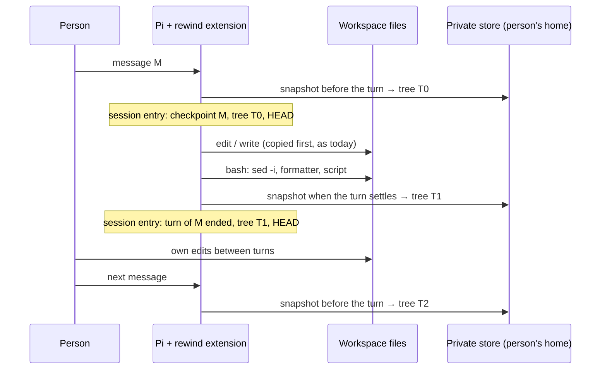
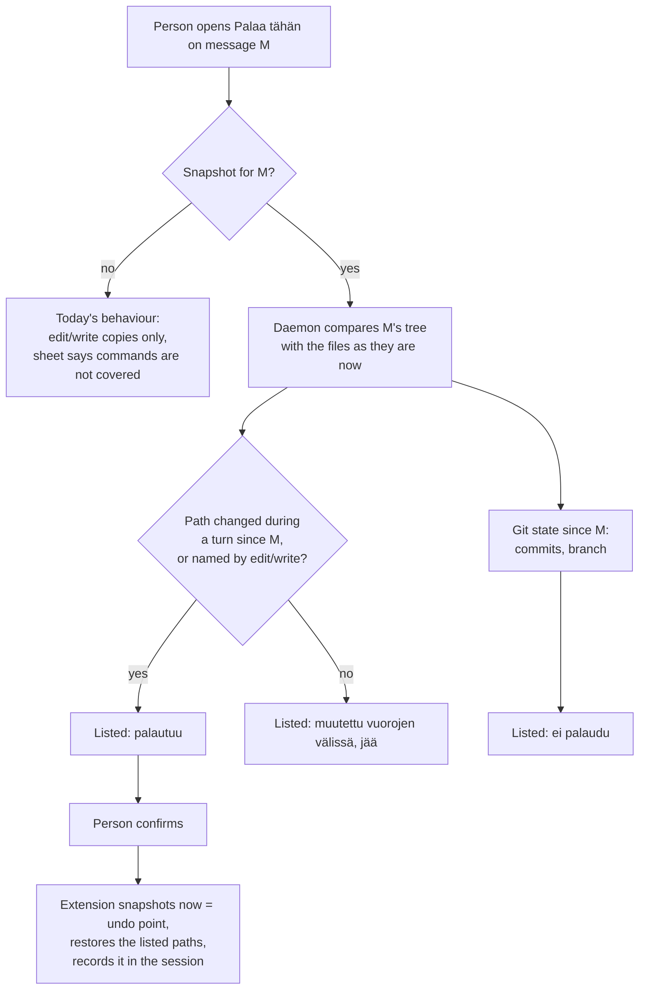

# Design: Palaa tähän restores what the agent changed, whatever tool it used

> **Saatesanat (Jarille)**
>
> Mitään ei ole toteutettu; tämä on suunnitelma ja pieni prototyyppikierros.
> **Suositus:** vuoron alussa ja lopussa työtilan työpuusta otetaan tilannekuva
> keskustelun omaan, yksityiseen Git-säilöön kodissasi; työtilan omaan repoon
> ei kirjoiteta. Mitattuna se vie tämän repon kloonissa noin 5 ms ja 100 000
> tiedoston repossa noin 50 ms. Palautus kattaa silloin myös komentojen,
> skriptien, `sed -i`:n ja formatoijien muutokset, poistot ja uudet tiedostot.
> **Ei palaudu, ja arkki sanoo sen:** Gitin oma tila (commitit, haara, stash),
> `.gitignore`n ohittamat tiedostot ja työtilan ulkopuoli. Tiedostojärjestelmän
> tilannekuvat eivät käy: koneissa on ext4, ei reflinkiä eikä overlayta ilman
> rootia.
> **Sinulta tarvitaan:** vastaus lopun neljään kysymykseen (kussakin suositus)
> ja suunta kierroksesta `2026-11-15-rewind-all-changes`.

## The problem

Palaa tähän copies a file only when Pi's `edit` or `write` tool is about to
change it. Anything the agent changes another way (a shell command, a script,
`sed -i`, a formatter, a code generator, `git checkout`) is never copied, so
returning to a message leaves those changes in place. The sheet says so in one
line (*Vain komennoilla muutetut tiedostot jäävät ennalleen*) and lists up to
five commands, but it cannot say which files they changed, and agents do a
large share of their work through the shell.

## How it works today

All of it is in `internal/daemon/rewind-extension.mjs` (the daemon's own Pi
extension, adapted from better-pi-rewind) and `internal/daemon/rewind_linux.go`
(the daemon's read side).

- **Capture.** When the agent starts answering a person's message
  (`message_start` of the first assistant message), the extension copies every
  file *tracked so far in this conversation* and appends a `snapshot` record
  (`oh-rewind-checkpoint`) to the Pi session. A file becomes tracked only in
  `tool_call` for `edit` or `write`: the paths are parsed from the tool input
  and copied before the tool runs (an `update` record). A `bash` call passes
  through the same hook and is ignored.
- **Copies** are whole files named by content hash under
  `~/.pi/agent/file-history/<session>/`. A missing file is recorded as
  "did not exist", which is how a restore removes what the agent created.
- **Restore** copies the current state of the tracked files first (the undo
  point), then puts each tracked path back to its version at the chosen
  message: whole files, written to a temporary name and renamed, never
  through a symlink. Later edits by anyone in those files are replaced; the
  sheet says so (decided 14.11.2026).
- **Preview.** The daemon reads the session file and the copies, compares
  them with the files as they are now and returns the list with line counts.
  It collects the `bash` commands of the continuation only as text.
- **Commits** (decided 7.11.2026): a restore never writes Git history. The
  preview marks a file *commitoitu* when `git log --since=<message time>`
  finds a commit on HEAD that changed it.
- The daemon writes neither the session nor the files; it asks the extension
  through `/oh-rewind`. Nothing is captured unless the experimental switch is
  on.

So the gap is exactly the tracked set: it grows only from `edit`/`write`
inputs.

## What "the right way" has to do

1. Capture a change without knowing in advance which file will change. A
   shell command does not announce its writes.
2. Have the *before* content. Detecting a change afterwards (mtime, inotify)
   is not enough to restore it.
3. Cost little enough to run on every turn of every conversation.
4. Not become a second place where the truth about the person's work lives,
   and not write into the person's repository.
5. Stay inside the person's own Unix user: no root helper, no new authority.

## Candidate approaches

Measured on this host class (Ubuntu 24.04, Git 2.43, ext4 for both `/home` and
`/var`), on a scratch clone of this repository (4 328 tracked files; with
`web/node_modules` 39 310 files, 812 MiB) and on a synthetic repository of
100 000 files (399 MiB). No real workspace was touched.

### A. Working-tree snapshot into a private Git store (recommended)

A bare Git repository per conversation, next to today's copies
(`~/.pi/agent/file-history/<session>/tree.git`). A snapshot is
`git add -A` followed by `git write-tree`, run with `GIT_DIR` pointing at the
private store and `GIT_WORK_TREE` at the workspace. The result is one tree
id; comparing two tree ids (`git diff-tree`) says exactly which files were
created, changed, deleted or changed mode between them.

Two things make it cheap. The store's `objects/info/alternates` points at the
workspace repository's object directory, so content the repository already
has is not stored again. And the store's index starts as a copy of the
workspace's index, so Git's stat cache is warm and only files that differ are
read.

| | this repository | 100 000 files |
|---|---|---|
| `git status` in the workspace, for scale | 5 ms | 46 ms |
| first snapshot (alternates + seeded index) | 5 ms, 0.6 MiB | 54 ms, 8.6 MiB (the index) |
| next snapshot, nothing changed | 5 ms | 53 ms |
| snapshot after a shell changed files | 58 ms (9 paths, one a 3 MB binary) | 95 ms (`sed -i` on 200 files), +1.4 MiB |
| compare two snapshots | not measured | 4 ms |
| first snapshot with a cold index | 83 ms | 901 ms |
| first snapshot without alternates | 499 ms, 28 MiB | 4 409 ms, 417 MiB |
| preview against the files as they are now, no store write | 9 ms | not measured |
| restore of 12 changed paths, then verify | 16 ms, tree identical | not measured |

What the experiment showed it captures: `sed -i` edits, a `git mv` rename
(seen as rename, 100 %), a deletion, a new directory with a file, a 3 MB
binary, a mode change (`chmod -x`), a symlink (stored as a link, not
followed) and an untracked file that `.gitignore` does not cover. After
restoring only the paths that differ, a new snapshot had the same tree id as
the target, and undoing gave back the tree id from before the restore.

What it does not capture:

- **Ignored files.** `web/node_modules/.touched` was not in the snapshot and
  survived the restore. That is what keeps the cost flat (the 761 MiB of
  `node_modules` cost nothing), and it is also the limit: build output,
  caches and an ignored `.env` are not restored.
- **Git's own state.** The workspace's `.git` is never read into the
  snapshot and never written: its file list, sizes and times were identical
  before and after a snapshot, and a snapshot succeeded while the workspace's
  `index.lock` was held, so it does not collide with the agent's own Git
  commands. Consequences seen in the experiment: after an agent commit the
  tree diff shows the file and HEAD has moved one commit; after the agent
  checked out an older commit on a new branch the diff showed 145 files;
  after `git stash` the files are back at HEAD while the stash holds the
  change; and after the restore the workspace's own index still held the
  staged `git mv`.
- **Nested repositories.** A repository inside the workspace is recorded as
  one link entry (mode 160000); an edit inside it was not seen.
- **Outside the workspace**: other repositories the agent `cd`s into, the
  rest of the home directory, `/tmp`, installed packages.
- **A directory that is not a repository** works (the snapshot was taken and
  compared), but with no `.gitignore` everything is captured, including a
  `node_modules` blob, until the store has its own exclude list.

Concurrency. A snapshot is the state of the tree at one moment, so the
difference between two snapshots cannot say *who* changed a file. Taking a
snapshot at the start and at the end of each turn separates three periods, as
the experiment showed: a file the agent changed in turn 1, files the person
changed between the turns, a file the agent changed in turn 2. A change made
by the person or by another conversation *during* a turn in the same
directory is counted as the agent's. Workers run in their own worktrees,
which are outside the workspace's tree, so their edits do not appear until
they are merged in.

Risk worth knowing: with alternates, the store depends on the workspace
repository keeping its objects. Content that was committed stays. Content
that was only staged, or commits that are later rewritten away, can be pruned
by the repository's own `git gc` after its two-week grace period; a restore of
such a file then reports it as not restorable, as a missing copy does today.

### B. The workspace's own repository (`git stash create`, a hidden ref)

Pi's example extension `git-checkpoint.ts` does this. Tested:
`git stash create` captured the modified tracked file and none of the
untracked ones (it has no untracked option; `-u` was silently taken as the
message), and it wrote 18 loose objects into the workspace's `.git`. Keeping
them alive needs a ref in the person's repository, visible to
`for-each-ref`, mirror pushes and other tools, and it needs the workspace's
index lock, which the agent's own Git commands also take. It is approach A
with the store in the wrong place.

### C. Filesystem snapshot (btrfs, overlay, reflink, full copy)

- Every filesystem on the hosts examined is ext4. The `btrfs` tool is
  installed, but there is no btrfs filesystem to snapshot.
- `cp --reflink=always` fails on ext4 with *Operation not supported*.
- A full copy of the 100 000-file tree took 2.2 s and 878 MiB per snapshot;
  copying this repository's `node_modules` alone took 3.2 s and 761 MiB.
- An overlay needs a mount. Unprivileged user namespaces are blocked on
  Ubuntu 24.04 (`apparmor_restrict_unprivileged_userns=1`; `unshare -Ur`
  failed), so it would need the root broker, and the agent would have to run
  inside the overlay instead of in the person's real directory. That moves
  authority and breaks "the same native session as over SSH".

It would be the only approach that also restores ignored files, but it is not
available on these hosts without changing the storage layout of every
installation.

### D. Watching or tracing the shell

- **mtime scan** (`find -newer`): 107 ms over 100 000 files. It names files
  changed since a stamp, misses deletions without a manifest, and has no
  earlier content. A manifest with content is approach A.
- **inotify**: 2 101 directories to watch in the synthetic tree and 3 767 in
  this repository with `node_modules` (limit 249 243 per user). Events arrive
  after the write, so there is nothing left to copy.
- **fanotify permission events** would deliver the event before the write,
  but need `CAP_SYS_ADMIN`: a root component watching a person's files.
- **strace/ptrace** of the bash tool sees each open before it happens. A loop
  of 200 `sed -i` runs went from 77 ms to 1 726 ms under `strace -f`, and a
  process that detaches escapes it.
- **Parsing the command text** for paths cannot see what a script or a
  formatter writes.

On their own these can at best *list* what a restore will not undo.

### E. Diffing the tree around every tool call in the Pi extension

This is not a separate store but a question of *when* approach A runs. Pi
gives the hooks: `tool_call` (before execution, may wait), `tool_result`
(after), `user_bash` for the person's own `!` commands, `agent_settled` for
the end of a turn. Snapshots around each `bash` call would attribute a change
to one command, at about one `git status` per call (5 to 50 ms). Parallel
tool calls overlap, and a background process the agent started keeps writing
after the call returns, so the per-call windows are good for *labels* but the
turn's window is the safer boundary for *what restores*.

## Recommendation

Approach A, taken at turn boundaries by the existing extension, with today's
per-file copies kept beside it.

- The extension runs inside the person's Pi as the person; the store is in
  the person's home; the daemon keeps only reading. No authority moves and no
  new service or registry appears: the store is Git's own format, and the
  record of which tree belongs to which message is a custom entry in the Pi
  session, as today.
- Git is run with the store's own configuration, so the workspace
  repository's own `.git/config` is never read; hooks do not run on `add` or
  `write-tree`; `core.fsmonitor` is off.
- Today's copies stay for `edit`/`write`, because they cover what a snapshot
  does not: an ignored file the agent edited directly (`.env`) and a file
  outside the workspace. What restores is the union.
- The restore keeps its present rules (undo point first, whole files, a
  temporary name and a rename, never through a symlink); only the source of
  the earlier content changes from a copy to a blob in the store.

What a restore to before message M covers (the recommended rule, question 1
below): the paths that changed inside one of this conversation's turns from M
onward, or that an `edit`/`write` named. Each goes back whole to its content
in M's snapshot. A path that changed only between turns is somebody else's
and stays; the sheet lists it.

### Phases

1. **Turn snapshots in Git workspaces.** The extension snapshots at the
   start and the settle of each turn and records the tree ids; the preview
   lists every changed path from the trees; the restore covers them. A
   workspace that is not a repository, or whose first snapshot exceeds a time
   budget, keeps today's behaviour and the sheet says which case it is. This
   alone closes the reported gap for the common case.
2. **Git state named exactly.** Each snapshot also records HEAD (branch and
   commit). The preview then counts the commits made since the message
   exactly (replacing the `--since` time heuristic and its known false
   positive) and says when the branch changed. Nested repositories found in
   the tree get their own snapshot.
3. **Plain folders.** Workspaces without Git get the same snapshot with a
   built-in exclude list and a size budget (question 4).
4. **Per-command labels.** Snapshots around `bash` calls and `user_bash`
   label a file with the command that changed it. The same data is the exact
   source the *Muutokset* line under a turn was left waiting for.

## What changes for the person

In the sheet, under **Tiedostot**:

- The count is all files that go back, not only those the edit tools
  touched: *7 tiedostoa palautuu*. In the list a file changed by a command
  rather than an edit carries the tag *komento*.
- The line *Vain komennoilla muutetut tiedostot jäävät ennalleen* and the
  list of commands that "stay" disappear when a snapshot exists. They remain
  only for messages from before snapshots, and for workspaces without one.
- Files changed only between turns are listed as staying:
  *2 tiedostoa muutettu vuorojen välissä; ne jäävät ennalleen.*
- A short fixed block says what never goes back:
  *Ei palaudu: Gitin commitit, haara ja stash; ohitetut tiedostot (esim.
  build, node_modules); työtilan ulkopuoliset muutokset.* With phase 2 the
  Git part is concrete: *Agentti teki 2 commitia* and, when it applies,
  *Agentti vaihtoi haaran `main` → `korjaus`.*
- When the branch has changed since the message, restoring would lay the old
  branch's files over the new branch. The Tiedostot choice then starts
  unchecked with that sentence as its reason; the person can still check it.
- The existing warning (all later changes in these files are replaced, your
  own included; the current contents are saved first) stays as it is.

The difference between restoring everything, restoring the agent's turns and
letting the person choose is visible in the sheet, so there is a small round:
`design-system/prototypes/rounds/2026-11-15-rewind-all-changes/` (its
`NOTES.md` has the build command and the three directions).

## Open questions for Jari

1. **What does Tiedostot restore?** (a) Everything in the workspace back to
   the message, including files only you changed between turns. (b) Only
   files that changed during the agent's turns or through its edit tools;
   files changed only between turns stay and are listed. (c) As (b), with a
   second checkbox to include the between-turn files.
   **Recommendation: (b).** It is today's rule ("the files the agent changed,
   whole") extended to the shell, it needs no new choice, and it never
   removes work the agent had no part in. The round shows all three.
2. **Ignored files** (build output, `node_modules`, an ignored `.env`) are
   not in the snapshot. Including them would cost seconds and hundreds of
   megabytes per turn. **Recommendation:** leave them out, keep the
   edit-tool copies for the ones the agent edits directly, and say it in the
   fixed block. After a restore the person or the agent rebuilds.
3. **Git state.** A restore could also move the branch back or reset
   commits. **Recommendation:** keep the 7.11. decision (never write Git),
   name the commits and a branch change in the sheet, and start with
   Tiedostot unchecked when the branch changed.
4. **Folders that are not repositories.** The snapshot works there, but
   without `.gitignore` it would copy everything, and such a folder can hold
   photos or a cloud mount. **Recommendation:** phase 1 covers Git
   workspaces only; plain folders come in phase 3 with a built-in exclude
   list, a per-file size limit and a time budget, and until then the sheet
   says that commands are not covered there.
