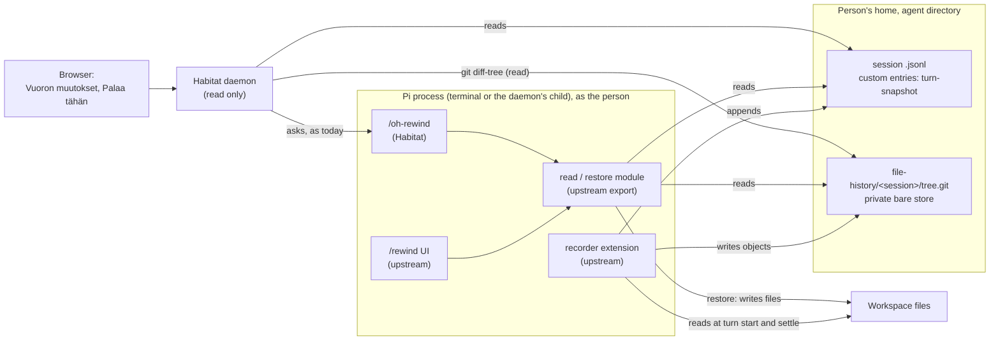
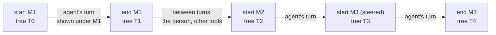
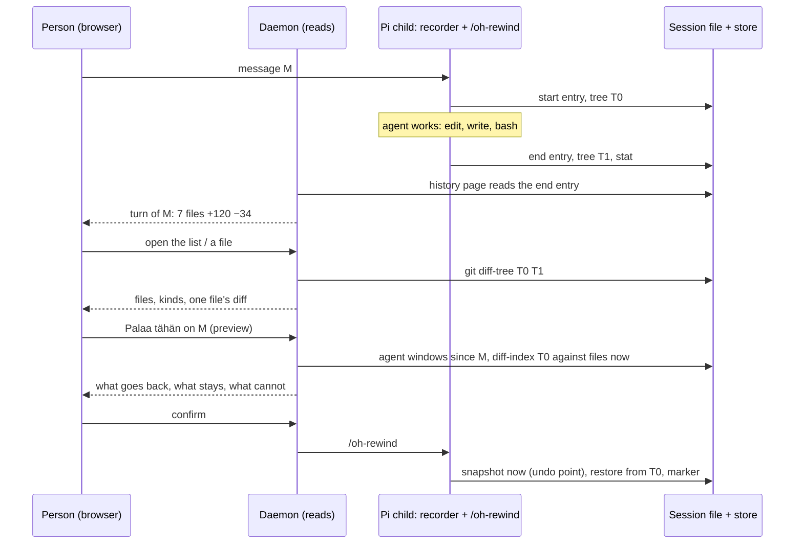

# Design: one shared record of what changed in a turn

> **Saatesanat (Jarille)**
>
> Mitään ei ole toteutettu; tämä on suunnitelma. **Suositus:** "palvelu" ei
> ole uusi prosessi vaan *tallenne*: Pi-laajennus ottaa työpuusta
> tilannekuvan vuoron alussa ja lopussa keskustelun omaan yksityiseen
> Git-säilöön ja kirjaa puun tunnisteen Pi:n istuntoon. Vuoron muutokset,
> Palaa tähän ja Rainen `/rewind` lukevat kaikki samaa tallennetta, kukin
> omalla käyttöliittymällään. Tallentaja kuuluu better-pi-rewindiin (toinen
> laajennus samassa paketissa), jolloin Habitat on pelkkä lukija ja daemon
> pysyy lukijana; valtuuksia ei siirry. Vanhat keskustelut toimivat kuten nyt.
> **Sinulta tarvitaan:** vastaukset lopun viiteen kysymykseen ja oma viestisi
> Rainelle; tekninen liite on kohdassa *Proposal text for upstream*.

This builds on `issues/rewind-tracks-all-changes/design.md`, which chose the
capture mechanism (a working-tree snapshot into a private Git store, measured
there) and left four questions with Jari. It assumes those recommendations
hold. What is new here is who owns the capture, what the shared record looks
like, and how three different readers use it.

## The shared blind spot

Both features learn about a file only from Pi's `edit` and `write` tool
calls.

- **Palaa tähän** (`internal/daemon/rewind-extension.mjs`) copies a file in
  `tool_call` for `edit`/`write`; a `bash` call passes through the same hook
  untouched.
- **Vuoron muutokset** (`web/src/app/turnChanges.ts`) rebuilds the turn in the
  browser from the tool calls' arguments. For commands it parses the command
  text and stops at `cd`, expansions, globs and here-documents, so a script,
  a formatter or a code generator leaves no trace. The text before the turn
  is known only when the turn happened to read the file whole first.
- **better-pi-rewind** has the same rule and says so in its README
  (*Coverage*): shell commands, custom tools and external editors do not
  register new files.

Three readers, one missing fact: the state of the workspace at the two ends
of a turn.

## What each consumer needs

| | Vuoron muutokset | Palaa tähän | better-pi-rewind `/rewind` | The agent |
|---|---|---|---|---|
| Runs in | daemon (read) + browser | daemon (preview), Habitat's extension (restore) | its own extension, Pi's or OMP's terminal UI | a tool call |
| Per turn: files, kind of change, +/− | yes, the collapsed line and the list | no | no (it shows change against *now*) | yes |
| Per file: the diff of one turn | yes | no | no | maybe |
| Against the files as they are now | no | yes: what a restore changes | yes: the selector's counts | no |
| Content before a turn | for the diff | to restore | to restore | no |
| A snapshot on demand | no | yes, the undo point | no (it has no undo) | no |
| What is *not* covered, by name | a note on the card | the sheet's *ei palaudu* list | README text today | no |
| Git HEAD and branch at the boundary | to say *haara vaihtui* | exact commit count, branch warning | already records it, for its hard reset | no |
| Order of edits inside the turn | the timeline (Aikajana) | no | no | no |
| Works without a Git repository | should | should | **must** (its stated difference from pi-rewind) | - |
| Works on OMP and Windows | no | no | yes | - |

Two things follow. First, every row except the timeline is answered by two
tree ids per turn and Git's own comparison of trees. Second, the timeline is
not a snapshot question: the order of edits inside a turn comes from the tool
calls, which Pi already saves and the browser already reads. Snapshots say
*what* changed; tool calls say *in which order the agent did things*. The
card keeps both sources and the snapshot decides the file list.

The agent is a possible fourth reader (a read-only tool, "what have I changed
since the person's message", for a self-review before reporting). Nothing
needs it yet; the record makes it a small addition later, so it is not part
of the first step (question 5).

## Where the capability lives

Only an extension inside Pi knows where a turn starts and settles, and that
is true of terminal sessions as much as of the daemon's own Pi child. So the
*capture* is an extension in every option; the options differ in who owns it
and how others read it.

### (a) A Pi extension records; the record is the interface (recommended)

The extension snapshots at the turn boundaries and writes two things, both in
places that already exist: a custom entry in the Pi session (which tree
belongs to which message) and Git objects in a private store under the
host's agent directory. Readers need no running service:

- another extension in the same Pi imports the package's small read/restore
  module, or reads the entries itself;
- a process outside Pi (Habitat's daemon) reads the session file, as it
  already does for `oh-rewind-checkpoint`, and asks plain `git` to compare
  two tree ids in the store.

The format is the contract: one entry type with a version, and a bare Git
repository. Git is the reader's library in any language, which is what lets
a Go daemon and a TypeScript extension agree without sharing code.

Trade-offs: the entry format becomes something upstream has to keep stable
(it already does this for `better-pi-rewind.file-history`, version 1), and a
reader outside Pi implements the three read commands itself. Capture exists
only where the extension is loaded; a session without it simply has no
entries.

### (b) A standalone library or CLI (`turn-snapshots`)

A separate program both the extension and the daemon call. It still needs an
extension to tell it when a turn starts, so it removes nothing; it adds a
second artefact to install, version and keep in step on every host, for both
the maintainer and each installation. Its real use would be agents that are
not Pi, and nobody has asked for that. The useful part of (b), shared
functions, is the module export in (a) at no extra cost. If a non-Pi host
ever appears, the format in (a) is already tool-neutral and a CLI can be
added then.

### (c) Habitat's daemon owns it, the extension is a client

The daemon sees turn boundaries only in the Pi child it started itself, so a
person's terminal sessions would have nothing. The daemon would start writing
into the person's agent directory, where today it writes neither the session
nor the files, and would hold the one description of a format that a second
project needs. It cannot serve upstream at all: better-pi-rewind's users do
not run Habitat, on OMP or Windows least of all. It also inverts the
project's rule that native tools keep their own state and Habitat reads it.

### Recommendation

Option (a), owned upstream in the better-pi-rewind package as a **second
extension entry** beside `extensions/rewind.ts`:

- `extensions/snapshots.ts` records and has no UI. The existing rewind
  extension reads it. A Pi package may list several extensions, so one
  `pi install` gives a terminal user both, and Habitat can load the recorder
  alone into its Pi child, the way it loads the `pi-processes` core but "not
  terminal UI extensions" (`recap_linux.go`).
- a module export (`better-pi-rewind/snapshots`) with the read, compare,
  snapshot-now and restore functions, used by the rewind UI and by Habitat's
  own `/oh-rewind` extension.
- the entry name and store layout are neutral (nothing in them says
  "rewind"), so the recorder can move to a package of its own later without
  a format change, if the maintainer prefers that split (question 2).

Habitat then keeps: its restore command and markers (undo point, *Jatka
tästä jatkosta*, *Peru palautus*, which upstream does not have), the daemon's
read side, and the browser. It stops owning capture.



Two recorders in one Pi (the person installed the package and Habitat loads
its copy) must not record twice. Habitat already handles this for
`pi-processes`: it does not add its copy when the person's settings provide
the package (`nativeSettingsProvideProcesses`). The recorder itself also
claims a process-wide slot (for example `Symbol.for` on `globalThis`, which
needs no host API) and a second instance stays passive.

Checked against Pi 1.3.0's extension types: `appendEntry`, `agent_settled`,
`user_bash`, `exec` and a shared `events` bus between extensions all exist.
Not checked: whether OMP has `agent_settled` or the bus. The design
therefore depends only on what better-pi-rewind already uses on both hosts
(`message_start`, `message_end`, `tool_call`, `appendEntry`), plus one settle
hook that needs a host adapter like the one it has for branching.

## The data model

### Boundaries

A *turn* here is what the person sees as one: from their message until the
agent has settled. Pi's own `turn_start`/`turn_end` are one model round trip
each and are not these boundaries.

- **start**: when the first assistant message begins after a person's
  message. This is the trigger better-pi-rewind and Habitat already use; it
  gives the message's entry id.
- **end**: when the run has settled (`agent_settled` on Pi: no retry,
  compaction or queued continuation follows), also after an abort or an
  error.

Each boundary appends one custom entry. The working name is `turn-snapshot`;
the name is upstream's to choose.

```json
{
  "version": 1,
  "userEntryId": "…",
  "phase": "start",
  "tree": "<object id, or null when no snapshot was taken>",
  "store": "<session id that owns the store>",
  "root": "/absolute/snapshot/root",
  "cwd": "/absolute/working/directory",
  "timestamp": "2026-01-01T12:00:00.000Z",
  "git": { "head": "<commit>", "branch": "refs/heads/main" },
  "skipped": { "count": 0, "paths": [], "reason": null }
}
```

An `end` entry adds `"outcome": "completed" | "aborted" | "error"` and
`"stat": { "files": 7, "additions": 120, "deletions": 34 }`, the comparison
of this turn's own two trees, computed once when the end snapshot is taken.
Trees never change, so this number cannot go stale; it lets a history page
or a selector show the collapsed line for every turn without running Git.

- `store` is recorded per entry because a forked session carries its
  parent's entries: the trees stay in the parent's store. Upstream already
  records a `storeId` with every file copy.
- `root` is the top of the repository that holds `cwd`, or `cwd` itself in a
  plain folder. An agent started in a subdirectory still edits its siblings.
- `git` is what better-pi-rewind already records per checkpoint. With it a
  reader counts commits exactly (`rev-list start..end`) and sees a branch
  change, which replaces Habitat's `git log --since` heuristic and its known
  false positive.
- `tree: null` with a `reason` (no Git binary, over budget, snapshot failed)
  is an explicit "this turn has no snapshot", so a reader falls back instead
  of guessing.

The entries are appended at the conversation's leaf, so they follow the
session tree: after a rewind the replaced continuation keeps its own
entries, and the trees stay valid in the store.

### Windows between boundaries

Along one branch the boundaries form a sequence, and each gap has an owner:



- start → end is the agent's turn. *Vuoron muutokset* for that message is
  the comparison of exactly these two trees.
- end → start is between turns. It is nobody's turn and is shown under none.
- start → start happens when the person steers a running agent, or when Pi
  died before settling. The window counts as the agent's and is marked
  unsettled, so a card can say the turn did not finish cleanly.

A restore to before message M (rule (b) of the earlier design) takes the
paths that changed in any agent window from M onward and puts each back to
its content in M's start tree.

### The store

`<agent dir>/file-history/<session id>/tree.git`, a bare repository beside
today's per-file copies, mode 0700, with its own configuration (no hooks, no
fsmonitor, `gc.auto=0`); the workspace repository's configuration is never
read and its `.git` is never written.

- `objects/info/alternates` points at the workspace repository's object
  directory, so only content that repository does not have is stored. In a
  linked worktree the object directory is the common one
  (`git rev-parse --git-path objects`), and the seeded index is the
  worktree's own.
- A snapshot lists what differs from the store's index
  (`ls-files -m -d -o --exclude-standard`), feeds that list to
  `update-index`, and runs `write-tree`. The explicit list, instead of
  `git add -A`, is what lets the recorder apply limits per file before
  anything is stored.
- Every tree an entry names is held by a ref in the store
  (`refs/snapshots/<entry id>-<phase>`). Checked in a scratch clone: a ref
  that points straight at a tree keeps it and its blobs through
  `git gc --prune=now`, and the store's index is a root too, so a blob goes
  only when no kept tree and no current file needs it.

Mechanics checked for this document on a scratch clone of this repository
(not a benchmark; the earlier design has the timings): the explicit-list
snapshot recorded a `sed -i` edit, a deletion, a `git mv` rename, a new
directory and a 300 kB binary; `diff-tree -r -M --numstat` between the two
trees gave statuses and counts in 1 ms; `diff-tree -p` gave a file's unified
diff; and a comparison with the files as they are now (`diff-index` plus
`ls-files -o` for new files) took 3 ms and wrote nothing into the store.
`--shortstat` without `-M` counts a rename as a deletion and an addition, so
the recorded `stat` uses rename detection.

### Diff computation

All of it is Git's, on immutable trees, run as the person:

| Question | Command (in the store) | Asked by |
|---|---|---|
| Files of one turn, kind, +/− | `diff-tree -r -M --numstat --name-status <start> <end>` | turn summary |
| One file's diff in a turn | `diff-tree -p --no-ext-diff --no-textconv <start> <end> -- <path>` | turn summary |
| Paths changed in agent windows since M | the same, per window, united | rewind preview, restore |
| A restore's effect now | `diff-index <tree>` with the workspace as work tree, plus `ls-files -o --exclude-standard` | rewind preview, `/rewind` selector |
| Content before | `cat-file blob <tree>:<path>` | restore |

A reader bounds its own output (number of files, diff size, a time limit)
and reports "more" instead of truncating silently. A binary file has no line
counts and no diff, only its kind of change.

### Limits and lifecycle

- **Per snapshot:** a size limit per newly stored file, a limit on new bytes
  per snapshot and a time budget. What is left out is named in `skipped`
  (count, the first paths, the reason), which is the "cannot be restored"
  list every reader needs. A snapshot that cannot finish records
  `tree: null`. The numbers are to be set with measurements at
  implementation; a starting point is 20 MiB per file, 200 MiB per snapshot
  and 2 s.
- **With the session:** the store is one directory named by the session id,
  so deleting a conversation deletes its store with one removal and no
  reference counting. This is why the store is per session and not per
  workspace: sharing between sessions would save little once alternates are
  in use, and would need a registry of who still refers to what.
- **Orphans and age:** at most once a day the recorder removes stores whose
  session file no longer exists, and drops the refs of snapshots older than
  the retention period, followed by `git gc` in that store (question 4). A
  reader that meets a tree it cannot read treats the turn as having no
  snapshot.
- **Visible to the person:** Habitat's storage breakdown already measures
  `.pi/agent/file-history` under history, so the store's size shows there
  without a change.

### Out of scope, by design

The limits found in the earlier design stand, and the record makes each one
nameable instead of silent:

- **Git's own state** (commits, branch, stash, the workspace's index) is
  recorded as `git.head` and `git.branch` but never restored by the shared
  part. better-pi-rewind keeps its optional hard reset as its own feature;
  Habitat keeps its decision of 7.11.2026 never to write Git.
- **Ignored files** are not in the tree. The per-file copies for
  `edit`/`write` stay beside the snapshots for exactly these and for files
  outside the root, and remain the whole mechanism where there is no Git
  binary.
- **Outside the root**: other repositories, the rest of the home directory,
  temporary directories, installed packages.
- **Nested repositories** appear as one link entry; edits inside are not
  seen until they get their own snapshot (a later phase of the earlier
  design).
- **Plain folders** work mechanically but have no `.gitignore`; they wait
  for the built-in exclude list (earlier design, question 4).
- **Not measured yet:** Git LFS and other clean/smudge filters, a split
  index, sparse checkouts. Until they are, a repository that uses a filter
  is treated as having no snapshot.

### Concurrency

- **The person edits during a turn.** The change falls inside the agent's
  window and is counted as the turn's. The summary line says *Muutokset*
  and not "the agent changed", which stays true; the rewind sheet already
  warns that later changes in the listed files are replaced, the person's
  included, and saves the current contents first.
- **Another conversation works in the same directory at the same time.**
  Each session's windows include the other's changes, and a snapshot cannot
  tell them apart. Both summaries would list the same files. This is a
  stated limit of the first version. Later the daemon can notice overlapping
  windows of two sessions with the same `root` from their timestamps and
  say so on the card.
- **Workers in their own worktrees** are outside the root. Their work
  appears in the window in which it is merged in, together with a moved
  `git.head`, so the card can say that commits arrived.
- **A background process the agent started** may keep writing after the
  turn settles. Those writes land between turns: they are shown under no
  turn and are not restored. The sheet lists such files as changed between
  turns.
- **A snapshot taken while something writes** can hold a half-written file.
  Taking the end snapshot only at settle keeps this to background
  processes.
- **The agent's own Git commands** do not collide with the recorder: the
  store has its own index and lock (measured earlier, with the workspace's
  `index.lock` held).

## How Habitat migrates



1. **The recorder arrives.** Preferably as a pinned upstream release in the
   runtime payload; the daemon adds it to its Pi child's arguments when the
   experimental switch is on and the person's own settings do not already
   provide the package. Because Pi's arguments are fixed when the child
   starts, the switch takes effect in a conversation the next time its Pi
   starts, not mid-run as today's per-turn check does. A person who installs
   the package themselves gets snapshots in terminal sessions too, and
   Habitat reads them like any other session.
2. **Vuoron muutokset reads snapshots.** The daemon's history projection
   carries the end entry's `stat` for the turn, so the collapsed line needs
   no extra read. Opening the list or a file asks a new read on the daemon,
   which runs the comparisons above. This is a contract change
   (`contracts/v1`), designed when it is built. The browser keeps today's
   tool-call aggregation in two roles: as the fallback for a turn without
   snapshots, and as the timeline's source. A file in the snapshot that no
   `edit`/`write` call names gets the tag *komennolla*; the command parser
   then only labels timeline marks and no longer decides the file list.
3. **Palaa tähän reads snapshots.** The preview comes from the trees and
   the recorded HEAD; Habitat's `/oh-rewind` restores through the shared
   module and keeps its own markers. The undo point becomes a snapshot taken
   just before the restore, named in the marker, with per-file copies only
   for paths outside the root.
4. **Sessions recorded before** have no `turn-snapshot` entries and behave
   exactly as now, for good: the summary from tool calls with its notes, the
   sheet with *Vain komennoilla muutetut tiedostot jäävät ennalleen*.
   Nothing is converted. A conversation that spans the switch is old before
   it and new after it, message by message. Existing `oh-rewind-checkpoint`
   entries and copies stay readable.
5. **Experimental until proven.** One switch for the record itself
   (question 3), off by default; the two features use snapshots when a turn
   has them and fall back when it does not. Proven means: on real
   repositories the snapshot list contains everything the tool-call list
   does, restore followed by a new snapshot gives the target tree, and the
   added time per turn stays within the budget. Then the switch is folded
   into the two features, and the `--since` heuristic and the parser's role
   in the file list are removed.

No authority moves in any step. The recorder and the restore run inside the
person's Pi as the person; the store is in their home; the daemon gains one
more read as the person, of the same kind as the `git log` it already runs
for the *commitoitu* mark, and still writes neither the session nor files.

## Proposal text for upstream

The technical attachment for Jari's own message. Nothing has been filed.

---

**Record a working-tree snapshot per prompt, in a format other tools can read**

*Problem.* Checkpoint coverage is the set of files that went through `edit`
or `write`. Agents change many files through the shell (formatters,
generators, `sed -i`, scripts, `git checkout`), and those are neither
restored nor counted. Open Habitat, a browser front end for Pi that embeds a
derivative of this extension, has the same gap in two places: its rewind and
its per-turn "what changed" summary.

*Proposal.* At the two ends of a run (first assistant message after a user
prompt; settled), take a snapshot of the working tree into a private bare
Git repository under the agent directory,
`file-history/<session-id>/tree.git`, and record the tree id in a session
custom entry. The user's repository is not written: the store has its own
index and config, and `objects/info/alternates` points at the repository's
objects so existing content is not stored twice. Measured on Linux: about
5 ms per snapshot on a 4 000-file repository, about 50 ms on 100 000 files,
8.6 MiB for the first snapshot there; comparing two snapshots takes a few
milliseconds.

*Entry (v1).* `{ version, userEntryId, phase: "start" | "end", tree, store,
root, cwd, timestamp, git?: { head, branch }, skipped?, outcome?, stat? }`.
`stat` on the end entry is files/additions/deletions for that run, so a
selector can show it without running Git.

*What `/rewind` gains.* The selector's counts and the restore cover every
non-ignored file under the repository root, including deletions, renames,
mode changes and new files, whatever tool made the change. The start and end
of a run separate "changed during a run" from "changed between runs", so a
restore can leave alone files only the user touched.

*What stays.* The per-file backups remain for ignored files, for files
outside the root, and as the whole mechanism where there is no `git` binary,
so the extension still works without a repository. Git references are not
touched by snapshots; the existing optional hard reset is unchanged. Out of
scope: ignored files, Git's own state, anything outside the root.

*Shape.* A second extension entry in this package (`extensions/snapshots.ts`,
no UI) that records, and a small exported module (list runs, compare two
trees, compare a tree with the working tree, snapshot now, restore paths)
that `rewind.ts` uses. A host with its own UI can then load the recorder
alone and read the same entries. Only hooks the extension already uses are
needed, plus one "run settled" hook behind the host adapter.

*Limits.* Per-file and per-snapshot size limits and a time budget, with
skipped paths named in the entry; stores removed with their session and
after a retention period.

*Offer.* We can send this as a pull request with tests, and are glad to
adapt names, layout or the split into packages to your preference. Open
points we would like your view on: OMP's equivalent of the settle hook,
Windows behaviour of the Git calls, and whether the recorder belongs in this
package or one of its own.

---

## Open questions for Jari

1. **If upstream is slow or says no.** Habitat could wait, or carry the
   recorder itself in the same neutral format.
   **Recommendation:** write the recorder as the upstream pull request from
   the start and let Habitat load it from that branch behind the
   experimental switch. If it is merged, Habitat pins the release; if not,
   the same code stays as Habitat's own extension and nothing in the daemon
   or browser changes, because they depend only on the format.
2. **Inside better-pi-rewind or a package of its own.**
   **Recommendation:** propose it inside better-pi-rewind as a second
   extension entry (one maintainer, one install, and its rewind is the first
   reader), and leave the split to the maintainer. The format does not
   depend on the answer.
3. **Which switch records.** Tie recording to the two existing switches, or
   add one for the record.
   **Recommendation:** one new experimental switch (working name *Tarkat
   muutokset*, `turn-snapshots`) that both features use when it is on. It
   can be tried and turned off without losing either feature's present
   behaviour, and it disappears when proven.
4. **How long snapshots are kept.** They hold copies of uncommitted work in
   the person's home.
   **Recommendation:** remove a store with its conversation, drop snapshots
   older than 90 days, and add no total size budget until the storage
   breakdown shows a real installation needing one.
5. **A tool for the agent** ("what did I change in this turn").
   **Recommendation:** not in the first step. Decide after Vuoron muutokset
   has run on snapshots; it would be a read-only tool in the recorder, and
   upstream's to accept.
