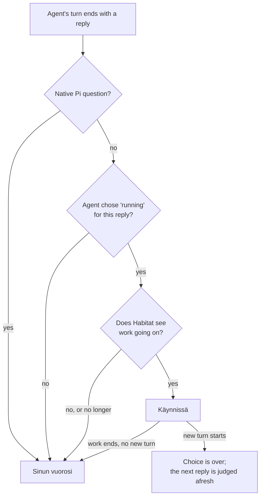
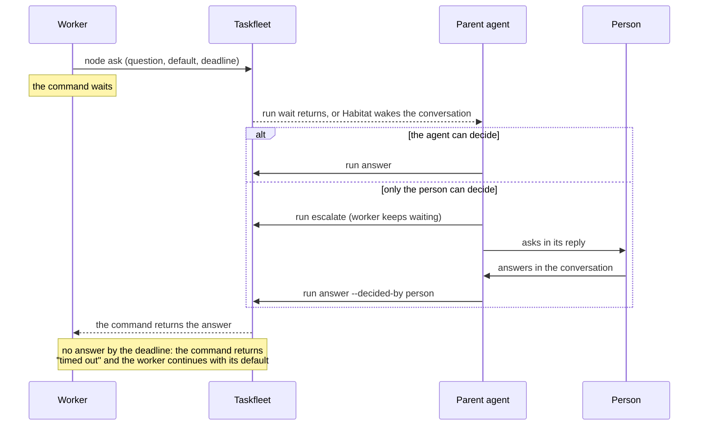
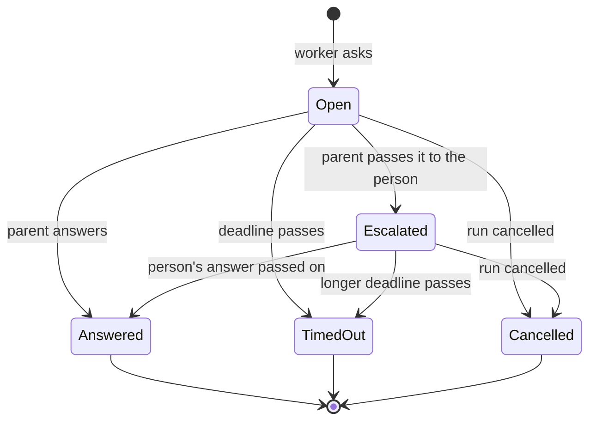

# Design: the agent chooses its rail section, and a worker asks its parent

> **Saatesanat (Jarille)**
>
> Tämä on kahden issuen yhteinen suunnitelma: `agent-sets-rail-state` ja
> `worker-asks-parent`. Mitään ei ole toteutettu.
> **Osa 1** on kirjoitettu uusiksi iltapäätöksesi mukaan: agentti valitsee
> komennolla vain osion (Käynnissä tai Sinun vuorosi), riville ei tule agentin
> tekstiä ja raili näyttää samalta kuin nyt. Käytännön hyöty: vastaus
> "käynnistin workerit, palaan asiaan" ei enää nouse Sinun vuorosi -osioon.
> **Osa 2** on workerin kysymys vanhemmalleen ennallaan, ilman railin tekstejä.
> **Sinulta tarvitaan:** tarkista, että osa 1 vastaa sitä mitä tarkoitit, ja
> vastaa lopun kuuteen kysymykseen; jokaisessa on suositus.
> **Suositus:** osa 1 tehdään ensin, koska se on pelkkää Habitatia. Osa 2 alkaa
> Taskfleet-ehdotuksesta (liite), jota ei ole vielä viety Taskfleetiin.

## The problem

An agent starts three workers and replies "started, I'll report when they
finish". The rail puts that conversation under *Sinun vuorosi*, because a new
reply claims the person's turn unless the agent's own turn is running. Nothing
is asked of the person. Habitat cannot tell this reply from one that needs an
answer; the agent can.

The second problem is on the worker's side. A worker that meets a decision
outside its brief can only stop and report `success: false`. It cannot ask its
parent and carry on with the answer, and on Claude or Codex nobody can reach it
mid-run at all.

## What Jari has decided

1. **The agent decides only its conversation's section**, through an
   `open-habitat` command: in practice *Sinun vuorosi* or *Käynnissä*. No
   agent-written text appears on the row, and the rail looks as it does today.
   (14.11.2026, on `agent-sets-rail-state`.)
2. **A worker's question goes to the parent agent**, which answers it and asks
   the person only when the person must answer. (14.11.2026, on
   `worker-asks-parent`.)

Everything below is a proposal for carrying these out, unless it says it is
today's behaviour.

## Part 1: the agent's section choice

### The idea

The agent can say one thing about the reply it is writing: **"this reply does
not ask anything of you; my work goes on."** The rail then leaves the
conversation in *Käynnissä*, where its workers already keep it, instead of
lifting it to *Sinun vuorosi*.

That is the whole effect. The choice changes how one reply is counted and
nothing else, so every other rail rule works as it does today and nothing new
is drawn on the row.

```
open-habitat agent section update --current --section running --json
open-habitat agent section update --current --section yours --json
open-habitat agent section show --current --json
```

- `running`: the reply of this turn does not claim the person's turn while
  Habitat sees the conversation's work going on.
- `yours`: the reply claims the person's turn. This is what happens without
  the command, so it exists for saying so explicitly and for taking back a
  `running` said earlier in the same turn. The last word in a turn counts.

There is no value for *Hiljaiset*: the decision names two sections.

### Where a conversation lands



"Work going on" is Habitat's own observation: one of the conversation's
workers is working, or the agent waits on a background process or a
`taskfleet run wait`. A worker that itself waits for the person does not count.

### When the choice holds and when it ends

- **It starts when the turn ends.** During the turn the row is in *Käynnissä*
  as *Työskentelee*, as today.
- **A new turn ends it.** The person writes, or a finished worker wakes the
  agent: the choice belonged to the previous reply. The agent chooses again if
  it still applies.
- **The work ending ends it.** When Habitat no longer sees work going on and
  no new turn has started, the reply claims *Sinun vuorosi* like any reply. A
  wrong or forgotten `running` therefore cannot hide a reply for longer than
  the workers run. This is also why no text is needed: a row is in *Käynnissä*
  only while there is an observed reason that today's labels already name
  (*Worker työskentelee*, *Odottaa taustatyötä*).
- **Opening the conversation changes nothing**, as reading never moves a row.
  The reply stays unread until it is opened.

### What Habitat still observes, and what always wins

The agent chooses nothing else. Unchanged, and never overridden by the choice:

- a running turn;
- failures: a crashed Pi, a cut turn, an error turn, a failed worker;
- a native Pi question, which claims the person's turn;
- the person's own marks, *Nosta* and *Ei nyt*, exactly as they work today;
- archive, the new-conversation rule and lost-connection marking.

### How it is built (proposals)

- **Stored in the conversation's own Pi history**, as a small entry written
  through the Pi companion, the way `agent notice create` writes today. No new
  file. The choice belongs to one reply, so it ends by its position in the
  history, survives a daemon restart, reads the same on every device, and a
  rewind removes it with its turn. The snapshot gains one optional field for
  it, so the implementation changes `contracts/v1/` and needs the independent
  review.
- **Own conversation only, and only during its running turn.** The command has
  no `--conversation` form. The daemon refuses it unless that conversation's
  turn is running. The reason is concrete: a worker started from a Habitat
  conversation inherits the parent's conversation ID and launch generation, so
  without this a worker, or a leftover background script, could re-mark a
  parent that has moved on.
- **No new authority.** The command uses the person's per-user agent socket
  and writes to that person's own history, as notices do. Any process of the
  same Unix user can already send messages to and stop that user's
  conversations through the same socket; choosing a section is weaker than
  both.

## Part 2: a worker asks its parent

### The flow



1. **The worker asks** with one shell command that states the question, the
   default it will take if nobody answers, and a deadline. The command waits.
   Because it is an ordinary command, it works in Pi, Claude and Codex alike.
2. **The parent agent is woken.** If it is waiting with `taskfleet run wait`,
   the wait returns at once. If its Pi was stopped mid-wait, Habitat wakes the
   conversation as it does today for a finished worker; that wake is extended
   to questions. If it was not waiting at all,
   nothing wakes it today; question 3 below asks whether Habitat should.
3. **The agent answers, or asks the person.** Within its own brief it answers
   with `taskfleet run answer`. When only the person can decide, it tells
   Taskfleet so (`run escalate`, which keeps the worker waiting longer), asks
   the person in its reply, and passes their answer on.
4. **The answer reaches the worker** as the output of the command it was
   waiting in. Nothing is typed into the worker's terminal.
5. **No answer in time:** the command returns "timed out", the worker
   continues with its stated default, and Taskfleet records that it did. A
   late answer is refused, so the parent learns the worker went on without it.

### The states of one question



### Who owns what

Taskfleet owns the question, the answer, the deadline and every state between
them, in the run's event log. Habitat stores none of it. It reads the open
question from `taskfleet run list` and `run show`, as it reads everything else
about a run, shows it, and wakes the parent. The person answers in the parent
conversation; there is no second inbox.

### What the person sees

The rail gets no new text and no new kind of row.

| Situation | Rail | Worker's row in the Workers panel |
| --- | --- | --- |
| Question open, the agent is handling it | *Käynnissä*, as today | *Kysyy agentilta*, with the question, the default and the deadline |
| The agent has asked the person | *Sinun vuorosi*, because the agent's reply asks, as any reply does | *Odottaa sinun vastaustasi* |
| Answered | as today | back to *Työskentelee* |
| Timed out | as today | *Jatkoi oletuksella*, with the default, until the run ends |
| Open for five minutes and no agent is handling it | *Sinun vuorosi*, with today's label *Worker odottaa sinua* | as the first row, marked unanswered |

The last row is the safety net. If the question has been open for five
minutes, the agent has not passed it on, and the agent's turn is not running
(the person stopped the conversation, Pi could not start), the conversation
moves to *Sinun vuorosi*. Otherwise the worker would fall to its default with
nobody having seen the question.

When the agent asks the person, it simply does not choose `running` for that
reply; part 1 needs nothing more for this.

The Workers panel's present *Odottaa vastausta päätteessä* stays for the
prompts that really are answered in the worker's own terminal.

## Order of work

| Slice | Where | Delivers | Needs |
| --- | --- | --- | --- |
| 1. Section choice | Habitat | Part 1: the command, the rail rule, the agent skill text | nothing |
| 2. Ask and answer | Taskfleet | The appendix: `node ask`, `run answer`, `run escalate` | nothing |
| 3. Show and wake | Habitat | The question on the worker's row; waking a stopped parent for a question, counted per question | 2 |
| 4. Safety net | Habitat | The five-minute rule; the person's answer action in the Workers panel; waking a parent that was not waiting | 3 |

Slices 1 and 2 are independent. Slice 2 is useful before slice 3 exists for a
parent that waits with `run wait`; Habitat ignores a field it does not know,
and an unanswered worker continues with its default.

Not in this design: non-blocking notes from a worker to its parent, and a
worker that is stuck before its agent starts. Such a worker cannot run any
command, so it cannot ask; Taskfleet tracks that separately.

## Open questions for Jari

1. **Is the command right?** Recommendation:
   `open-habitat agent section update --section running|yours`.
2. **Is leaving out *Hiljaiset* what you meant?** Your first idea included
   "done, nothing pending"; the decision names two sections. Recommendation:
   leave it out. A finished reply that nobody has read belongs in *Sinun
   vuorosi*.
3. **May Habitat wake a conversation that was not waiting, when its worker
   asks?** Today a conversation that only started runs is not woken.
   Recommendation: yes for questions, once per question, never a conversation
   you stopped or archived. A question is addressed to the parent; a finished
   run is only news.
4. **When you answer a worker's question from the Workers panel, does it go
   through the parent conversation?** Recommendation: yes. The panel writes
   your message to the parent conversation naming the run, and the agent
   passes it on. The conversation stays the record, and the daemon keeps only
   reading Taskfleet. The alternative, the daemon answering Taskfleet itself,
   is faster but would be the daemon's first write into Taskfleet.
5. **Does "no agent text" also cover the Workers panel?** The table above
   shows the worker's question on the worker's own row there. Recommendation:
   show it. The panel is where you look at one worker, and the question is
   Taskfleet's data about that worker, not the agent's word about the
   conversation.
6. **Deadlines.** Recommendation: 30 minutes for a question, four hours once
   it has been passed to you, and five minutes before an unhandled question
   moves the conversation to *Sinun vuorosi*.

## Appendix: proposal to Taskfleet

Written to be filed in Taskfleet's tracker as it stands. It has not been
filed, and Taskfleet is unchanged. Read against Taskfleet 0.20.0.

### A worker's blocking question to its parent: `node ask`, `run answer`

**Problem.** A worker that meets a decision outside its brief can only end the
run with `success: false`, or append a low-level `node.awaiting_input` event.
That event is described as a human decision, reaches the parent's `run wait`
after a 180-second grace, and has no answer: `node.input_resolved` clears
attention and delivers nothing. `run message` reaches a live worker only on
Pi. A Claude or Codex worker cannot get a mid-run answer, and no worker can
wait for one with a bounded, recorded fallback.

**Proposal.** A durable question and answer, matched by an ID and carried by
ordinary shell commands, so it works in every harness that can run one.

#### Worker side

```
taskfleet node ask (--current | <RUN_ID> <NODE_ID>)
    (--question TEXT | --question-file FILE)
    --default TEXT [--option TEXT]...
    [--timeout 30m] [--wait 8m]
    --idempotency-key KEY [--json]
```

- `--default` is required: what the worker does if nobody answers. It must be
  something the brief already allows, which may be "stop and report the
  decision". Taskfleet records it and does not judge it.
- `--timeout` sets the deadline once, when the question is first asked.
  `--wait` bounds one invocation, because harnesses cap how long a command may
  run. Re-invoking with the same key attaches to the same question and never
  moves the deadline.
- One open question per node; a second is refused and names the open one.
- `--current` resolves the run from the worktree, as `run show --current`
  does, because `TASKFLEET_RUN_ID` is not exported in every harness.

| Exit | `outcome` | Meaning |
| --- | --- | --- |
| 0 | `answered` | the answer, the chosen option if any, and who decided |
| 4 | `pending` | `--wait` elapsed and the question is still open: re-invoke with the same key |
| 2 | `timed_out` | the deadline passed; the output repeats the default to take |
| 3 | `cancelled` | the run was cancelled or the node ended |
| 1 | — | usage error or unknown run |

#### Parent side

```
taskfleet run answer <RUN_ID> --ask <ASK_ID>
    (--text TEXT | --body-file FILE | --choice OPTION)
    [--decided-by agent|person] [--json]

taskfleet run escalate <RUN_ID> --ask <ASK_ID> [--extend 4h] [--note TEXT] [--json]
```

- `run answer` records the answer and releases the worker. On a question that
  is no longer open it fails and reports how it ended and which default the
  worker took.
- `--decided-by` is the answering session's own statement of whether a person
  made the decision. It is not verified and grants the worker nothing its
  brief did not; it lets the worker's report tell "my parent judged" from "the
  person decided".
- `run escalate` says the parent has passed the question to a person. The
  question stays open, the deadline moves later, and the question stops
  returning `run wait`, so the parent can wait again.

#### Events and what observers read

Four node events: `node.asked`, `node.ask_escalated`, `node.answered`,
`node.ask_timed_out`. The question's ID comes from the sequence of its
`node.asked` event, so a stale answer cannot close a newer question. The first
closing event wins. If the worker's command is gone when the deadline passes,
readers derive `timed_out` from the deadline, as `stalled` is derived today.

`run show`, `run list` and each `run wait` outcome gain `open_ask` (ID,
question, options, default, asked and expiry times, whether escalated) and
`last_ask` (how the previous question ended).

`awaiting_input` is not set for a question. It keeps meaning a prompt answered
at the worker itself, which is how Habitat's Workers panel presents it.

#### `run wait`

- An open question that has not been escalated returns a default `run wait`
  at once, with no grace. The grace exists so that a short-lived prompt does
  not page a person; here the worker is blocked and the reader is its parent
  agent.
- An escalated, answered or timed-out question does not return the wait.
  `--terminal` ignores questions, as it ignores other attention.

#### Worker instructions

The generated run preamble changes from "write a `success: false` report" to:
ask with `node ask`, state a default the brief allows, continue on the answer
or the default, and name in the final report any decision taken by default.
Ending with `success: false` remains for a decision with no acceptable
default.

#### Not proposed

Typing into the worker's terminal or per-harness delivery adapters; a
non-blocking note channel; a push hook to the parent; any change to who may
write to a run.

#### Acceptance

- A Claude worker and a Pi worker each ask, wait, and continue on the parent's
  answer, which arrives as the command's output.
- A killed `node ask` re-attaches to the same question with the same key and
  the same deadline.
- With no answer the worker gets `timed_out` at the deadline, and a later
  `run answer` is refused and names the default taken.
- A parent's default `run wait` returns at once for a new question and waits
  again after `run escalate`.
- An answer racing the deadline leaves exactly one closing event, and both
  commands report it.
